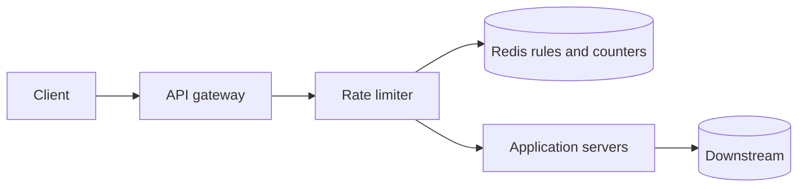
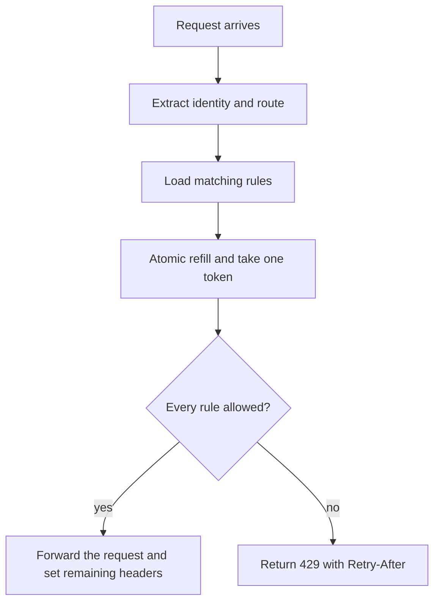

# Design a Rate Limiter

Study notes for interview practice. Defend the why. Numbers are assumptions; say them out loud and change them if the interviewer gives different ones.

Aligned with chapter 4. Original revision guide, not a copy of the chapter.

## How to present

Spend the first five minutes on where the limiter sits and what a "limit" means. The algorithm is the deep dive people expect; do not open with it.

Say this:

> Server-side limiter in front of the APIs, rules like "100 requests per minute per user" and "10 account creates per day per IP." I will use a token bucket stored in Redis so every app server sees the same counter. I am not building client-side limiting; clients can ignore it.

Then draw one request path. Offer token bucket versus sliding window only after they agree the limiter is a shared, low-latency check on the request path. Close on what happens when Redis is down.

## What to remember

- Client-side limits are advisory. Enforcement is on the server or at the gateway.
- Token bucket is the default: two numbers per key (tokens, last refill time), allows a burst, then a steady rate.
- The counter must be atomic across app servers. A Lua script or a single Redis command, not read-modify-write in the app.
- Return 429 with `Retry-After` and remaining-quota headers. The caller has to be able to back off.
- Decide fail-open versus fail-closed before they ask. Default for a general API is fail-open so a cache outage does not become an outage. Payments and auth are fail-closed.
- A global limit is a hot key. Local buckets plus periodic sync are how you survive that, at the cost of a small over-admit.

## 1. Problem statement and requirements

**Functional**

- Enforce rules: N requests per window, keyed by user id, API key, IP, or a combination.
- Rules differ by route. A write is more expensive than a read.
- Rejected calls get a clear response, not a timeout.
- Operators can change a rule without a deploy.

**Non-functional**

- The check adds a small amount of latency. Budget about 1 ms at the cache, not a database round trip.
- Accurate enough. A few percent over-admit during failure or clock skew is acceptable for a public API. It is not acceptable for a billing-critical quota.
- Works across many stateless app servers. The limit is global for that key, not per process.
- Limiter failure must not take the product down, unless the product is one where over-admit is worse than downtime.

**Out of scope**

- DDoS volumetric filtering at the network edge (that is a different system, in front of this one).
- Business quotas such as "1,000 emails a month" if they need an exact ledger. Mention them as a slower path.
- Per-user dynamic pricing.

**Assumptions**

- Peak 1 million requests/sec across the edge, mostly cheap checks. Say 100 million daily active API keys is not required; the hard part is QPS and hot keys, not key cardinality.
- Rules are tens of thousands, not billions. The counters are the large state.
- One region first.

## 2. Back-of-envelope estimation

Assume 1,000,000 requests/sec peak, and that 20% are unauthenticated so the key is IP. The rest are user or API key.

- Counter state per key: about 64 bytes (key, tokens, timestamp, TTL overhead). Call it 100 bytes.
- Active keys in a one-minute window: if each key sends at least one request a minute, cardinality can be large. Suppose 50 million distinct keys in the busiest minute.
- Memory: 50e6 * 100 bytes = 5 GB. Comfortable for a small Redis cluster. The danger is not total memory; it is one key that all traffic hits (a global "protect the database" limit).
- Extra latency: one Redis round trip inside the region, well under 1 ms if the limiter sits next to Redis. Do not put this check in the primary database.
- Write amplification: every allowed request updates the counter. At 1e6/sec that is 1e6 writes/sec to Redis. Shard by key.

Peak versus average: rate limits exist because traffic is spiky. Size the limiter for peak, not for the daily average.

## 3. High-level architecture

### Architecture



### Request flow



### Whiteboard sketch

```
client
  -> edge / API gateway
       -> rate limiter (rule lookup + atomic consume)
            -> Redis (rules cache + counters)
       -> application server
            -> database / downstream
```

On reject, the gateway returns 429 and never calls the application.

**Data flow, allowed request**

1. Gateway extracts the identity (API key, then user, then IP) and the route.
2. It loads the matching rules. Rules are cached; they change rarely.
3. For each rule it asks Redis to take a token. The script refills based on elapsed time, then decrements if tokens remain.
4. If every rule allows the call, the request proceeds. Response headers report remaining tokens.
5. If any rule denies, respond 429 with `Retry-After` set from the refill rate. Log the decision for abuse review.

**Data flow, rule change**

An admin writes the rule to the config store. Gateways watch that store or poll every few seconds. Counters are not reset on a rule change unless you explicitly want a clean window.

The application stays stateless. Any gateway instance can decide, because the decision state lives in Redis.

## 4. Deep dive

### Algorithm: token bucket

Keep `tokens` and `last_refill_ts` for each (rule, key).

- Capacity is the burst size. Refill rate is the steady limit (for example 100 tokens per 60 seconds, capacity 100, or capacity 20 if you want a smaller burst).
- On each request, add `rate * elapsed`, cap at capacity, then take one token if `tokens >= 1`.
- Do this inside Redis so two gateways cannot both observe the last token.

**Rejected: fixed window.** A counter that resets every minute allows almost 2x the limit at the boundary (99 calls at 0:59 and 99 at 1:00). Easy to explain, too crude for a public API.

**Rejected: sliding window log.** Store every timestamp. Accurate, and memory grows with the limit. Fine for "5 rewards per week," painful for "1,000 requests per second."

**Also valid: sliding window counter.** Current window count plus a weighted piece of the previous window. Less memory than the log, smoother than a fixed window, slightly approximate. Choose this if the interviewer wants accuracy without a burst parameter. Token bucket is still the one to pick by default because burst is a feature, not a bug: a user opening an app fires many calls at once, then goes quiet.

Leaking bucket is the inverse shape: it smooths output to a constant rate. Use it when you are protecting a downstream that cannot absorb bursts (a third-party payment API). Say that distinction if they ask "why not leaking bucket?"

### Where it runs

**Chosen: at the API gateway or a middleware on the request path, state in Redis.** Every service inherits the same rules. App code stays free of limit logic except for a few expensive routes that need an extra check after authentication.

**Rejected: only inside each app process, in memory.** Fast, and useless once you run more than one process. Ten servers each allow 100 requests, so the user gets 1,000.

**Rejected: client enforcement only.** A hostile or buggy client will not cooperate. You can still ship a client limiter to be polite; it is not the control.

**Condition that flips it:** a tiny internal service with one process and a hard latency budget can keep an in-process bucket and skip Redis. Say that so you do not sound dogmatic.

### Atomicity and the race

Two gateways read `tokens = 1` and both allow the call. The fix is to make refill-and-take one script. `INCR` plus `EXPIRE` is not a token bucket, and `EXPIRE` on every hit can also reset the window if you are careless. Talk through the race; it is the part that separates "I read about rate limiting" from "I can run it."

## 5. Trade-offs and alternatives

**Central counter versus local buckets**

| | Central Redis | Each gateway keeps a local bucket and syncs |
| --- | --- | --- |
| Accuracy | One limit, globally | Over-admit up to roughly (gateways * local burst) between syncs |
| Latency | One cache hop | No network hop on the hot path |
| Hot key | The global rule is one Redis key | Load is spread; the global rule still needs a design |
| Failure | Redis blip affects every decision | Each node fails alone |

Pick central Redis for v1. Move a specific hot rule to local buckets with a slower sync when that key shows up in the latency graphs.

**Fail open versus fail closed**

| | Fail open | Fail closed |
| --- | --- | --- |
| Redis down | Traffic passes, downstream might overload | Users see 429 or 503, product looks down |
| Fits | Product APIs, social, content | Login, payments, SMS spend, credential stuffing |

Default fail open, with a local emergency cap so a Redis outage cannot send unbounded traffic at the database. Say the emergency cap out loud. It is the mitigation, not a footnote.

## 6. Bottlenecks, failure modes, mitigations

- **Redis down.** Fail open plus a coarse in-process cap. Alert on limiter error rate, not only on 429s.
- **Hot key.** A single global limit serializes on one Redis slot. Shard the counter into N stripes and allow `limit/N` per stripe, or use local buckets. Striping over-admits a little and removes the hotspot.
- **Clock skew.** Refill uses Redis time, not gateway wall clocks, so a skewed app server cannot mint tokens.
- **Rule mismatch.** A bug that treats missing rules as "allow everything" is quiet and dangerous. Missing rule should be a default deny for authenticated partner APIs, or a logged default allow for public reads. Pick one and test it.
- **At 10x (10 million checks/sec).** One Redis cluster stops being casual. Shard by identity key, keep rules in memory on the gateway, and only the counter hits the network. Consider borrowing a token batch (take 10, spend them locally) for the hottest keys. That is the same over-admit trade you already named.

No single app server is a point of failure. Redis is, until you run it with replicas and accept that a failover can double-spend a few tokens. That is fine for this product.

## 7. Open questions

- Is the limit a protective throttle (approximate) or a billed quota (exact, auditable)? Exact quotas want a ledger, not a bucket.
- Do we need hierarchical rules (per user, and also per organization that owns those users) on one request? That is two atomic checks and a partial-refund problem if the second denies.
- Should internal service-to-service calls share the same limiter? Usually no; they need a separate budget or they will eat the user's quota.
- How fast must a rule change take effect? A few seconds via config watch is normal. Instant, worldwide, is a different project.
- Are we required to limit by a key we only know after the request body is parsed? That pushes the check later and makes gateway-only enforcement incomplete.
