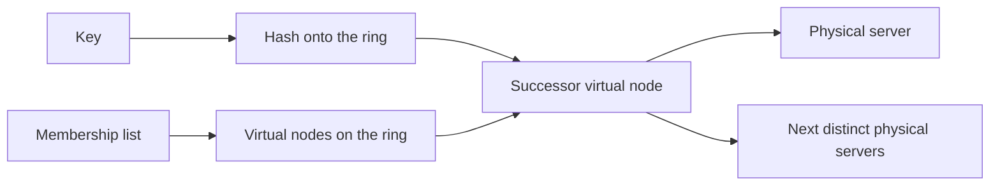
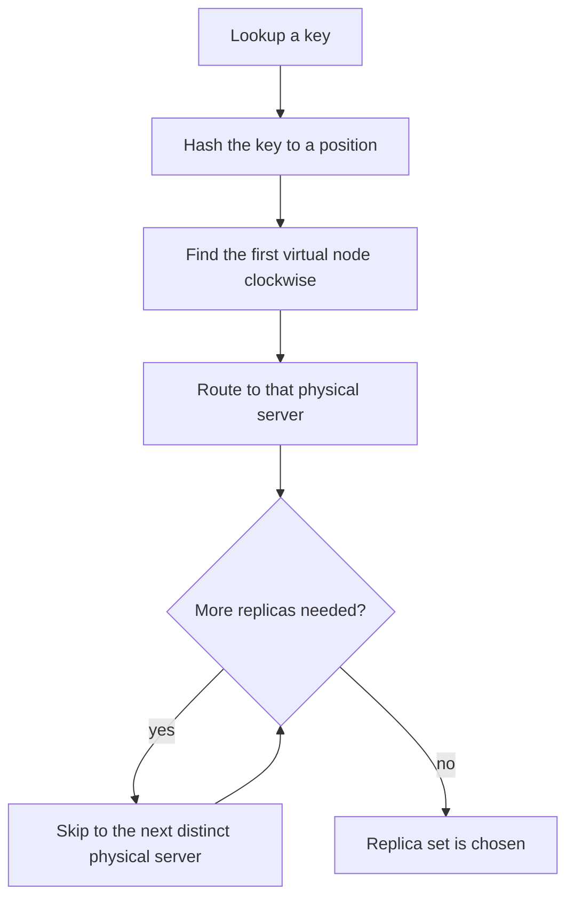
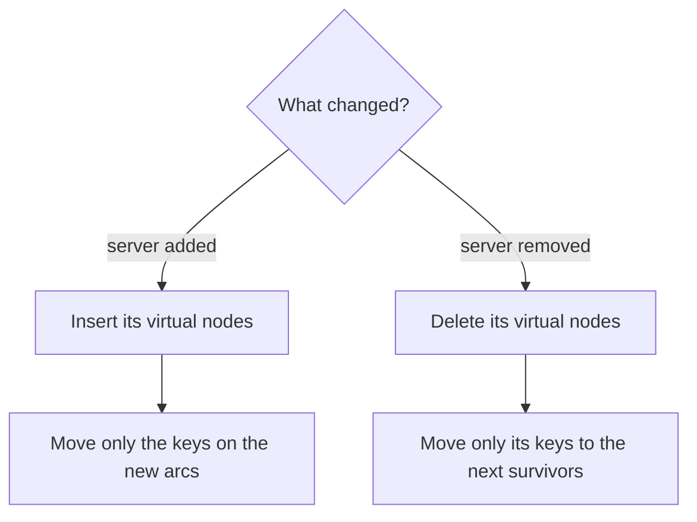

# Design Consistent Hashing

Study notes for interview practice. This is a building block, not a product. Treat it as the deep dive inside a cache fleet, a key-value store, or a partitioner.

Aligned with chapter 5. Original revision guide, not a copy of the chapter.

## How to present

Open with the failure of `hash(key) % N`, then draw the ring. Virtual nodes are the part to linger on. If you only say "consistent hashing" and move on, you have named a tool, not designed it.

Say this:

> With modulo, adding one cache node moves almost every key. I want a scheme where adding or removing a node moves about 1/n of the keys. I will put nodes on a ring and give each node many virtual positions so the load stays even.

Then do the three pictures: lookup, add a node, remove a node. Finish with what virtual nodes do not fix (hot keys).

## What to remember

- `hash(key) % N` is stable only while N is stable. N changing remaps almost everything.
- Hash the key and the node ids onto the same ring. The key lives on the first node clockwise.
- Adding or removing a node moves only the keys in the arc that changed ownership. Expected movement is about `K/n` keys, not all K.
- Real node ids land unevenly. Virtual nodes (many points per physical node) smooth that out.
- Replication is a separate decision: the next distinct physical nodes clockwise, skipping a node's own virtual points.
- Consistent hashing does not split a hot key. A celebrity key is still one key on one node.

## 1. Problem statement and requirements

**Functional**

- Map a key to a server.
- Add or remove a server with as little data movement as possible.
- Spread keys across servers so no server holds a wild multiple of the average, assuming keys themselves are uniform.

**Non-functional**

- Lookup is O(log n) with a tree of ring positions, or effectively O(1) with a well-sized table. It runs on the request path.
- Rebalance after a membership change should move the minimum data that restores the invariant.
- The map is deterministic. Every client that sees the same membership computes the same owner.

**Out of scope**

- The storage engine on each node.
- Conflict resolution when two nodes both served writes (that belongs to the key-value store note).
- Hot-key splitting and request coalescing.

**Assumptions**

- A cache or storage fleet of n nodes, keys far more numerous than nodes.
- Membership changes are uncommon relative to requests, but they happen (deploys, crashes, scale-out) and must not stampede the database.
- Clients or a coordinator can learn membership. How they learn it (gossip, a config service) is a related problem; name it, do not design all of it unless asked.

## 2. Back-of-envelope estimation

Suppose 100 cache nodes, 10 million keys, and you add a 101st node.

- Modulo: in expectation almost all 10 million keys change owner. If this is a cache, that is 10 million misses against the database at once.
- Consistent hashing, one position per node: about `10e6 / 101 ≈ 100,000` keys move. A 100x reduction in the stampede, before virtual nodes.
- Virtual nodes: 100 physical nodes * 200 virtual nodes = 20,000 positions on the ring. Memory for the ring is tiny (positions plus node ids, a few megabytes). Lookup cost is the log of 20,000, which is nothing next to a network hop.
- Load variance: with v virtual nodes and k keys, each physical node's share concentrates around `1/n`. More virtual nodes, tighter spread, more ring metadata. 100 to 200 virtual nodes is a reasonable interview default. Production systems often use more when nodes are heterogeneous.

If nodes have different sizes, give a bigger machine more virtual nodes. That is the knob. Do not pretend the hash function knows about hardware.

## 3. High-level architecture

### Architecture



### Lookup flow



### Membership change



### Whiteboard sketch

```
key -> hash(key) -> position on ring
                 -> first virtual node clockwise
                 -> physical server that owns that virtual node

membership change -> update ring -> move only the affected arc
```

**Lookup**

1. Hash the key to a position.
2. Binary search the sorted virtual-node positions for the successor.
3. Send the request to that physical server.
4. For replication factor R, continue clockwise until you have R distinct physical servers.

**Add server s**

1. Insert s's virtual nodes.
2. For each new position, the keys between the previous neighbor and this position move from the old successor to s.
3. Other arcs are untouched.

**Remove server s**

1. Delete s's positions.
2. Keys that had s as successor move to the next survivor.
3. If s failed and held the only replica, those keys are gone unless you replicated.

Every client must use the same ring. A stale client sends reads to a node that no longer owns the key. Mitigate with a forwarding hint ("not me, try s7") and a membership version.

## 4. Deep dive

### Why the basic ring is not enough

Hashing four servers onto a circle often clumps them. One server can own half the arc by luck. Keys are then "consistent" and still unfair.

**Chosen: virtual nodes.** Each physical server contributes v positions, `hash(server_id + "#" + i)`. The law of large numbers evens out the arc lengths. When a server leaves, its keys scatter across many successors instead of landing on one neighbor, which avoids a second hotspot.

**Rejected: one position per server, and "hope the hash is uniform."** It is uniform in expectation and lumpy in a single deployment. You will get the unlucky picture in production.

**Rejected: double hashing or a directory service that stores key-to-node for every key.** A directory of 10 million keys is a system you now have to shard, replicate, and cache. The ring is computed from membership, which is a list of hundreds of servers.

### What moves, precisely

Say this carefully, because interviewers listen for it:

- Keys in unaffected arcs do not move.
- You do not "rehash the world."
- The fraction that moves when you add one node is about `1/(n+1)`, if virtual nodes have balanced the arcs.
- Replication changes the constant, not the idea. Each key has R owners; a membership change still touches a small arc per replica.

### Hash function

You need a wide, stable hash (64-bit or 128-bit). You do not need a cryptographic hash for a cache ring. You do need one that does not correlate with key prefixes; otherwise all `user:1*` keys clump. Mention that. Do not spend time deriving a hash.

## 5. Trade-offs and alternatives

**Virtual node count**

| Fewer virtual nodes (around 20) | Many virtual nodes (hundreds or thousands) |
| --- | --- |
| Smaller ring, faster membership updates | Tighter balance, closer to 1/n |
| Higher chance one node is overweight | More metadata; rebuilding the ring on every client is still cheap at this size |
| A departure dumps a bigger fraction on each survivor | A departure spreads thinly |

Pick around 100 to 200 unless nodes are uneven. Increase v for the larger machines rather than inventing a second algorithm.

**Consistent hashing versus rendezvous hashing**

Rendezvous (highest-random-weight) hashing: for each key, hash `(key, node)` for every node and pick the max. No ring and no virtual nodes. Balance is naturally good. Adding a node moves about 1/n of the keys, same goal.

| Consistent hashing with virtual nodes | Rendezvous hashing |
| --- | --- |
| O(log V) lookup, V = n * v | O(n) per lookup unless you cache or approximate |
| Familiar in Dynamo-style systems | Less ring metadata, excellent balance |
| Easy to explain on a whiteboard | Harder to sketch; cost grows with n unless optimized |

For an interview, pick the ring. Name rendezvous as the alternative you would consider when n is small (a few hundred) and you want balance without tuning v. Both are valid. The modulo approach is the one that is not, once n changes.

## 6. Bottlenecks, failure modes, mitigations

- **Stale membership.** Clients disagree on the owner. Version the ring. On a miss, the wrong node forwards using the newer ring, and the client refreshes.
- **Node death.** Those keys miss (cache) or go to the next replica (store). Prefetch or replicate ahead of the failure if the cost of a miss is a database stampede. A cache fleet should use request coalescing so 100,000 misses for the same hot key do not become 100,000 database reads.
- **Hot key.** The ring cannot help. Replicate that key to extra nodes and read from all of them, or cache it in the client. Say this before they say it.
- **Heterogeneous servers.** Equal virtual nodes overload the small box. Weight v by capacity. Revisit weights when a new instance type arrives; this is an operational knob, not a one-time diagram.
- **At 10x nodes.** The ring still fits in memory. The new problems are membership churn (autoscaling every minute causes constant reshuffle) and the time to stream moved keys. Stabilize membership; do not rebalance on every flap. Use a join/leave protocol that drains, then updates the ring.

The ring computation is not a single point of failure if every client can compute it. The membership source (ZooKeeper, etcd, a seed list) is the thing you must not lose. Cache the last known good ring so a config outage does not freeze routing.

## 7. Open questions

- Who is allowed to publish membership, and how fast may it change? Flapping nodes will reshuffle forever if you are naive.
- Is this a cache (loss is allowed, movement means misses) or a database (movement means a data copy you must finish before you drop the old owner)?
- Do clients compute the ring, or do they ask a proxy? A proxy is simpler and becomes a bottleneck and a blast radius.
- How do we rebalance when one node is at 90% disk and others are at 40%, if the hash says the full node still owns that arc? Consistent hashing does not solve capacity skew by itself; you may need to move virtual nodes explicitly.
- Multi-datacenter: is the ring global, or is there a ring per region with a different replication story? Do not invent a global ring in the last five minutes. Flag it.
