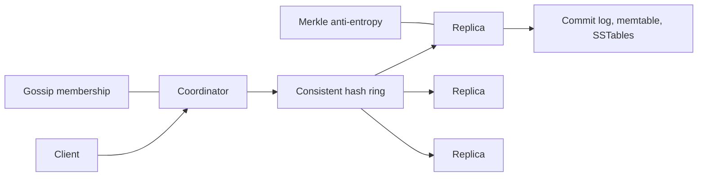
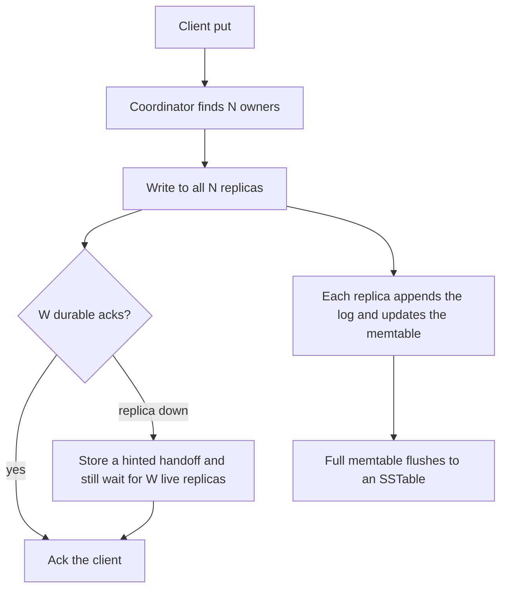
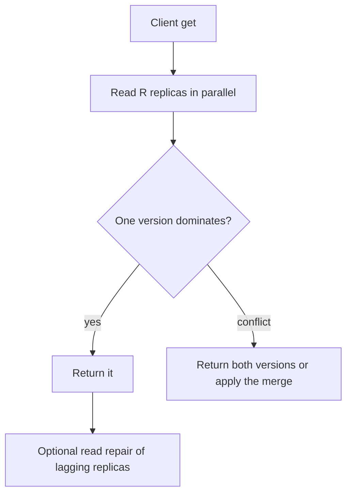

# Design a Key-Value Store

Study notes for interview practice. This is the distributed-systems chapter. You will not finish every technique. Agree the architecture, then go deep on replication plus conflict handling, or on the storage engine. Not both, unless they ask.

Aligned with chapter 6. Original revision guide, not a copy of the chapter.

## How to present

Say the CAP choice in the first minute. Everything else hangs on it.

Say this:

> A Dynamo-style key-value store: get and put by key, no joins, highly available, partition-tolerant. I will sacrifice strict consistency. Conflicts are detected with vector clocks and resolved by the client or a last-writer policy. Data is partitioned with consistent hashing and stored locally in an LSM tree.

If they want strong consistency, say you would switch to a leader per partition and wait for a quorum of durable writes before ack. Do not mix the two stories in one diagram.

## What to remember

- Partition tolerance is not optional. The real choice is consistency versus availability during a partition.
- This design picks availability: reads and writes succeed on reachable replicas, conflicts are repaired later.
- Place replicas with consistent hashing. N copies, ack the write after W, return a read after R. If `W + R > N`, a quorum overlaps, so you see a recent write unless two writers raced.
- Vector clocks detect conflicts. They do not pick a winner. Last-write-wins is a policy on top, and it drops data.
- Temporary failure: hinted handoff. Permanent failure: anti-entropy with Merkle trees.
- On disk: commit log, then memtable, then immutable SSTables, with a Bloom filter so reads do not touch every file.

## 1. Problem statement and requirements

**Functional**

- `put(key, value)` and `get(key)`.
- Keys and values are opaque bytes. No secondary indexes, no range scans, unless you explicitly add them later.
- A key can be a few KB of value up to a configured max (assume 1 MB). Larger objects belong in blob storage.

**Non-functional**

- High availability for both reads and writes when a minority of nodes are down.
- Partition tolerance. A network split must not make the cluster unusable on both sides.
- Horizontal scale to hundreds of nodes. Adding a node moves about `1/n` of the keys.
- Low latency inside a region: single-digit milliseconds for a quorum read of a small value.
- Durable once the write is acked. Ack means W replicas have the record in a commit log, not only in memory.

**Out of scope**

- SQL, transactions across keys, and strong global isolation.
- Full multi-region consensus (that is a different product: Spanner-style).
- Secondary indexes and search.

**Assumptions**

- Workload is point lookups, 80% reads, values around 1 KB.
- 100 TB of data, growing. Three replicas, so 300 TB of disk plus overhead.
- Clients tolerate "eventual" for keys that were written concurrently. For a shopping cart, the merge function is "union of items," not silent overwrite.

## 2. Back-of-envelope estimation

Assume 100 million daily active users, each doing 20 key operations a day. That is a mild product workload; scale it if they say "ad tech."

- QPS = 1e8 * 20 / 86400 ≈ 23,000 average. Peak ≈ 50,000.
- At 1 KB per operation this is about 50 MB/s of payload at peak, times replication. Network is not the first bottleneck. Random disk seeks would be.
- Storage: suppose 10 billion live keys * 1 KB = 10 TB primary. Times N=3 is 30 TB, plus write amplification from compaction (plan 2x to 3x on disk for an LSM). Call it about 100 TB of disk across the cluster.
- Memory: Bloom filters and indexes, not the full dataset. A Bloom filter at 10 bits/key for 10 billion keys is about 12 GB, spread across the cluster. Memtables are sized to flush every few hundred MB so recovery stays fast.
- Quorum latency is the slowest of W or R in-region replicas, not the sum, if you wait in parallel. One slow replica must not be on the critical path forever; use a timeout and hinted handoff.

If they say 1 million writes/sec, stop and reshard the estimate: that is a log-structured write pipeline and a much larger fleet. The shape of the design does not change; the fanout and compaction budget do.

## 3. High-level architecture

### Architecture



### Write flow



### Read flow



### Whiteboard sketch

```
client
  -> coordinator (any node, or a stateless router)
       -> consistent-hash ring
            -> N replica nodes for this key
                 -> commit log + memtable + SSTables
  gossip: membership and failure suspicion
  anti-entropy: Merkle trees between replicas
```

**Write path**

1. Client sends `put` to any coordinator.
2. Coordinator finds N distinct owners clockwise on the ring.
3. It writes to all N and waits for W durable acks.
4. Each replica appends a write-ahead log, updates the memtable, and returns.
5. When the memtable is full, it freezes and flushes an immutable SSTable. Compaction merges SSTables later.
6. If a replica is down, the coordinator stores a hinted handoff and still acks once W live replicas have it.

**Read path**

1. Coordinator reads R replicas in parallel.
2. It compares versions (vector clocks).
3. If one version dominates, return it. If they conflict, return both, or apply the configured merge.
4. Optionally repair lagging replicas in the background (read repair).

The coordinator is stateless with respect to user data. Losing it loses in-flight requests, not keys.

## 4. Deep dive

### Quorum and the consistency you actually get

N=3, W=2, R=2 is the interview default. A write is on at least two nodes before ack. A read sees at least one of them, because any two-node subsets overlap.

This is not linearizability. Two clients can write concurrently, both get W=2 on different majorities if you are unlucky with timing and sloppy quorums, and both versions survive. That is why versioning exists. Do not tell the interviewer that `W + R > N` means "no conflicts." It means a read will see a completed write that was not concurrent with another write. Concurrent writes still conflict.

**Rejected: W=N, R=1.** Fast reads, and a single down replica rejects all writes. That fails the availability requirement.

**Rejected: W=1, R=1.** Fast, and reads miss the write whenever they hit another replica. Fine for a cache, not for this store.

**Condition that flips it:** if the product needs read-your-writes for a session, route that user's requests to the same coordinator and use a client-side version so a stale replica cannot answer an older clock.

### Conflicts: vector clocks, then a policy

Each value carries a vector clock, a map of `(node -> counter)`. On write, the coordinator increments its own counter and keeps the clocks it has seen.

- If one clock is greater on every node and strictly greater on one, it is a descendant. Keep it.
- If neither dominates, the writes were concurrent. Keep both and surface a conflict.

**Rejected: last-write-wins by wall clock.** Simple, and it silently drops one of two concurrent shopping carts. Wall clocks also skew. Acceptable for a cache or a metric, dangerous as the only story for a database.

**Rejected: always keep every version forever.** Conflicts must be resolved or the vector grows and old versions fill the disk. Clients resolve, or a domain merge function resolves, and then a new write supersedes both.

Vector clocks grow with the number of writers. Cap the number of coordinators that increment clocks, or prune old entries. Mention the cap; unbounded clocks are a real incident.

### Failure detection and repair

- Gossip for membership. A central heartbeat service is simpler and is a single place that can be wrong about the whole cluster. Gossip is the better fit once you already chose a decentralized store.
- Hinted handoff for a node that is briefly down: some other node stores the write with a hint and replays it when the owner returns. This keeps availability up. It also means a read quorum might include a node that is not a "real" replica (sloppy quorum). Say that this weakens the overlap guarantee until hints drain.
- Merkle trees for a node that was down for hours. Compare hashes of key ranges, then only sync the ranges that differ. Do not full-scan both disks.

### Local storage engine

LSM, not a B-tree, because the workload includes sustained writes and the log is already sequential.

- Bloom filter per SSTable: almost no disk I/O for keys that are absent.
- Compaction is the tax. It rewrites data and competes with reads. Size the disk budget for write amplification, not for the raw dataset.
- The commit log is what makes a crash safe. A memtable-only design loses acked writes.

**Rejected: in-memory hash map only.** It matches the API and fails durability and size.

## 5. Trade-offs and alternatives

**AP (this design) versus CP (leader per partition)**

| Available during a partition | Consistent during a partition |
| --- | --- |
| Both sides can write; you repair conflicts later | Minority side refuses writes |
| Vector clocks, hinted handoff, client merges | Raft or Paxos log, one leader, followers replicate |
| Fits carts, session state, IoT, multi-datacenter writes | Fits inventory counts, unique constraints, money |

Both are valid key-value stores. Pick AP when the prompt says "Amazon Dynamo / Cassandra style" or "always writable." Pick CP when losing an update is worse than refusing it. Say the sentence: "I am choosing availability because you asked for a store that accepts writes during a partition. If this key is an account balance, I would not."

**Read repair versus only anti-entropy**

Read repair fixes the keys people actually read, quickly, and does nothing for cold keys. Merkle sync fixes cold keys and costs background I/O. You want both. If you must pick one to explain, explain Merkle trees, because read repair is one sentence.

## 6. Bottlenecks, failure modes, mitigations

- **Hot key.** One key, one replica set, all the QPS. Consistent hashing will not split it. Application-level sharding of that key, or a cache in front, is the mitigation. Call this out.
- **Compaction storm.** All nodes compact at once and read latency spikes. Stagger compaction. Rate-limit it.
- **Hint buildup.** A down node for a day makes the hint store huge, and replay is a thundering herd. Throttle replay. If the node is declared dead, stop hinting and rely on replica rebuild.
- **Coordinator loss mid-write.** The client retries. Idempotent puts (same version) must not create a false conflict. Define whether put is last-writer or compare-and-set.
- **At 10x data.** More nodes, same ring. The new pain is streaming data to a joining node without melting it. Bootstrap should be incremental, with the new node taking traffic only after it has caught up for its ranges.
- **At 10x cross-region.** Quorum across oceans blows the latency budget. Use local quorums and async cross-region replication, and be honest that this is eventual across regions.

Single points of failure to reject: one primary for all keys, one heartbeat box whose death marks every node down, one coordinator that owns all client sessions.

## 7. Open questions

- What is the conflict merge for this specific product? "Keep both" is not a product behavior. Carts union; profiles may last-write-wins; counters need a different structure entirely.
- Do we need compare-and-set (conditional put) for a few keys? That pushes those keys toward a CP path.
- What is the value-size limit, and do large values bypass the LSM into blob storage with only the pointer in the store?
- How long may a replica lag before we stop serving it? Unbounded staleness is not "eventual consistency," it is a bug.
- Who operates restores? Merkle trees find divergence; they do not answer the human question of which version was correct after a bad deploy wrote garbage.
