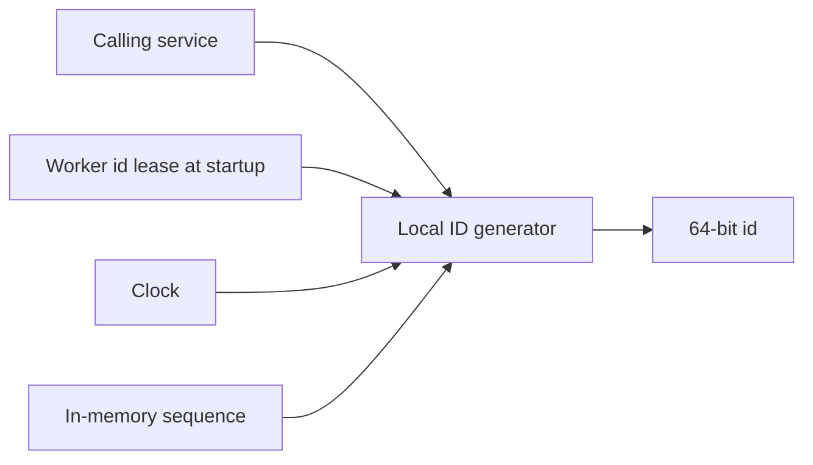
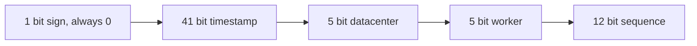
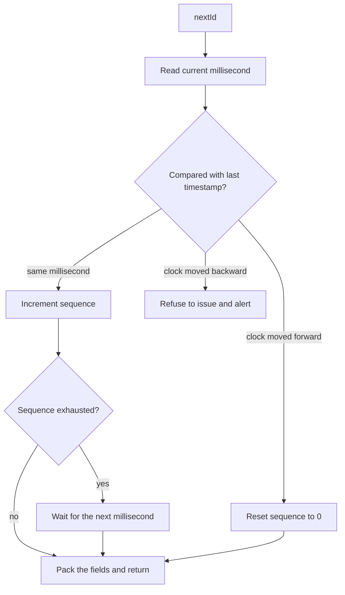

# Design a Unique ID Generator in Distributed Systems

Study notes for interview practice. The interesting part is the ID shape and the failure of a single allocator, not the API.

Aligned with chapter 7. Original revision guide, not a copy of the chapter.

## How to present

Reject UUID and the ticket server quickly, then spend the time on a Snowflake-style 64-bit ID and the clock.

Say this:

> I need IDs that are unique, roughly time-ordered, and numeric, at tens of thousands per second per node, with no coordination on the hot path. I will give each generator a unique machine id and pack timestamp, machine id, and a per-millisecond sequence into 64 bits.

Then draw the bit layout. Mention clock rollback before they do.

## What to remember

- Uncoordinated UUID (128-bit, random) is unique and not sortable, and it is wider than you want as a primary key in some stores.
- A single database auto-increment is simple and a single point of failure, and it couples ID issuance to database QPS.
- Multi-master auto-increment (`k` machines, each issuing `n, n+k, n+2k`) works at small k and collides or wastes space when you reconfigure.
- Snowflake layout: 1 unused sign bit, 41-bit timestamp, 5-bit datacenter, 5-bit worker, 12-bit sequence. About 4,096 IDs per millisecond per worker.
- 41 bits of milliseconds is about 69 years from a chosen epoch. State the epoch.
- Clock going backwards is the real bug. Refuse to issue, or wait, or borrow sequence; do not emit an old timestamp with a fresh sequence or you can collide.

## 1. Problem statement and requirements

**Functional**

- `nextId()` returns an integer that has never been returned and will never be returned again.
- IDs trend upward with time, so a datastore can cluster recent rows together and "give me the latest" can use the id.
- Numeric and 64-bit so they fit existing indexes and URLs (a URL shortener may encode them).

**Non-functional**

- High throughput. Assume a fleet that must issue at least 10,000 IDs/sec, with headroom to millions/sec across many generators.
- Low latency. No network call on the success path.
- Availability. One dead generator does not stop the others.
- Uniqueness across datacenters.

**Out of scope**

- IDs that are secrets (these are guessable if you know the layout).
- Strictly gap-free IDs. Gaps are fine and expected.
- Global total order across machines at sub-millisecond resolution. "Roughly ordered" is the requirement. Two machines can interleave.

**Assumptions**

- We can assign a stable worker id to each process, unique within the datacenter id space.
- Worker ids fit in 10 bits combined (1,024 generators) in the classic layout. If the fleet is larger, steal bits from the sequence or the timestamp and say so.
- NTP runs, and we still do not trust it blindly.

## 2. Back-of-envelope estimation

Classic layout:

- Timestamp: 2^41 ms ≈ 69.7 years.
- Workers: 2^5 datacenters * 2^5 workers = 1,024 generators.
- Sequence: 2^12 = 4,096 IDs per ms per worker ≈ 4.1 million IDs/sec per worker.

One worker is already far above 10k/sec. The fleet limit is 1,024 * 4.1e6 ≈ 4 billion IDs/sec, which is not a real product requirement. The practical limit is clock behavior and worker-id allocation, not the bit math.

Storage of the id itself is 8 bytes. Negligible. The reason to care about 64 versus 128 bits is index size on the tables that store trillions of rows, not the generator.

If you need more than 1,024 generators, drop datacenter bits into a config service that hands out worker ids from a 10-bit pool, or move to 2 extra bits from the sequence (1,024 IDs/ms is still 1 million/sec/worker).

## 3. High-level architecture

### Architecture



### Bit layout



### Issuance flow



### Whiteboard sketch

```
service that needs an id
  -> local id generator library
       -> clock
       -> worker id (from startup config)
       -> sequence counter in memory
  -> 64-bit id
```

No database and no lock service on the request path.

**Issuance**

1. Read the current millisecond.
2. If it equals the last timestamp used, increment the sequence.
3. If the sequence overflows, wait until the next millisecond.
4. If the clock moved forward, reset the sequence to 0.
5. If the clock moved backward, do not issue. See the deep dive.
6. Pack the fields and return.

**Worker identity**

On start, the process is given a unique `(datacenter, worker)` pair. Store it in config or a small lease service. The lease is not on the hot path; it is on the start path. A duplicate worker id is a silent uniqueness bug, so the assignment must be exclusive.

## 4. Deep dive

### Bit layout

```
0 | timestamp (41) | datacenter (5) | worker (5) | sequence (12)
```

The leading 0 keeps the value positive in signed 64-bit languages.

Walk an example: "this id was issued at epoch + 1,700,000,000,000 ms, by worker 3 in datacenter 1, and it was the 19th id that millisecond." You should be able to decode an id on the board. That is half the interview.

**Rejected: random UUID.** No coordination, excellent uniqueness, bad locality for B-trees, not k-sortable, awkward in URLs. Use UUIDs when you do not need ordering and the width does not matter (request ids in logs). Say that they are the right tool for a different requirement.

**Rejected: ticket server (one database row with `UPDATE counter`)**. Strong, gap-tolerant, and every id issuance is a write to one row. It caps throughput and dies when that database dies. A replicated ticket server still has a single logical writer.

**Rejected: multi-master auto-increment with a stride.** Easy in two MySQL primaries. Painful when you add a third, and the ids from different masters interleave in a way that still has operational sharp edges. Fine for a small deployment you already run. Not the design to propose for "distributed systems."

### The clock

Uniqueness inside one worker is `(timestamp, sequence)`. If the clock jumps back and you reset the sequence, you can reissue an id from the past.

**Chosen policy:** remember the last timestamp. If now is earlier, refuse to issue and alert, or sleep until the clock catches up if the skew is a few milliseconds. Persisting the last timestamp on disk helps across restarts: after a reboot, do not start at sequence 0 for a timestamp you may have already used if the clock is behind. In practice, waiting out a short skew plus a worker id that is not reused during the skew window is the combination that holds.

**Rejected: ignore skew.** It will pass tests and fail twice a year on a bad NTP step.

**Rejected: take a lock from a central time service per id.** You rebuilt the ticket server.

Also mention: sequence exhaustion in the same millisecond means you block briefly. At 4,096/ms that is a very hot worker. If one worker is that hot, you have a load-balancing problem, not an ID problem.

### Worker id lifecycle

Crashed worker's id must not be given to a new process until any clock skew window has passed, or until you are sure the old process cannot issue again. Lease with a TTL longer than max expected skew (for example 10 minutes) is a clean story. Recycling immediately is how you get duplicates.

## 5. Trade-offs and alternatives

**Sortable 64-bit versus random 128-bit**

| Snowflake-style | UUID v4 |
| --- | --- |
| Ordered, compact, guessable | Unordered, wide, unguessable |
| Requires unique worker ids and a sane clock | Requires nothing |
| Leaks creation time and worker | Leaks nothing useful |

Pick Snowflake when ids are primary keys or short-URL material. Pick UUID when the only requirement is uniqueness and you want no allocator. Do not present Snowflake as universally better.

**Local generator versus a range allocator**

A range allocator (database hands each worker a block of 10,000 ids) also removes the hot path coordination.

| Local timestamp layout | Reserved ranges |
| --- | --- |
| Time-ordered across the fleet, roughly | Ordered only inside a worker's range; workers interleave in arbitrary blocks |
| No database | Needs a database or ZooKeeper to hand out ranges |
| Clock risk | No clock risk; risk is double-allocation of a range |
| Ids expose time | Ids expose nothing |

Ranges are the better choice if legal or product reasons forbid guessable, time-based ids, and you still want 64-bit integers. Mention it as the alternative when they flinch at guessability.

## 6. Bottlenecks, failure modes, mitigations

- **Duplicate worker id.** The failure mode that actually causes collisions. Exclusive lease, and alert if two processes heartbeat the same id.
- **Clock step.** NTP steps the clock back by seconds. The generator stops issuing rather than colliding. Page someone. Do not "fix" it by resetting state silently.
- **Restart.** Sequence memory is gone. Rely on "time has moved forward" plus "worker id not reused," or persist last timestamp.
- **Datacenter bit exhaustion or fleet larger than 1,024.** Change the layout before you are out of bits. Layout changes are a migration: old and new ids must both decode, so version them or keep the same width and only change unused bits.
- **At 10x generators.** The bit width, not the CPU, runs out. Move to a leased worker-id space that is still 10 to 16 bits, and do not run a generator per request thread. One generator per process is enough.
- **Guessable ids as a security hole.** If the id is the only authorization for a document, this design is the wrong design. Use an unguessable token. Call this out; it is a common misuse of Snowflake ids in URL shorteners and file links.

There is no single point of failure on the issuance path once worker ids are assigned. The lease service is a dependency at startup only. Cache the lease so a lease-service outage does not stop a running process.

## 7. Open questions

- Are ids allowed to reveal time and rough traffic rate? Sometimes that is a product leak.
- Do we need globally monotonic ids, or is per-millis ordering enough? Global monotonic means a single writer. Be explicit that we are not providing that.
- How do analytics systems that assumed gap-free auto-increment behave when ids jump around because workers interleave?
- What is the epoch, and who owns the decision when 69 years are close to over? (Twitter's epoch is late 2010; the layout lasts until roughly 2080. Fine. Still say it.)
- Multi-language clients: who packs the bits, and do all languages agree on signed versus unsigned?
