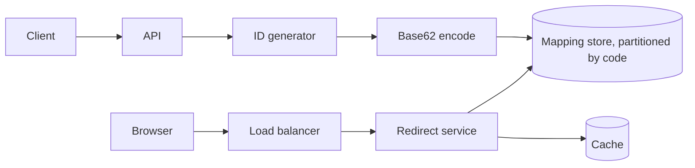
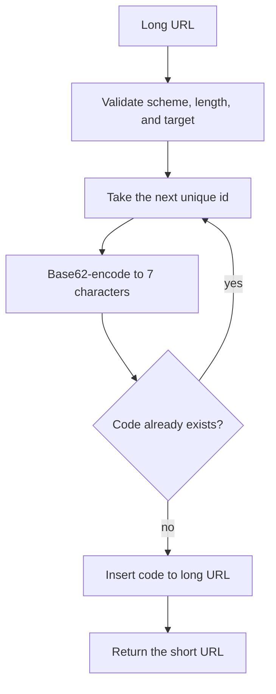
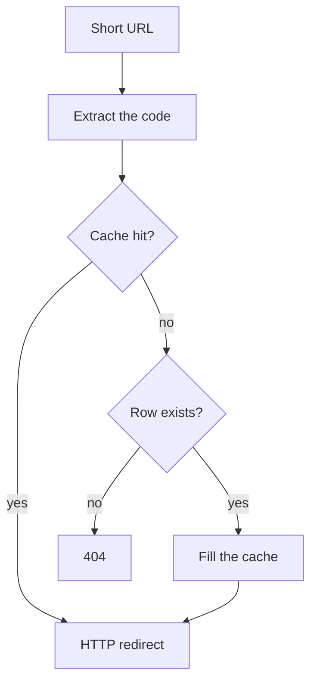

# Design a URL Shortener

Study notes for interview practice. The redirect path is the one that has to be fast. The create path is the one that has to be correct.

Aligned with chapter 8. Original revision guide, not a copy of the chapter.

## How to present

Agree the scale, then separate create from redirect. Spend the deep dive on how the short code is minted, and on 301 versus 302.

Say this:

> 100 million new short URLs a day, reads about 10x writes. I will mint a unique numeric id, encode it in base62, and store the mapping. Redirects are cache-heavy. I am assuming links do not expire and cannot be edited, unless you want that in scope.

## What to remember

- Write QPS is about 1,200/sec at 100 million/day. Read QPS is about 12,000/sec at 10:1. Ten years is about 365 billion rows and on the order of a few hundred TB if you store the long URL inline.
- 7 base62 characters is 62^7 ≈ 3.5 trillion codes. Enough for this retention with room left.
- Do not hash the long URL and hope. Collisions force a lookup and sometimes a longer code. An id generator plus base62 has no collision.
- 301 is cacheable by the browser and hides your analytics. 302 is not cached the same way, so you see every click and you pay for every click.
- Cache the hot short codes. The distribution is heavily skewed.
- The short code must be unguessable if it protects anything. A raw Snowflake id is guessable. This design assumes the code is an alias, not a secret.

## 1. Problem statement and requirements

**Functional**

- Create: long URL in, short URL out.
- Resolve: short URL in, redirect to the long URL.
- Optional, if they ask: custom aliases, expiration, and a simple click count.

**Non-functional**

- Redirect latency under about 10 ms at the edge for a cache hit, a few tens of ms on a cache miss inside one region.
- Create must never hand out a code that maps to two long URLs.
- Highly available redirects. A failed create is annoying; a failed or wrong redirect is the product.
- Durable mapping. Losing the table loses every link ever sent.

**Out of scope**

- Link preview, malware scanning, and a full analytics warehouse. Mention scanning as a follow-up if the product is public.
- User accounts and edit history, until they add them.
- A web UI.

**Assumptions**

- 100 million creates per day.
- Read:write = 10:1. State this; some products are 100:1.
- Average long URL is 100 bytes. Short code is 7 characters.
- Retention is 10 years, no deletes. If they want deletes, the id space still must not recycle a code that might be in a book or an email.

## 2. Back-of-envelope estimation

- Creates: 1e8 / 86400 ≈ 1,160/sec. Peak ≈ 2,000 to 3,000/sec.
- Redirects: ≈ 12,000/sec average, peak ≈ 30,000/sec. Easy for a cache; do not design a distributed system that would scare you at 1 million/sec unless they raise the number.
- Rows in 10 years: 1e8 * 365 * 10 = 365 billion.
- Store per row: 100 bytes URL + short code + timestamp + indexes. Call it 200 to 500 bytes with index overhead.
- Disk: 365e9 * 500 bytes ≈ 180 TB, up to roughly 365 TB at the pessimistic end. Plan to partition. This does not fit one machine, and it does not need a clever format on day one.
- Cache: you cannot cache 365 billion rows. You cache the hot tail. If 20% of redirects hit 1% of keys, a few hundred GB of cache covers the links people actually click this week.
- Bandwidth is small. These are redirects, not the destination page. 30,000 * 300 bytes ≈ 9 MB/s.

The number that should change your design is retention times daily creates, because that forces partitioning. QPS alone would fit on one well-cached database for a long time. Say that. It shows judgment.

## 3. High-level architecture

### Architecture



### Create flow



### Redirect flow



### Whiteboard sketch

```
create:
  client -> API -> id generator -> base62(code)
                -> database (code -> long URL)

redirect:
  user -> load balancer -> redirect service -> cache
                                          -> database on miss
                        -> HTTP redirect to long URL
```

**Create**

1. Validate the URL (scheme, length, not an internal address if this is a public shortener).
2. Take the next id from the unique-id design (64-bit, unique, no round trip if the generator is local).
3. Base62-encode it. Pad to a fixed width if you want stable length.
4. Insert `(code, long_url, created_at)`. The code is the primary key.
5. Return `https://short.example/{code}`.

**Redirect**

1. Extract the code.
2. Cache get. On hit, redirect.
3. On miss, read the partition that owns that code, fill the cache, redirect.
4. If absent, 404. Do not redirect to a default marketing page unless product asks; it hides broken links.

Application servers are stateless. The database is the system of record. Cache loss is a latency event, not a data-loss event.

## 4. Deep dive

### Minting the code

**Chosen: unique id, then base62.** Uniqueness is delegated to a generator you already know how to defend. Encoding is reversible and collision-free. Codes are short and trend a bit predictable.

Base62 alphabet: `0-9a-zA-Z`, 62 symbols. 6 characters is 62^6 ≈ 56 billion, short of 365 billion. 7 characters is ≈ 3.5 trillion. Use 7.

**Rejected: hash(long URL) and take the first 7 characters.** Two different URLs can share a prefix. You then look up, and on collision you append salt and rehash. That is a retry loop on the write path and a variable length. Same long URL hashing to the same code can be a feature (dedupe) or a bug (you cannot give two customers different codes for the same URL). Call dedupe a product decision, not a hashing accident.

**Rejected: let users pick all codes with no random id.** Custom aliases are a separate unique index. They are sparse and valuable (`/apple`). Support them as an optional column, and fall back to generated codes when the alias is taken. Do not make custom aliases the only scheme.

### 301 versus 302

**Chosen default: 302 (or 307) for a product that wants click counts and the right to change the target later.** Every click hits your service. You can count, rate-limit, and pull a bad link.

**Choose 301 if** the link is permanent, you do not need analytics, and you want browsers and intermediaries to cache the mapping so your read QPS drops. You will not see those clicks again. Say that trade in one sentence. Interviewers wait for it.

Cache-Control on a 302 can still let you cache at your edge without letting the browser cache forever. That is the compromise: you observe clicks at the edge, and the origin stays quiet.

### Partitioning

Partition the mapping by the short code, not by the long URL. Redirects look up by code. A hash of the code spreads 365 billion rows evenly. Range partitioning by id also works and keeps new writes hot on one partition; that is a reason to hash instead, or to hash-range so new ids spread out.

Cache key is the code. TTL can be long because we assumed immutability. If updates exist, either delete the cache entry on write or accept a short TTL.

## 5. Trade-offs and alternatives

**Generated code versus content hash**

| ID plus base62 | Hash of the long URL |
| --- | --- |
| No collisions, simple insert | Dedupe is free when you want it |
| Different users can shorten the same URL to different codes | Collision handling on the write path |
| Codes are predictable if ids are | Codes look random |
| Needs an id generator | Needs a collision strategy and a length decision |

Pick id plus base62. Offer hashing only if product wants one canonical short link per destination and accepts collision handling.

**SQL versus a key-value store**

The access pattern is get-by-primary-key and insert. A key-value store fits. A relational database also fits and gives you operational comfort, as long as you shard by code once you pass a few terabytes. Do not introduce a distributed SQL story unless they push on analytics joins. Click analytics belong in a log pipeline, not in the mapping table.

## 6. Bottlenecks, failure modes, mitigations

- **Cache stampede on a hot link** (a celebrity tweet). One code, enormous QPS, cache expires, database melts. Use request coalescing, a long TTL, and replication of that one key. Pre-warm if the create came from a known large account.
- **Id generator collision or reuse.** Then two URLs share a code. This is the correctness bug. Treat generator uniqueness as a hard dependency. The insert should still be a conditional create: fail if the code exists, mint again.
- **Database partition down.** Redirects for that key range fail. Replicate each partition. A wrong redirect is worse than a 503, so do not guess.
- **Abuse:** shorteners are phishing infrastructure. Rate-limit creates, block private IP targets, and keep a denylist. This is more product-critical than shaving 1 ms.
- **At 10x creates (1 billion/day).** 3.65 trillion rows in 10 years. 7 characters is tight (3.5 trillion). Move to 8 characters before you are close, or expand the alphabet. QPS at 10x reads is still a cache problem, not an algorithmic problem.
- **At 10x retention or when updates are allowed.** Cache invalidation becomes real. Immutable mappings were an assumption; if it changes, say the design changes there.

Single points of failure: one unsharded database, one id allocator that is a single ticket server. Avoid both.

## 7. Open questions

- Do links expire, and may a code be recycled? Recycling is almost never worth it.
- Is dedupe required? It changes the write path from "insert" to "lookup by hash of long URL."
- Do we need per-user history? That is a second index, `user_id -> codes`, and it changes partitioning.
- How accurate must click counts be? Edge logs sampled into a warehouse are enough for product analytics. A strongly consistent counter on every redirect is a different, hotter system.
- Do we scan destinations for malware synchronously on create (slower create, safer) or asynchronously (fast create, a window where the link is live and bad)?
