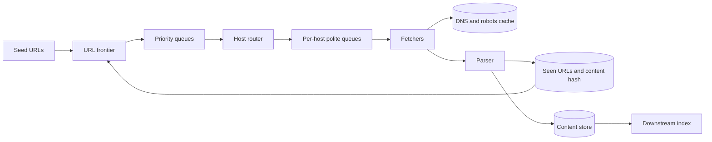
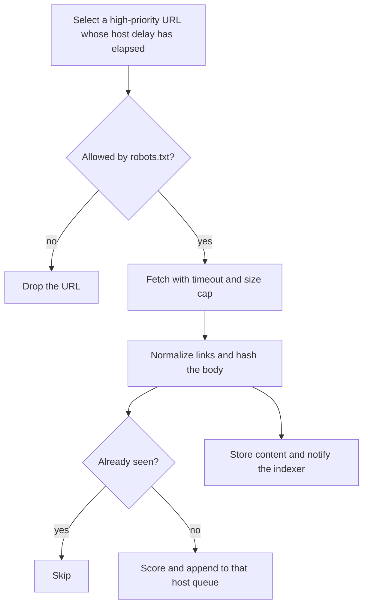

# Design a Web Crawler

Study notes for interview practice. The hard part is not "download HTML." It is politeness, priority, and not crawling the same URL forever.

Aligned with chapter 9. Original revision guide, not a copy of the chapter.

## How to present

Scope it to "crawl the public web for a search index" or "crawl a set of domains," because those are different sizes. Then draw the frontier loop. Deep dive on the frontier (politeness plus priority) and on dedupe.

Say this:

> A crawler that fetches pages, extracts links, and feeds a downstream index. I will keep a URL frontier that is prioritized and polite: one domain does not get flooded. I assume we re-crawl important pages more often than the long tail, and we obey robots.txt.

## What to remember

- The loop is: frontier -> fetch -> parse -> dedupe links -> back to the frontier.
- BFS alone is the wrong scheduler. It treats every URL as equal and it hammers the first big site it finds.
- Politeness: per-host queues, a delay between fetches to the same host, and robots.txt.
- Priority: a separate selection so news and high-PageRank pages are not stuck behind a million product images.
- Dedupe before fetch, not after. A Bloom filter or a hash set of seen URLs.
- DNS and HTTP connection setup will dominate if you do not cache DNS and reuse connections.
- Spider traps (infinite calendars, session ids) need a depth cap, a URL-pattern cap, and a content fingerprint.

## 1. Problem statement and requirements

**Functional**

- Start from a seed list.
- Download a page, extract URLs, and schedule the ones we have not accepted yet.
- Store the content for a downstream system (index, archive, or extractor). We design the crawler, not the search ranker.
- Re-crawl so the stored copy does not go stale forever.
- Respect robots.txt, crawl-delay, and noindex-style exclusions if we claim to be a good citizen.

**Non-functional**

- Politeness is a requirement, not a nicety. Getting banned means we fail.
- Throughput on the order of hundreds of pages per second for a serious single-cluster crawler; a web-scale crawler is a fleet problem with the same shape.
- Fault tolerant. A worker crash loses an in-flight fetch, not the frontier.
- Extensible filters: new exclusion rules without rewriting the fetcher.

**Out of scope**

- Ranking and snippet generation.
- Authenticated content and the deep web behind logins.
- Rendering every JavaScript app. Mention a headless-browser tier as a slow, expensive side path, not the default fetcher.

**Assumptions**

- Goal is breadth for a search index, not a perfect archive of one site.
- 1 billion pages fetched per month as a concrete starting point. Adjust if they want "the whole web."
- We store the raw document once, plus a checksum.

## 2. Back-of-envelope estimation

1 billion pages / 30 days.

- QPS = 1e9 / 2.6e6 seconds ≈ 400 pages/sec average. Peak, if you crawl harder at night in some regions, maybe 1,000 pages/sec. This is connection and politeness bound, not CPU bound.
- If you truly want a trillion-URL web, you are at hundreds of thousands of fetches/sec and this note becomes a capacity plan for many clusters. Say that, then design the 400/sec system so the shape is clear.
- Page size: assume 1 MB average including assets you choose to keep, or 100 KB if you store HTML only. Be explicit. HTML-only at 100 KB * 1e9 = 100 TB/month before replication and before you drop boring pages. You will not keep every byte forever. Set a retention or a "index and discard raw" policy.
- Frontier size dominates operationally. URLs in flight can be tens of billions of strings. A URL averages a couple of hundred bytes. 10 billion queued URLs * 200 bytes = 2 TB of queue state. That is a partitioned queue, not a Redis list on one box.
- DNS: 400 fetches/sec with no cache is 400 DNS lookups/sec plus connection setup. Cache DNS with a TTL and you stop paying that on every URL of wikipedia.org.

Bandwidth at 400 pages/sec * 100 KB = 40 MB/s. Fine for a cluster. The constraint you hit first is "do not open 50 connections to one host."

## 3. High-level architecture

### Architecture



### Crawl flow



### Whiteboard sketch

```
seeds
  -> URL frontier (priority + per-host politeness queues)
       -> fetchers (DNS cache, robots cache, HTTP)
            -> parser (links, content hash)
                 -> dedupe (seen URL, seen content)
                      -> new URLs back to frontier
            -> content store
                 -> downstream index
```

**One URL's life**

1. A selector pulls the next URL that is both high priority and polite to fetch now.
2. The fetcher checks the robots cache for that host. If disallowed, drop or mark done.
3. Download with a timeout, a max byte cap, and a user-agent that identifies us.
4. Parser pulls links, normalizes them (lowercase host, strip fragments, drop obvious trackers), and computes a content hash.
5. Seen-URL set filters links we have already queued or fetched.
6. New links are scored and appended to that host's queue.
7. Content goes to blob storage; a message tells the indexer.

Workers are stateless. The frontier and the seen set are the state. A crashed fetcher means that URL stays leased until the lease expires, then someone else tries.

## 4. Deep dive

### The frontier

This is the system. A single FIFO is the design to reject out loud.

**Problems with plain BFS**

- The first huge site fills the queue with its own links, so you crawl one domain for days.
- High-value URLs discovered late wait behind junk.
- You cannot express "at most one fetch every N seconds for this host."

**Chosen: two-level frontier.**

- Front queues, ordered by priority (page importance, change rate, fresh news).
- A router sends each URL to a back queue owned by a single host.
- A mapping from back queue to fetcher, and a delay so that host is not contacted again until `now + delay`.
- The selector only releases a URL whose host delay has elapsed.

Priority and politeness stay independent. That sentence is the one to remember.

**Rejected: one global priority queue.** Highest priority always wins, so you either starve the tail or, if priorities tie, you still clump on one host. Politeness has no place to live.

**Rejected: one queue per host and nothing else.** Polite, and a million unknown blogs outrank nothing, so a breaking-news page on a busy host waits its turn behind a crawl-delay. You need priority in front of politeness, not instead of it.

### Dedupe, freshness, and traps

Normalize before you test membership. `HTTP://Example.com/a#frag` and `http://example.com/a` are one URL.

**Chosen: a partitioned seen set** (hash of the canonical URL) plus a Bloom filter in front if the set is huge. Bloom false positives mean you skip a page you have not seen. For a search crawler that is acceptable if the false-positive rate stays low. A false negative means a duplicate fetch, which wastes money. Bias the filter toward fewer false positives, and keep an exact set for the recent window.

Content hash dedupes mirrored pages and trivial session-id variants that slipped past normalization.

**Freshness:** do not re-crawl everything every day. Store last-fetch and last-change. Revisit news sites often, revisit a stable policy PDF rarely. A simple approach that you can defend: priority rises with link importance and with how often the content hash has changed, and falls when the page is unchanged visit after visit.

**Traps:** cap URL length, cap path depth, cap the number of URLs kept per host per day, and fingerprint content so a calendar that emits a new URL with the same body does not get infinite priority. A human denylist for pathological sites will exist. Say so. You will not detect every trap with a rule.

### Fetch mechanics that actually burn time

- Cache DNS. Respect TTL, but do not look up `en.wikipedia.org` once per page.
- Cache robots.txt for that host's TTL.
- Reuse connections. Cap concurrent connections per host at a small number (often 1 or 2) regardless of how parallel the cluster is.
- Timeouts and max body size. A slow host must not occupy a fetcher thread for ten minutes.

## 5. Trade-offs and alternatives

**Bloom filter versus exact seen set**

| Bloom filter | Exact set |
| --- | --- |
| Tiny memory, fast | Large memory, exact |
| Rare false positive skips a real URL | No skipped URLs |
| Cannot delete cleanly when you want to recrawl | Easy to mark "due again" |

Use a Bloom filter or a similar compact structure for "have we ever queued this?" at web scale, and an exact store for URLs that are due for recrawl. Recrawl is a timestamp index, not a second copy of the entire web in a queue.

**Politeness strictness**

| Strict (one connection, long delay) | Aggressive |
| --- | --- |
| You stay unbanned, crawl is slower | Faster index, you will get blocked and do legal harm |
| Required for a general web crawler | Acceptable only inside a property you own |

Pick strict for the public web. If the prompt is "crawl our own documentation," drop politeness to "do not melt our origin" and use higher concurrency. The prompt changes the design. Say which prompt you heard.

## 6. Bottlenecks, failure modes, mitigations

- **Frontier hotspot.** One popular host's queues grow without bound. Cap per-host queue length and drop or defer low priority.
- **Fetcher deadlock.** All threads stuck on slow hosts. Timeouts, a circuit breaker per host, and isolate hosts so one cannot consume the global thread pool. This is the same isolation idea as the per-host queue.
- **DNS or robots cache stampede** at startup. Warm them, and shard the cache.
- **Poison page.** A parser crash on one document must not kill the worker loop. Quarantine the URL.
- **Seen-set loss.** You recrawl the world. Snapshot it. A Bloom filter can be rebuilt from the content store's URL list, slowly.
- **At 10x (4,000 pages/sec).** Partition the frontier by host hash so each cluster owns a set of hosts. Politeness then stays local: you do not need a global lock to decide whether wikipedia can be fetched, as long as only one partition owns that host. That ownership rule is the scaling insight.
- **At web scale.** The same design, many clusters, a directory of who owns which hosts. Bandwidth and politeness dominate CPU.

Single points of failure to avoid: one frontier machine, one seen-set database, one fetcher pool shared by every host.

## 7. Open questions

- Are we a search crawler, a price monitor, or an archival crawler? Freshness and politeness settings fall out of that answer.
- Do we execute JavaScript? If yes, that tier is 10x to 100x more expensive and needs its own queue.
- What do we store, and for how long? Raw HTML, extracted text, or both?
- How do we handle sites that cloak, rotate links, or serve different content to our user-agent?
- Is there a legal/compliance review for the user-agent, the robots policy, and personal data we accidentally fetch? That is a real gate, not a wrap-up flourish.
