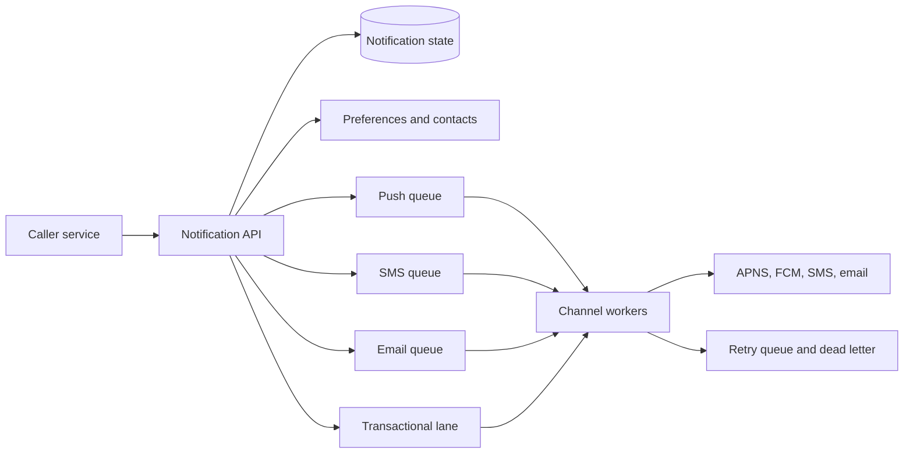
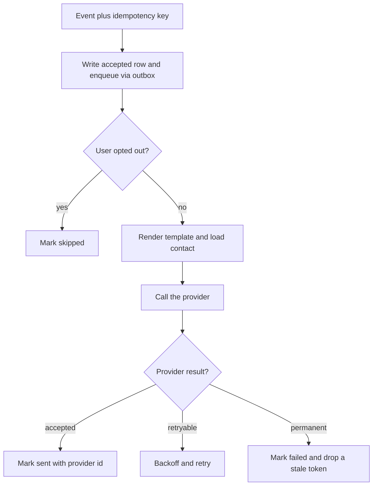

# Design a Notification System

Study notes for interview practice. One pipeline, many channels. The deep dive is fanout, delivery guarantees, and "do not spam the user."

Aligned with chapter 10. Original revision guide, not a copy of the chapter.

## How to present

Start with the three channels and the fact that providers (APNS, FCM, SMS, email) are outside your uptime. Then one queue per channel.

Say this:

> A service other teams call to notify a user by push, SMS, or email. I accept the request, persist it, and hand it to a per-channel queue. Workers talk to the provider. I assume at-least-once delivery, so workers must be idempotent, and I will rate-limit so a bug cannot text a user a thousand times.

## What to remember

- Producers are internal services. Providers are external and slow and fail independently.
- A queue decouples "we decided to notify" from "the provider accepted it."
- Separate queues (or at least separate worker pools) per channel so an SMS outage does not block push.
- At-least-once plus idempotency keys. Exactly-once against a phone network is not a promise you can keep.
- User preferences, contact lookup, and templates happen before the send, not inside the provider call.
- Rate limit and dedupe. Notification bugs are how you burn SMS budget and uninstall the app.
- Retry with backoff, then a dead-letter queue. Do not retry a 400 "invalid token" the same way you retry a 503.

## 1. Problem statement and requirements

**Functional**

- Send a notification to a user or a device on one or more channels: mobile push, SMS, email. In-app inbox if they ask.
- Callers specify the recipient, the template, and the channel, or they specify a logical event ("package shipped") and the system decides the channel from preferences.
- Track status: queued, sent to provider, failed, skipped because the user opted out.
- Support a burst (a campaign) and a trickle (transactional alerts).

**Non-functional**

- Transactional alerts (password reset, fraud) should leave our system in seconds.
- Campaigns can take minutes. They must not delay transactional traffic.
- Durable: a crash after we accept the request must not drop it.
- Providers throttle us. Our system has to queue, not stampede them.
- Assume tens of millions of notifications a day, with campaign spikes of millions an hour.

**Out of scope**

- Building our own SMS gateway or mail transfer agent. We use providers.
- A full marketing-automation product (journeys, A/B testing). Leave a hook.
- End-user delivery guarantees beyond what the provider reports. A push "sent" is not a push "seen."

**Assumptions**

- 50 million notifications/day average, 10x on a campaign hour.
- Mix: mostly push, some email, SMS is the expensive one and the one we limit hardest.
- One region sends, providers are global.

## 2. Back-of-envelope estimation

- 5e7 / 86400 ≈ 600 notifications/sec average.
- Campaign spike: 5 million in an hour ≈ 1,400/sec if spread out, or 10,000/sec if a job dumps them in a few minutes. Design the workers to drain at a controlled rate, not at "as fast as the queue can pop."
- Payload is small: a few KB of template data. 10,000 * 5 KB = 50 MB/s at a hard spike. Not the bottleneck.
- State: one row per notification for a retention window. 5e7/day * 1 KB * 30 days ≈ 1.5 TB/month. Easy. The hot data is today's queue, not the history.
- Device tokens: 100 million users * 2 devices * 100 bytes ≈ 20 GB. Cache it.
- SMS cost dominates any server cost. A bug that double-sends is a finance incident. Call that out in the estimate so they know your priority.

## 3. High-level architecture

### Architecture



### Send flow



### Whiteboard sketch

```
caller service
  -> notification API (validate, persist, enqueue)
       -> metadata store (notification state)
       -> preference and contact service
       -> queues: push | sms | email | transactional-priority
            -> workers
                 -> APNS / FCM / SMS provider / email provider
            -> retry queue / dead letter
```

**Send path**

1. Caller posts an event with an idempotency key.
2. API writes a notification row as `accepted` and appends to the right queue. Those two steps need an outbox so you do not enqueue without a row or write a row without a queue.
3. Worker loads preferences. If the user opted out of marketing SMS, mark `skipped` and stop.
4. Worker renders the template, fetches the device token or phone or email.
5. Worker calls the provider.
6. On success, mark `sent` with the provider id. On a retryable error, backoff. On a permanent error (bad token), mark failed and delete the stale token.

**Gathering contacts**

When a user installs the app or verifies a phone, that write goes to the contact store. The send path only reads. Do not make "collect the device token" part of the send diagram except as a dependency.

Priority: transactional and campaign traffic do not share a single FIFO. Otherwise a marketing blast delays a password reset.

## 4. Deep dive

### Delivery semantics

The provider call can succeed and the response can be lost. The worker retries and the user gets two texts.

**Chosen: at-least-once delivery, idempotent workers.** The idempotency key is unique per logical event. The worker records "provider accepted this key" before retrying. For SMS, pass a provider dedupe id if one exists. For push, duplicate messages still happen; keep the window small and the key strict.

**Rejected: exactly-once as a promise to the user.** You do not control the phone network. Claiming it is a smell.

**Rejected: at-most-once (send and forget).** Drops on the floor during a deploy. Unacceptable for fraud and password resets. Acceptable for a lossy "your friend liked this" push only if product signs off.

### Fanout

"Notify all followers" can be a million recipients.

**Chosen: the caller, or a fanout worker, expands the audience into per-recipient messages onto the queue, at a bounded rate.** Each message is then independent, retryable, and preference-checked.

**Rejected: one worker that loops a million provider calls inside one request.** No retry granularity, no fairness, a crash restarts the blast.

**Rejected: enqueue one "campaign" message and let every worker read the same user list.** They will double-send unless you add leasing. Per-recipient messages are easier to reason about. The cost is queue volume, which is fine.

### Rate limit, dedupe, and templates

- Per user, per channel, per hour caps. A looping producer must not be able to page someone's phone all night.
- Global provider caps, because the vendor will block your account.
- Dedupe window: the same template to the same user inside five minutes collapses to one send.
- Templates live in a store with a version, so a bad copy change rolls back without a deploy. Workers cache templates.

This is the same rate-limiter design as the dedicated note, applied at the worker before the provider call. You do not need to re-derive token buckets. Point at it.

## 5. Trade-offs and alternatives

**One shared queue versus a queue per channel**

| Single queue | Queue per channel, plus a priority lane |
| --- | --- |
| Simpler | An SMS provider outage only backs up SMS |
| A slow channel blocks fast ones | More moving pieces |
| Hard to give password resets priority | Transactional lane stays short |

Pick per-channel queues and a separate transactional lane. The extra queues are cheap. The isolation is the point.

**Synchronous send versus queued send**

| Caller waits for the provider | Caller gets an accept, worker sends |
| --- | --- |
| Simple for a tiny product | Caller is protected from provider latency |
| Provider outage fails the user action | Notification is delayed, not dropped |
| Couples checkout latency to email | Requires the outbox and status tracking |

Queue it. The only synchronous exception is a flow that must know immediately that the address was invalid, and even then you can return `accepted` and surface status on a poll. If they insist on synchronous email for a toy scope, say you would delete the queue until volume shows up.

## 6. Bottlenecks, failure modes, mitigations

- **Provider outage.** Queue depth grows. Workers back off. Transactional lane uses a second provider if you pay for one. Surface age-of-oldest-message as the page, not CPU.
- **Bad deploy of a template.** You can notify millions before a human notices. Stage campaigns, send to an internal cohort first, and keep a kill switch that stops a campaign id.
- **Hot user or hot token.** One debug account in every test. Rate limit per recipient.
- **Outbox inconsistency.** Row says accepted, queue never got it. A sweeper republishes rows stuck in `accepted`. This sweeper is part of the design, not an afterthought.
- **Stale device tokens.** Provider says unregistered. Delete the token or you will waste capacity forever.
- **At 10x, especially a single global blast.** Fanout itself becomes the bottleneck. Partition the audience and run many fanout workers. Pre-render nothing that depends on per-user data; do render shared template fragments once.
- **Retry storms** after the provider returns. Cap concurrency explicitly. A queue with a million messages and uncapped workers is a self-DDoS.

Single points of failure: one worker process, one queue with no replication, one provider with no backup for transactional SMS. The API tier is stateless and is not the risk.

## 7. Open questions

- What is the freshness bar per event type? "Package delivered" and "weekly digest" should not share a latency SLO.
- Do we need an in-app inbox as the source of truth, with push as a hint? That changes durability: the inbox write is the commit, the push is best effort.
- Localization, quiet hours, and per-country SMS regulation. These change whether a worker may send now, not the shape of the queue.
- How long do we keep delivery logs, and are they personal data under a retention policy?
- Who is allowed to create a campaign, and is there an approval gate before a million-send template goes live?
