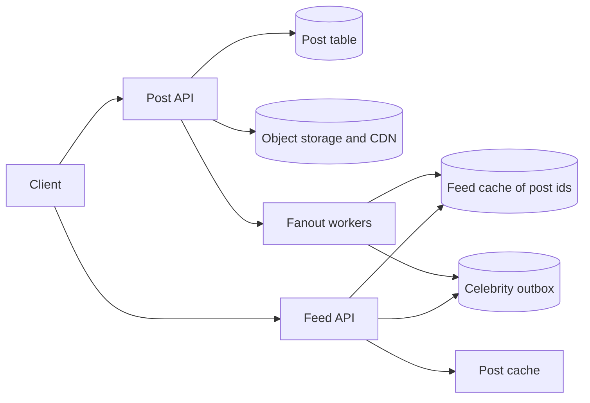
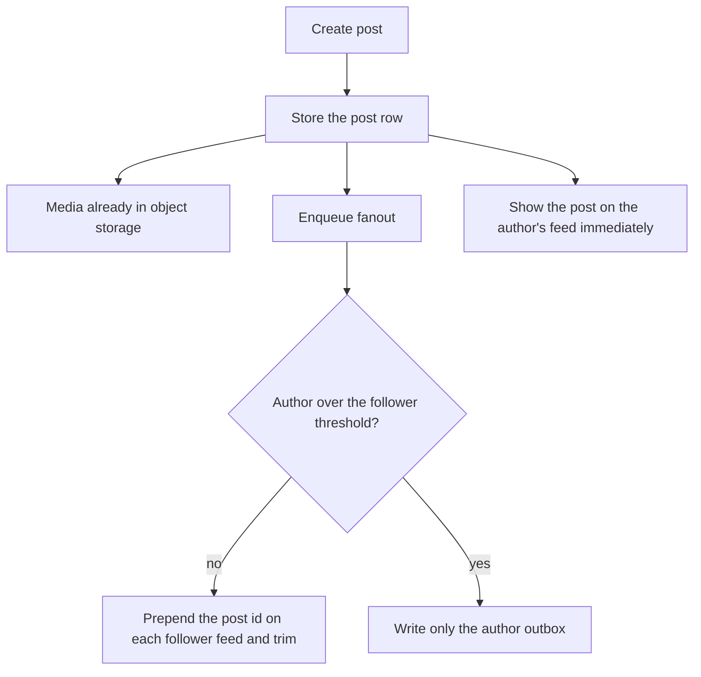
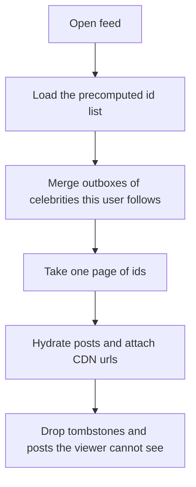

# Design a News Feed System

Study notes for interview practice. Publishing is easy. Building the feed is the decision. Say "fanout" early and then earn it.

Aligned with chapter 11. Original revision guide, not a copy of the chapter.

## How to present

Lock scope: text plus media, reverse chronological, follow graph, not a ranked recommender. Then two flows: publish and read. Deep dive on fanout.

Say this:

> Users post, and followers see those posts newest first. I will fan out on write for normal users so reads are a single cache lookup. For celebrities I will fan out on read so one post does not turn into fifty million writes. Media goes to object storage and a CDN, not into the feed payload.

## What to remember

- Two pipelines: post creation, and feed retrieval. Do not draw one blob called "feed service" and stop.
- Fanout on write: fast reads, heavy writes, painful for celebrities.
- Fanout on read: cheap writes, slow reads that merge many lists.
- Hybrid is the real answer. Threshold on follower count.
- Feed storage is a cache of post ids per user (a list or a sorted set), not a copy of the photo.
- The follow graph and the post table are the source of truth. The feed cache is rebuildable.
- Ranked feeds (ad mixing, ML) are out of scope until the timeline works. Mention them as a later sort step over the same ids.

## 1. Problem statement and requirements

**Functional**

- Create a post: text, optional images or video.
- Follow and unfollow.
- Open the app and see posts from people you follow, newest first.
- Page through older posts.

**Non-functional**

- Feed read is the hot path. p99 inside a region on the order of 100 to 200 ms including media URLs, not the media bytes.
- Post create can be slower, around a few hundred ms until the post is durable. Fanout to every follower can finish asynchronously; the author should see their own post immediately.
- Highly available reads. A stale feed by a few seconds is acceptable. A lost post is not.
- Assume 10 million daily active users, average 500 friends/followers, some users with millions.

**Out of scope**

- The ranking model, ads, and "people you may know."
- Comments and reactions, except as counts you can bolt on.
- A full media transcoding pipeline (see the YouTube note if video is the focus).

**Assumptions**

- 10 million DAU.
- Each user opens the feed 10 times a day and posts 0.2 times a day. State these; they drive read:write.
- Max followers for "normal fanout" is a threshold we pick, for example 5,000. Above that, the account is a celebrity.
- Reverse chronological, as agreed. If they want ranking, the fanout still produces candidate ids, and a ranker reorders the page. Do not start there.

## 2. Back-of-envelope estimation

- Feed reads: 1e7 * 10 / 86400 ≈ 1,200/sec average, peak ≈ 5,000/sec. Small. The amplification is in fanout, not in read QPS.
- Posts: 1e7 * 0.2 / 86400 ≈ 23 posts/sec average.
- Fanout writes: 23 * 500 followers ≈ 12,000 feed-list writes/sec average if everyone is "normal." Peak higher. Still comfortable for a cache cluster.
- One celebrity post at 20 million followers is 20 million writes if you fan out on write. That single post is the incident. This is why the hybrid exists. Put this number on the board.
- Post storage: 23/sec * 86400 * 365 * 1 KB of text metadata ≈ 0.7 TB/year of metadata. Media is the real storage. If 10% of posts have a 1 MB image: about 0.2 * 1e7 * 0.1 * 1 MB = 200 GB/day, about 70 TB/year. Object storage, not the database.
- Feed cache: 10 million users * 500 post ids * 8 bytes ≈ 40 GB if you keep 500 ids each. Keep 200 to 800 ids per user, not the full history. Older history is a query, not a cache entry.

Read QPS will not scare anyone. Celebrity fanout and media storage are the numbers that matter.

## 3. High-level architecture

### Architecture



### Publish flow



### Read flow



### Whiteboard sketch

```
publish:
  client -> post API -> post DB
                     -> object storage (media)
                     -> fanout worker
                          -> for normal followers: prepend post id to their feed cache
                          -> for celebrities: only write the celebrity's own outbox

read:
  client -> feed API -> feed cache for this user
                     -> merge celebrity outboxes the user follows
                     -> hydrate post ids from post cache / post DB
                     -> return metadata + CDN urls
```

**Publish**

1. Authenticate. Store the post row as the commit point.
2. Upload media directly to object storage; the post row holds the object key.
3. Enqueue fanout. Do not do 5,000 cache writes inside the user request.
4. Worker's job: look up follower ids. If this author is under the threshold, push the post id onto each follower's feed list and trim the list.
5. Always put the post on the author's own feed immediately so they see it even before fanout finishes.

**Read**

1. Load the precomputed id list from cache.
2. Find celebrities this user follows. Pull the latest ids from those outboxes and merge by time.
3. Hydrate the page of ids (20 posts) from a post cache.
4. Return JSON. Images load from the CDN later, by the client.

Unfollow must stop future fanout and ideally hide old ids. Hiding can be a filter at read time ("drop posts whose author I no longer follow") so you do not delete from millions of lists.

## 4. Deep dive

### Hybrid fanout

**Chosen: fanout on write below a follower threshold, fanout on read above it.**

Normal user posts: the expensive work happens once at write time, in the background. Opening the app is an O(1) cache read plus a small merge.

Celebrity posts: the post lives in one outbox. Every reader merges a handful of celebrity outboxes. You never write 20 million cache entries for one tweet.

**Rejected: fanout on write for everyone.** Simple reads, and one famous account publishes the site into a multi-hour queue. Followers who are offline still pay a write.

**Rejected: fanout on read for everyone.** Simple writes. Every feed open walks the follow graph, loads hundreds of post lists, and merges. With 500 follows that is 500 reads per page view unless you cache aggressively anyway. You end up rebuilding fanout on write informally.

Pick a threshold from data (follower count, or "fanout cost"). A user who crosses it migrates: stop pushing their new posts, keep their outbox, and let readers merge. Old precomputed ids can age out.

### Feed data model

Per user, a sorted set of `(timestamp or post id, post id)`. Post ids that are time-ordered (see the unique-id note) let you sort without a second field.

The post body is not in that list. Hydrate from `post_id -> post`. Otherwise every edit or like-count change rewrites every follower's feed.

**Media:** object storage plus CDN. The feed JSON carries a URL. Do not stream bytes through the feed API.

**Graph store:** follower and followee lists. Fanout reads "who follows this author." That list is hot for celebrities and must be cached and partitioned by author id. A celebrity's follower list does not fit one unsharded key if it is huge; for fanout-on-read you mostly need the other direction at read time ("which celebrities does this user follow?"), which is small if each user only follows a few dozen celebrities. Say which direction you read on which path.

### Edits, deletes, privacy

A delete should disappear quickly. Store a tombstone and filter at hydration time so you do not hunt through every feed list. Accept that a cached page might show the post for the cache TTL of the hydrated object, and keep that TTL short for bodies (seconds) while the id list TTL is long.

Private account to public, block, and "only followers" are authorization checks at hydration. The id list may contain a post the viewer must not see. Filter it. Do not rely on fanout having been perfect.

## 5. Trade-offs and alternatives

**Precompute versus merge at read** (the same choice, said as a product trade)

| Precomputed timeline | Merge at read |
| --- | --- |
| Predictable, fast open | Write path stays small |
| Wasted work for lurkers who never open the app | Heavy users with large follow graphs pay on every open |
| Breaks on huge follower counts | Breaks on huge followee counts |

Hybrid says: precompute the common case, merge the case that would explode. If the product is "everyone follows the same 50 newspapers," skip precompute and merge those 50. The follow-graph shape picks the design. Ask about it.

**Push the whole post versus push ids**

| Copy the post into every feed | Copy ids only |
| --- | --- |
| Read does no second lookup | One more hydrate hop, easily cached |
| Edits and deletes are a write storm | Edits are one row |
| Enormous storage | Id lists are compact |

Always ids. There is not a serious case for copying bodies into every timeline at this scale.

## 6. Bottlenecks, failure modes, mitigations

- **Celebrity threshold too high.** A 1-million-follower account still fanouts on write and melts the queue. Monitor fanout duration per post. Lower the threshold automatically when fanout lags.
- **Hot follow-graph key.** "Followers of celebrity" is a giant partition. Avoid reading it on the user-facing path. Fanout-on-read only needs "celebrities I follow."
- **Feed cache loss.** Rebuild from the people the user follows: load recent posts per followee and merge. That is the fanout-on-read path used as a repair tool. It will be slow and that is acceptable for a miss.
- **Worker backlog.** Posts are durable in the post table but missing from feeds. Readers can fall back to a short merge of the most recent authors. Alert on queue age.
- **Media upload failure after the post row exists.** Post is visible with a broken image. Make the post visible only when required media is durable, or show it as pending.
- **At 10x DAU.** Read QPS is still fine. Fanout writes scale with posts times average degree. Shard the feed cache by user id. The graph store shards by user id as well.
- **At 10x, ranking added.** The precomputed list becomes a candidate generator, not the displayed order. Keep fanout. Add a ranker that sees a few hundred ids, not the whole world. Do not replace the design; put a stage in front of hydration.

Single points of failure: one fanout worker, one unsharded feed cache, the post database without a replica. The API is stateless.

## 7. Open questions

- Is the order chronological or ranked? Ranking changes the read path more than the write path.
- How fresh must a post be on a follower's screen? Seconds, or is a minute of fanout lag fine?
- What is the follow-graph shape? A few celebrities, or a dense social graph? Get a number before you commit to the threshold.
- Do we support private posts and blocks in v1? If yes, hydration-time filtering is in scope now, not later.
- Is video in the feed "a URL we store" or "we transcode it"? If we transcode, that is a queue and a CDN, and it should not block the post insert.
