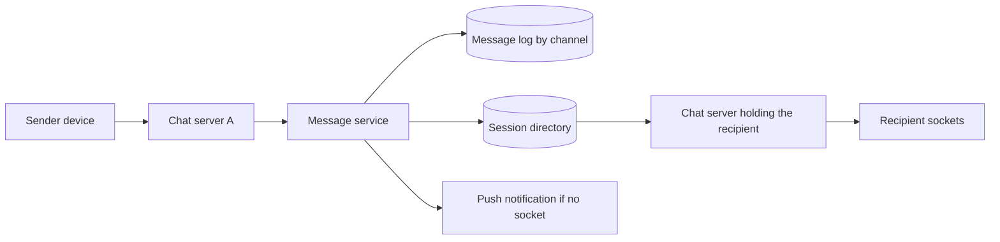
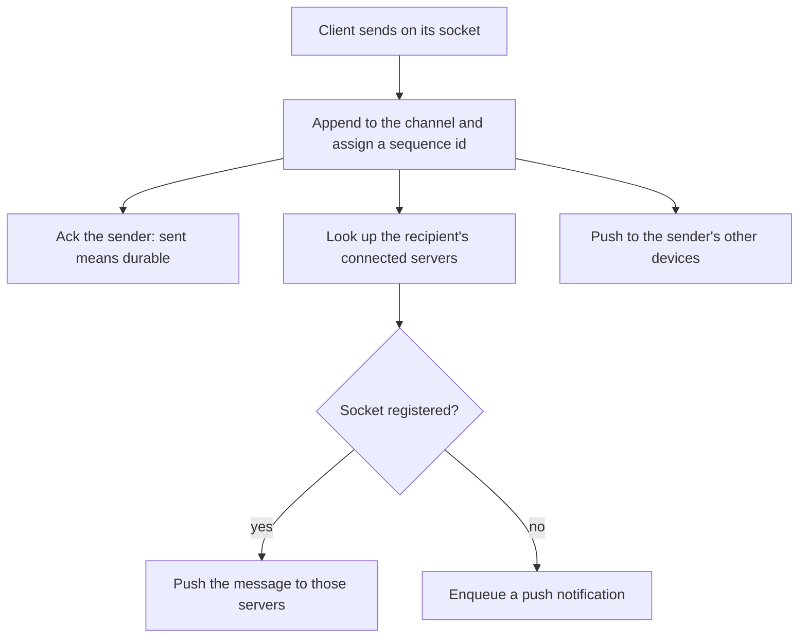
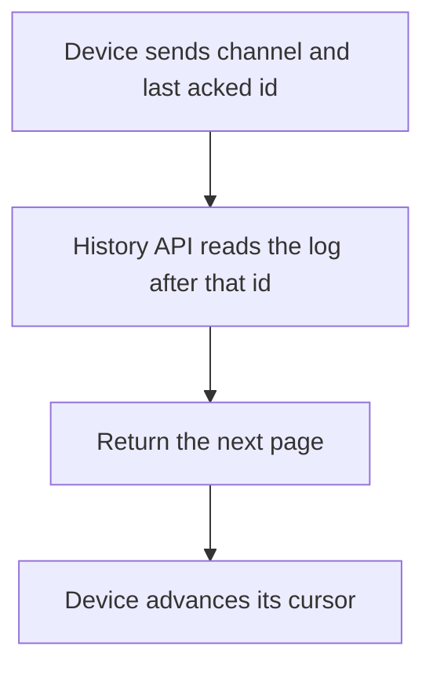

# Design a Chat System

Study notes for interview practice. Real-time delivery, durable history, and presence are three different problems. Separate them on the board.

Aligned with chapter 12. Original revision guide, not a copy of the chapter.

## How to present

Clarify 1:1 versus group, and whether history is required. Then pick WebSocket, explain how a message finds the other user's server, and do presence last.

Say this:

> One-to-one and small group chat, with history and online status. Clients hold a WebSocket to a chat server. Messages are durable in a store keyed by channel, ordered by a per-channel id. Presence is a heartbeat, not a row you update on every keystroke.

Out of scope unless they insist: end-to-end encryption, a full media pipeline, and groups of hundreds of thousands.

## What to remember

- Long polling works and wastes connections. Short polling is worse. WebSocket is the default for bidirectional chat. Server-sent events are enough if the client never uses the socket to send.
- Chat servers are stateful only in the sense that they hold sockets. Any server can accept a user if a directory maps `user -> connection server`.
- The directory is the routing brain: when A messages B, the service looks up which server holds B's socket and pushes.
- Message ids must increase inside a channel so history sync is "give me everything after id X."
- Multi-device: each device has its own cursor. The store is the source of truth, not the socket.
- Group fanout copies a message to N sockets, not N database rows. One stored message, many pushes.
- Presence: heartbeat, TTL, and a debounced broadcast. Do not write "online" to a database on every ping.

## 1. Problem statement and requirements

**Functional**

- 1:1 chat and group chat up to a few hundred members.
- Online delivery in near real time, and history when you open the app or switch devices.
- Read state, at least a per-user cursor.
- Presence: online, offline, maybe last seen.
- Push notification when the user has no live socket.

**Non-functional**

- Delivery latency of a few hundred milliseconds when both users are connected, inside a region.
- Messages are durable before you tell the sender "sent."
- Order is preserved per channel as the sender observes it. Global order across channels does not matter.
- Assume 50 million daily active users, 20 messages/day each. Scale the sockets, not a complicated database.

**Out of scope**

- End-to-end encryption and multi-device key verification.
- Voice and video calls.
- A group with a million members (that is a news feed or a notification fanout).
- Message search.

**Assumptions**

- Reliability bar is "WhatsApp-like" for a single region: sent means stored, delivered means we pushed to a socket or to push notification.
- Groups are small. Fanout to 200 sockets is fine. Fanout to 200,000 is not this design.
- One region, with users sticky to a chat server for the life of the connection.

## 2. Back-of-envelope estimation

- Messages: 5e7 * 20 / 86400 ≈ 12,000 messages/sec average. Peak ≈ 30,000/sec. Trivial for a log-structured store partitioned by channel.
- Storage: 30,000/sec peak is not the storage driver; average is. 5e7 * 20 * 200 bytes ≈ 200 GB/day of text. A year is about 70 TB plus replication and indexes. Media is extra and goes to object storage; the message row holds a pointer.
- Concurrent sockets: if 10% of DAU are connected at peak, 5 million sockets. At roughly 10k to 50k connections per chat server (a capacity you should treat as a measured number, not a law), you need on the order of a few hundred chat servers. The point is horizontal scale of connection holders, not one giant box.
- Presence heartbeats: 5 million users * a ping every 30 seconds ≈ 170,000 heartbeats/sec. This must be in memory. It must not be 170,000 database writes.
- Fanout: a group of 100 at even 1% of traffic multiplies pushes, not stored rows. Keep that distinction in the estimate.

## 3. High-level architecture

### Architecture



### Send flow



### History sync



### Whiteboard sketch

```
sender device
  -> WebSocket -> chat server A
       -> message service (persist, assign channel sequence)
            -> message store (partitioned by channel)
       -> presence / session directory (user id -> chat server)
            -> chat server B -> recipient sockets
       -> if no socket: notification service (push)
```

**Send a 1:1 message**

1. Client sends on its existing socket: channel, client-generated idempotency key, body.
2. Chat server hands the payload to the message service.
3. Message service appends to that channel and returns a monotonic message id. This ack is what "sent" means.
4. Service looks up the recipient's connected servers and pushes `{channel, message}` to those servers, which write to the sockets.
5. If there is no socket, enqueue a push notification.
6. Sender's other devices get the same push so the phone and the laptop stay aligned.

**History sync**

1. Client says "channel C, after message id 440."
2. Any stateless history API reads the store and returns the next page.
3. The socket is not required. A device that was offline does not "replay the socket"; it reads the log.

**Group**

Same persist step, one row. Push goes to every member who has a socket, except the sender's current device. Members over a size limit do not get per-member database copies.

## 4. Deep dive

### Connection and routing

**Chosen: WebSocket, plus a session directory.**

The directory maps user id to one or more `(server id, device id)` records. Chat servers register on connect and deregister on disconnect. Heartbeats expire stale rows so a crashed server does not leave ghosts forever.

When a message is ready, routing is a lookup, then a push over an internal RPC to the server that owns the socket. You do not broadcast to every chat server.

**Rejected: short polling.** Simple, and you will either be late or you will DDoS yourself.

**Rejected: long polling.** Correct enough, and you hold an HTTP request per user anyway, with worse overhead and harder bidirectional flow. Fine as a fallback for hostile networks. Not the primary design.

**Rejected: store-and-wait, where the recipient polls the database every second.** History sync uses the store. Live delivery should not.

Sticky sessions at the load balancer are optional if the directory is correct: a reconnect can land on a new server and register again. Stickiness only reduces directory churn.

### Ordering and the message id

Per channel, a monotonic id. Clients display in that order and ack "I have everything up to id N."

**Chosen: a counter per channel**, allocated when the message is persisted (a single writer partition for that channel, or a short critical section on that channel's sequencer). The sender can attach a client id so retries do not double-insert.

**Rejected: wall-clock timestamps as the only order.** Clock skew swaps messages. You can display a timestamp and still order by the channel id.

**Rejected: a global Snowflake as the only order across all chats.** It is almost ordered, and two messages in one channel can still invert relative to causal send order if they are issued by different machines close together. A per-channel sequence is the one that matches the product. Snowflake is fine as a tie-break or as a storage key if you also keep a channel sequence.

### Presence

In-memory on the connection servers, aggregated in a presence cache:

- Client heartbeats every 20 or 30 seconds.
- If two beats are missed, mark offline.
- Broadcast presence changes to interested users (the small friend set, or members of the open conversation), and debounce so a flapping phone does not fan out every second.
- Last-seen is updated on transition to offline, not on every heartbeat.

**Rejected: write presence to the user table on each heartbeat.** You turned a cheap ping into the hottest database on earth.

For a large group, do not push presence of all members to all members. Fetch presence for the people on screen. This is the usual follow-up, and it is where naive fanout dies.

## 5. Trade-offs and alternatives

**Stateful socket servers plus directory versus a managed pub/sub (Redis, NATS, a cloud websocket service)**

| We own the socket tier | Managed pub/sub for fanout |
| --- | --- |
| Full control of protocol and backpressure | Less code, a vendor limit on connections |
| We operate reconnect storms | Reconnect storms are still ours |
| Directory is a component we must design | The bus is the directory |

Either is valid. In an interview, design the directory so you understand it, and say you would buy the bus if the company already runs one. Do not spend the time designing TCP.

**One store for all messages versus recent-in-cache and archive-on-disk**

| Single partitioned log | Hot cache of recent messages, cold archive |
| --- | --- |
| Simpler reads by id range | Recent open-chat is faster |
| Must partition well from the start | Two retrieval paths, a consistency edge at the boundary |

A single partitioned store is enough to defend. Add a cache of the latest page per active channel if read latency requires it. Most "reads" are the live socket, not history.

## 6. Bottlenecks, failure modes, mitigations

- **Chat server death.** All sockets on it drop. Clients reconnect, register on new servers, and sync history from the last acked id. Messages were never only in memory. This is the test of whether you persisted before ack.
- **Directory stale.** You push to a dead server. RPC fails; fall back to push notification and clear the directory row.
- **Hot channel.** A famous group chats faster than one partition sequencer. Shard that channel or split "super groups" into the fanout-on-read model (store once, clients pull). Say the threshold.
- **Reconnect storm** after a deploy. Roll chat servers gradually. Jitter client reconnects. History reads will spike; cache the tail of active channels.
- **Duplicate send** on retry. Idempotency key per client message. The second insert returns the original id.
- **At 10x connected users.** More chat servers, same directory, directory partitioned by user id. Watch heartbeat QPS. Increase the heartbeat interval before you scale the presence store.
- **At 10x history.** Partition by channel id is already the plan. Archive old months to cheaper storage and keep the recent window on the fast store. Clients rarely scroll back years.

Single points of failure: one session directory that is not replicated, one message partition with no replica, persisting "after" the socket push instead of before. The last one is a design bug, not a capacity bug.

## 7. Open questions

- Is "delivered" a socket write, a device ack, or a read receipt? They are three states. Product should name them.
- How large can a group get in v1? The answer changes fanout.
- Do we encrypt at rest only, or end to end? End to end removes server-side search, abuse scanning, and "load history onto a new device" simplicity.
- Multi-region: is one region the writer for a channel, or can two regions accept messages? Active-active ordering is a different design. Default to one home region per channel.
- Retention and legal hold. Chat storage is personal data; "keep forever" may be the wrong default.
