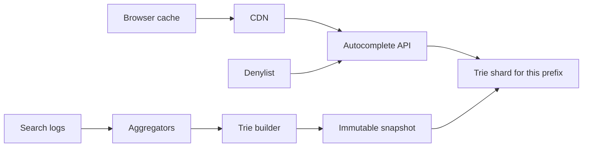
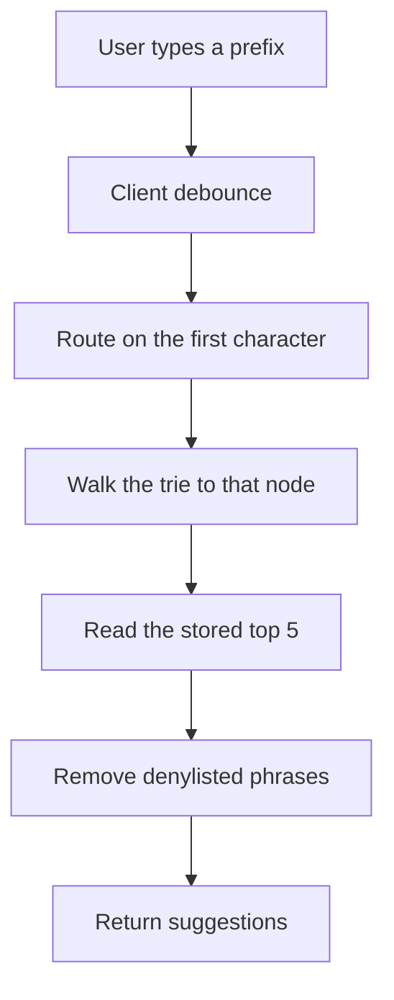
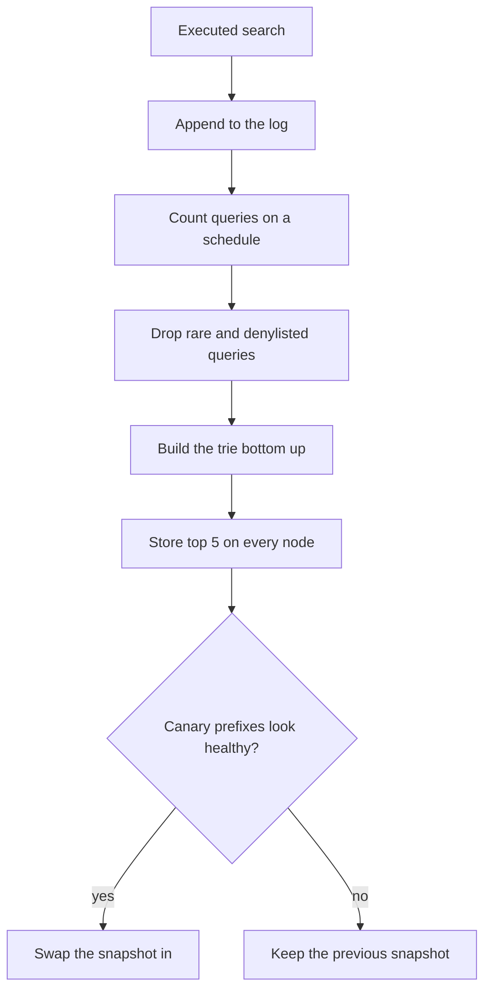

# Design a Search Autocomplete System

Study notes for interview practice. The data structure is a trie. The system design is how you build it, shard it, and keep junk out of the top suggestions.

Aligned with chapter 13. Original revision guide, not a copy of the chapter.

## How to present

Define the query: prefix in, top 5 suggestions out, within about 100 ms. Draw the trie with frequencies, then say you will not walk the whole subtree on the request path. Deep dive on precomputed top-k and on how the trie is built from logs.

Say this:

> As the user types, I return the five most frequent completions for that prefix. I will keep a trie and store the top five suggestions on each node so a keystroke is a walk of the prefix, not a search of the language. The trie is rebuilt from search logs every few minutes or hours, not updated on the request path.

## What to remember

- Naive approach: query a table `WHERE query LIKE 'prefix%' ORDER BY freq LIMIT 5`. Fine for a toy, too slow and too heavy at web scale.
- Trie walk is O(length of prefix). The expensive part is "find the top k in this subtree" unless you cache top k on the node.
- Update path is asynchronous. Logs append, workers aggregate, a new trie is published. Serving stays read-only.
- Shard the trie by prefix (the first character, or the first two). Popular prefixes need extra replicas, not a bigger shard.
- Filter offensive and unsafe queries before they are stored on a node. Deleting later is a rebuild or a denylist check at read time.
- Browser and CDN caching help for popular prefixes and hurt freshness. Bound the TTL.

## 1. Problem statement and requirements

**Functional**

- Given a prefix, return the top 5 completed queries by past search frequency.
- Suggestions update as the prefix grows.
- Support a denylist and the ability to remove a query quickly.
- English-first is a fair assumption; say so. Unicode and case folding are a design detail, not a separate product.

**Non-functional**

- About 100 ms end to end for a keystroke, so the server budget is tight, often under 50 ms.
- Highly available. Empty suggestions are a degradation, not an outage of search itself. Autocomplete can fail open to "show nothing."
- Freshness: minutes to hours, not seconds, unless they demand real-time trends. State the assumption.
- Scale: assume 10 million searches a day to start, or 100,000 peak QPS of keystrokes if they say "web search." Keystrokes are several times searches, because each character can be a request. Debounce in the client (for example 50 to 100 ms, and do not send until 2 characters).

**Out of scope**

- The search engine that runs after the user presses enter.
- Personalized ranking from private history, in v1. Mention it as a re-rank on top of the global top 5.
- Spelling correction as a full system. A small "did you mean" can sit beside this.

**Assumptions**

- Global popularity, not per-user, for v1.
- Top 5, prefix match, not fuzzy match.
- We can drop or sample high-cardinality garbage (queries typed once).

## 2. Back-of-envelope estimation

Use a web-scale sketch if they want one, and keep the math easy.

- 100 million searches/day. Average query length 10, and we send a request per character after the second: about 8 autocomplete calls per search.
- Calls: 1e8 * 8 / 86400 ≈ 10,000/sec average. Peak ≈ 30,000/sec. With a CDN cache on popular prefixes, origin QPS is much lower. The head prefixes (`a`, `th`, `how`) dominate.
- Unique queries worth keeping: suppose 100 million distinct queries after dropping the tail that was seen once. Each node stores a string only on the leaf side; internal trie nodes are characters.
- Memory, order of magnitude: 100 million queries * (average 10 nodes shared heavily). Tries share prefixes, so node count is not 100 million * 10. A practical planning number is a few tens of bytes per stored query after sharing and after you only keep queries above a count threshold. Call it on the order of tens of GB for a filtered vocabulary, small enough to replicate, large enough to shard so a publish is not one giant blob.
- Rebuild: aggregating a day of logs is a batch job. Serving does not touch the log store.

If the trie does not fit one machine, shard. Do not start with a distributed trie protocol. Start with "the first character picks a server."

## 3. High-level architecture

### Architecture



### Query flow



### Build flow



### Whiteboard sketch

```
browser (debounce, short cache)
  -> CDN / edge cache for hot prefixes
       -> autocomplete API
            -> trie shard for this prefix (read-only, in memory)
                 -> top 5 already stored on the node

search logs (append only)
  -> aggregator workers (periodic)
       -> frequency table
            -> trie builder
                 -> publish new immutable snapshot to shards
```

**Query path**

1. Client sends `prefix=sys` after debounce.
2. API hashes or routes on the first character to a shard.
3. Walk `s -> y -> s`. Read the top-5 list stored on that node.
4. Apply the denylist. Return the rest.

**Build path**

1. Search executions append `{query, time}` to a log. Not autocomplete calls; those are noisier.
2. Every N minutes, workers count queries, drop anything below a threshold, drop denylisted phrases.
3. Builder constructs a trie and writes the top 5 at every node: among the queries in this subtree, the five with the highest counts.
4. Publish the snapshot. Servers swap to it atomically. Rollback is "swap back."

No locks between readers and the builder. Readers see the old snapshot or the new one, never a half-built node.

## 4. Deep dive

### Trie with cached top-k

A plain trie answers "is this prefix a word?" It does not answer "what are the best completions?" without exploring the subtree. Exploring the subtree on each keystroke is the trap.

**Chosen: each node holds the top k completions for its subtree**, k=5. A query is a walk of length equal to the prefix. Time is tiny. Memory grows because each node stores k strings (or k pointers to shared query records).

When building, compute top k bottom-up: a node's list is the merge of its children's lists, keeping five. That is the build-time cost you pay so the read path stays boring.

**Rejected: compute top k at read time by DFS.** Simple to code, and a one-character prefix walks a huge fraction of the language.

**Rejected: SQL `LIKE 'sys%' ORDER BY count DESC LIMIT 5`** as the production path. Easy to operate at small scale, and it will show up in the latency graph the day the table gets large. Fine as the v0 you migrate off.

### Sampling, filtering, and deletion

Most human queries are unique typos. If you keep them, the trie fills with junk and the top 5 gets worse. Drop queries seen fewer than a threshold during aggregation.

Offensive or dangerous suggestions: filter at build time so they are not stored, and check a denylist at read time so a newly banned phrase disappears before the next rebuild. Read-time filtering is what makes "remove this now" possible. Rebuild-time filtering is what makes it stay gone.

**Rejected: delete a node in place on the live trie** as the only removal tool. Immutable snapshots are easier to ship and roll back. A denylist covers the emergency.

### Sharding and the head

Route by the first one or two characters. That is simple and unbalanced: `s` is hotter than `q`. Give hot shards more replicas. The data is read-only, so replication is just more copies of the same snapshot. You do not need a consensus write protocol on the query path.

If one prefix is still too hot for the shard's CPU, cache that prefix at the API and the CDN. The hottest prefixes are the shortest ones, and they change slowly, so a 1-minute cache is safe under our freshness assumption.

## 5. Trade-offs and alternatives

**Rebuild snapshots versus update counts in place**

| Periodic immutable snapshot | Live updates on the trie |
| --- | --- |
| Read path has no write contention | Suggestions track trends within seconds |
| Freshness is the rebuild interval | Every search is a write into a distributed trie |
| Easy rollback | Hard to shard, hard to reason about |

Pick snapshots. Move a small "trending" overlay in front if product wants breaking-news queries to appear quickly. The overlay can be a tiny in-memory map of prefixes to boosted queries, rebuilt every minute, merged at read time with the big trie. That is the compromise, and it is worth saying.

**Global popularity versus personalized**

| Global top 5 | Personal re-rank |
| --- | --- |
| Cacheable at the CDN | Cache key includes the user |
| No privacy issue on the query path | You are storing and serving search history |
| Wrong for ambiguous prefixes | Better for "my usual query" |

Ship global first. Personalization is a function that reorders five to twenty candidates, not a second trie per user.

## 6. Bottlenecks, failure modes, mitigations

- **Hot prefix.** Replicate and cache. Do not add a lock.
- **Stale suggestion after a news event.** Shorten the rebuild interval, or add the trending overlay. Do not switch the whole design to live updates in a panic.
- **Bad rebuild publishes garbage or empty.** Health-check the snapshot (node count, a set of canary prefixes) before swap. Keep the previous snapshot loaded.
- **Offensive query ranks first.** Denylist at read time is the immediate mitigation. Add a human review queue for queries that suddenly jump in frequency.
- **Trie memory blow-up.** Raise the frequency threshold. Cap stored query length. Sample the log if aggregation cannot keep up; popularity rank is stable under sampling if you are careful with the head.
- **At 10x QPS.** The trie does not get 10x bigger. QPS is cached at the edge. Origin replicas scale horizontally because the dataset is read-only.
- **At 10x vocabulary (many languages).** Shard by language and then by prefix. Do not build one trie with a root for every script unless you enjoy a root node with thousands of children. A root per language is a reasonable cut.

Single points of failure: one builder whose bad output is pushed everywhere without a canary, one unsharded trie server for all prefixes. The API tier is replaceable.

## 7. Open questions

- How fresh is fresh enough? A daily rebuild is a different product from a five-minute one.
- Do we suggest queries nobody has typed, generated from titles or entities? That is a second source merged into the same top-k, and it needs its own quality bar.
- Personalization and sensitive history: what are we allowed to store, and does the user expect "recent searches" mixed with popular ones?
- Multi-language and locale: is the prefix `san` in English and Spanish the same shard and the same top 5? Usually no.
- What is the abuse case for poisoning? Someone scripting a rare query to become a suggestion. Frequency thresholds and anomaly checks belong in the aggregator. Confirm who owns that review.
