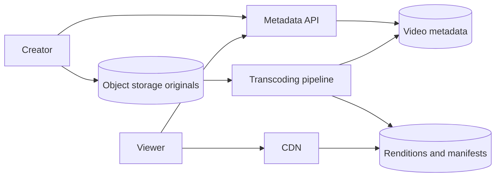
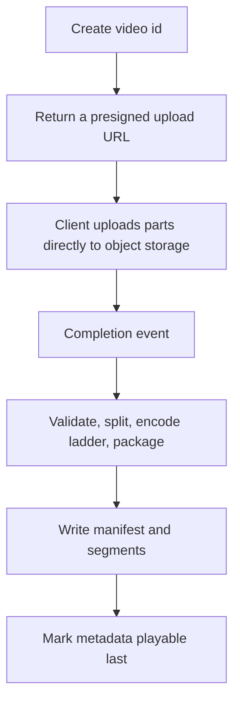
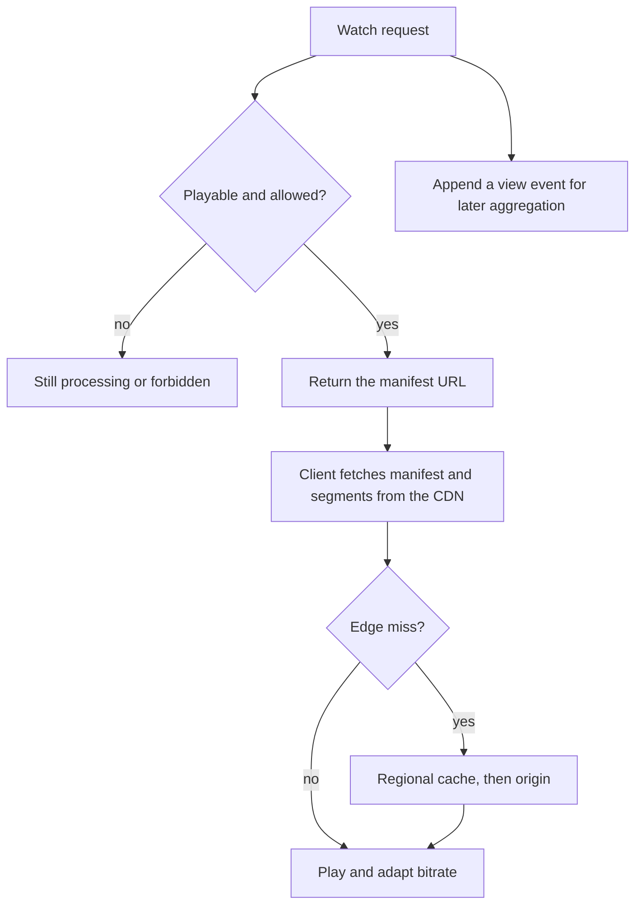

# Design YouTube

Study notes for interview practice. Split upload from playback on the first diagram. Transcoding is a pipeline, not a function call inside the upload request.

Aligned with chapter 14. Original revision guide, not a copy of the chapter.

## How to present

Agree you are designing upload plus watch, not recommendations, comments, or livestreaming. Estimate bandwidth before you estimate servers. Deep dive on the transcoding pipeline and on how a watch request finds a CDN segment.

Say this:

> Clients upload the original to object storage. A pipeline transcodes it into a few resolutions as small segments. Playback is mostly CDN: the client fetches a manifest and pulls segments. Metadata stays in a database. I am not designing the recommender.

## What to remember

- Upload path and watch path share metadata and almost no traffic shape. Watch is read-heavy and byte-heavy. Upload is slower and CPU-heavy after the bytes land.
- Direct-to-object-storage upload. Do not proxy the video through your API servers.
- Transcoding is asynchronous, DAG-shaped: validate, split, encode ladder, package, publish. A queue sits between steps.
- Store the original. You will re-encode later when codecs change.
- Adaptive bitrate: the client picks a rendition per segment based on bandwidth. You precompute the ladder; you do not transcode on the fly for each viewer.
- Hot videos are a CDN and cache problem. Long-tail videos are a storage-cost problem.
- Popularity is skewed. A small fraction of videos is most of the bandwidth.

## 1. Problem statement and requirements

**Functional**

- Upload a video, with title and description.
- Transcode so it plays on phones and slow networks, not only as the original file.
- Watch: start quickly, seek, and switch quality.
- View counts and basic metadata reads.

**Non-functional**

- Upload itself should feel finished when the bytes are stored, not when every rendition is done. Processing can take minutes for a long video.
- Playback start (time to first frame) is dominated by CDN proximity and segment size, not by your origin.
- Durable original. A lost upload is user-visible data loss.
- Cost-aware. Egress and transcoding CPUs dominate the bill. Say this early so you do not "add servers" as the only scaling tool.
- Assume on the order of a large consumer site: tens of millions of DAU, millions of watch-hours. Use the estimate below as the assumption you write down.

**Out of scope**

- The recommendation model and the homepage ranker.
- Live streaming (different latency budget, different protocol story).
- Comments, shares, and a full social graph.
- DRM, except to note where it would wrap the packaged segments.

**Assumptions**

- 5 million uploads/day is too high for a first sketch. Use 1 million uploads/day only if they insist. A defensible interview assumption: 50 million DAU, each watches 5 videos/day, and 5% of DAU upload one short video a day. Adjust with them.
- Average upload is 200 MB original. Average watch is a few minutes of a transcoded rendition, not the original.
- One primary region for metadata, CDN for bytes worldwide.

## 2. Back-of-envelope estimation

Assumptions to speak: 50 million DAU, 5 watches each, 5 minutes average, 1 Mbps average bitrate. And 2 million uploads/day at 200 MB. (If those upload numbers feel high, lower them; the architecture does not change.)

**Watch bandwidth**

- 5e7 * 5 * 5 minutes * 60 seconds * 1 Mb/s.
- Watch-seconds: 5e7 * 5 * 300 = 7.5e10 seconds/day.
- Bits: 7.5e10 * 1e6 = 7.5e16 bits/day. Bytes: /8 ≈ 9e15 bytes/day ≈ 9 PB/day.

That 9 PB/day is what viewers pull if every watch misses and is served as fresh bytes. It is not origin traffic. Say it that way:

- A small set of hot videos is most of the bytes, and those live on the CDN after the first fetch in a region.
- Origin should see misses, not steady-state watches. A 99% edge hit rate turns 9 PB/day of viewing into roughly 90 TB/day of origin egress, before you even count that many viewers share one cached copy.
- The number that changes the design is the miss rate, not the API QPS.

**Upload**

- 2e6 * 200 MB = 400 TB/day of originals ingested.
- Transcoding often expands storage: several renditions can be 1x to 3x the original combined, depending on the ladder. Budget about 1 PB/day of new cold-ish video if you keep originals and renditions. Lifecycle policies move cold videos to cheaper storage.

**Metadata**

- Tiny next to bytes. A video row is a few KB. Even 2 million new rows a day is nothing for a partitioned database.

The conclusion you want them to nod at: API QPS is not the hard part. Ingest bandwidth, transcode CPU, storage lifecycle, and CDN hit ratio are.

## 3. High-level architecture

### Architecture



### Upload flow



### Watch flow



### Whiteboard sketch

```
upload:
  client -> API (auth, create video id, presigned URL)
         -> object storage (original bytes, direct)
         -> completion event
              -> transcoding pipeline
                   -> renditions in object storage
                   -> metadata row marked playable

watch:
  client -> API (metadata, manifest URL, auth if private)
         -> CDN (manifest + segments)
              -> origin object storage on miss
```

**Upload flow**

1. Client calls the API with filename, size, and title. API authorizes, writes a metadata row in state `uploading`, and returns a presigned upload URL plus a video id.
2. Client uploads bytes straight to object storage, in parts, so a failed phone can resume.
3. Storage emits a completion event. A handler verifies the object and sets state `processing`.
4. The pipeline produces renditions, writes them, and sets state `playable` with the manifest location.
5. The user sees "processing" until that flip. They do not wait on the HTTP upload call for the whole DAG.

**Watch flow**

1. Client asks for video id. API returns title, length, and a manifest URL if the video is playable and the viewer is allowed.
2. Client fetches the manifest from the CDN (a small file listing segment URLs per rendition).
3. Client fetches segments, starting at a low or mid rendition, and switches quality as bandwidth allows.
4. A view-count event goes to a log, not to a synchronous increment on the video row.

## 4. Deep dive

### Transcoding pipeline

**Chosen: a DAG of workers behind queues, originals immutable in object storage.**

Steps you should be able to name:

1. Validate container and reject corrupt uploads.
2. Inspect duration, resolution, and audio channels.
3. Split into GOP-aligned chunks so workers encode in parallel.
4. Encode a ladder (for example 240p, 480p, 1080p; add 4K only when the source is 4K). Encode audio once.
5. Package segments and a manifest (DASH or HLS; you do not need to recite the spec).
6. Publish, then mark metadata playable.

Each step reads from object storage and writes back. Workers are stateless and horizontally scaled. A queue smooths a spike of uploads after a holiday. The DAG scheduler's job is dependency order (you cannot package a rendition that is not encoded) and retries of a single task without redoing the whole video.

**Rejected: transcode inside the upload API process.** One long video pins a web server for many minutes, failures are opaque, and you cannot scale CPU independently of request rate.

**Rejected: transcode on demand when the first viewer arrives.** The first viewer waits minutes, and a popular video thunders the encoder. Precompute the common ladder. On-demand is a reasonable cost optimization only for the long tail's exotic renditions, and only if product accepts a slow first view.

Store the original. Re-running the ladder when you add AV1 or fix a bug is a batch job over originals, not a plea for users to re-upload.

### Playback and the hot video

**Chosen: CDN in front of object storage, short segments (a few seconds) so the client can switch quality and seek.**

The API does not stream video bytes. If your diagram shows video flowing through the metadata service, redraw it.

Hot video: many edges will miss once and then hit. That first miss can stampede origin. Protect origin with request coalescing and a cache hierarchy (edge asks a regional cache, regional cache asks origin). A video that is going viral can be pre-warmed to large regions when watch velocity spikes.

Long tail: most videos are watched a handful of times. Do not keep every rendition on expensive hot storage forever. A lifecycle rule drops heavy renditions or moves them to cold storage, and the first watcher after that pays a slower start. Say this cost trade openly.

### Metadata and counts

Video table: id, owner, title, state, manifest key, duration, visibility. Partition by video id. Owner's "my videos" is a second index and a different access pattern; do not make the watch path depend on it.

View counts: append events, aggregate asynchronously, display a slightly stale count. A row lock increment on every view will serialize your hottest video. This is the same instinct as the news-feed like counter.

## 5. Trade-offs and alternatives

**Precompute the full ladder versus a short ladder plus on-demand**

| Full ladder at upload | Minimal ladder, encode more if the video gets popular |
| --- | --- |
| First viewer in every quality is fast | You save a lot of CPU and storage on videos nobody watches |
| You pay CPU for videos that get 3 views | A sudden spike waits on encoding, unless you detect the spike early |
| Simple publish step | More states: "1080 not ready yet" |

A strong default: always produce a playable low and mid rendition quickly, and enqueue high resolutions behind them so "playable" happens sooner. That is a middle path. Mention it. It shows you care about time-to-playable, not only about the DAG diagram.

**Direct-to-storage upload versus upload via our servers**

| Presigned direct upload | Proxy through API |
| --- | --- |
| Origin API stays small | Simple to implement, and it will fall over |
| You must secure the presigned URL (expiry, content-length, owner) | You can inspect bytes as they pass, which you rarely need synchronously |
| Resume is a storage feature | Resume is your bug |

Always direct-to-storage for video. The rejected option exists so you can say why.

## 6. Bottlenecks, failure modes, mitigations

- **Origin stampede** on a viral video. Regional caches, coalescing, pre-warm. Rate-limit abusive clients separately from this.
- **Transcode backlog.** Queue age is the metric. Autoscale workers. Prioritize short videos and creators who are mid-upload-session so the product feels alive; long-tail backfill can wait. Priority queues are justified here.
- **Corrupt or malicious upload.** Validate before you spend a full ladder of CPU. Cap duration and resolution. Scan asynchronously if policy requires it, and do not mark the video public until the scan passes if that is the requirement. Flag the policy choice.
- **Partial upload.** Multipart upload with a client resume token. Expire abandoned uploads so they do not fill the bucket.
- **Metadata says playable, manifest missing.** The publish step must flip the bit last, after objects exist. Readers treat a missing manifest as still processing.
- **Hot region egress bill.** The failure mode is financial. Per-title bitrate caps, CDN cache TTLs long enough for immutable segments (segments are content-addressed and immutable; the manifest can change).
- **At 10x uploads.** More workers, same DAG. Split encoding across more chunks. The scheduler and the object store handle the scale; the API does not.
- **At 10x watches.** CDN capacity and contracts, not your stateless API. Metadata reads scale by caching video rows aggressively. They change rarely relative to watches.

Single points of failure: one transcode box, one region of object storage with no replication, flipping a video to playable before the files are durable. Avoid a single "video server" that both stores bytes and answers API calls.

## 7. Open questions

- What is the time-to-playable target for a 30-second clip versus a 2-hour upload? They should not share one queue priority.
- Are videos public, unlisted, or private? Authorization has to sit on the manifest URL, or private bytes leak through the CDN. Signed URLs are the usual answer and they complicate caching. This is worth a real discussion if they ask about privacy.
- Do we keep every rendition forever? Storage lifecycle is a product and cost decision.
- Is livestream in scope later? Do not contort the VOD pipeline to pretend it is live. Leave a separate ingest path.
- How wrong may the view counter be, and is it monetized? Monetized counts need a stricter pipeline than a vanity number.
- Multi-region upload: do we ingest in the creator's region and replicate originals asynchronously? Yes, if upload latency matters. Metadata still needs a source of truth.
