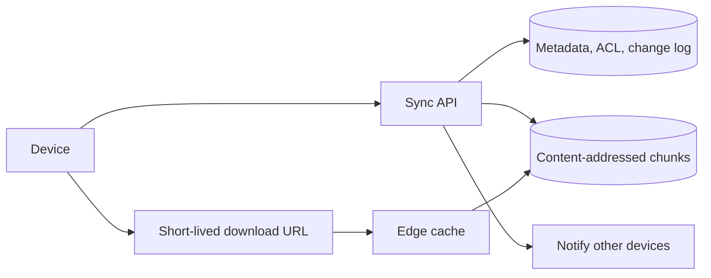
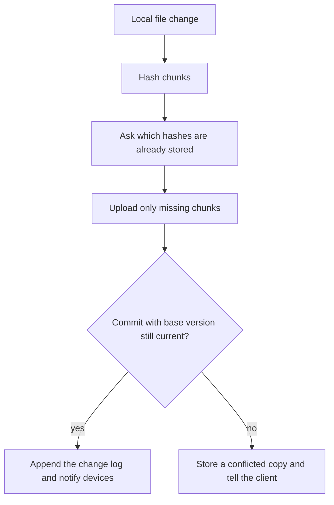
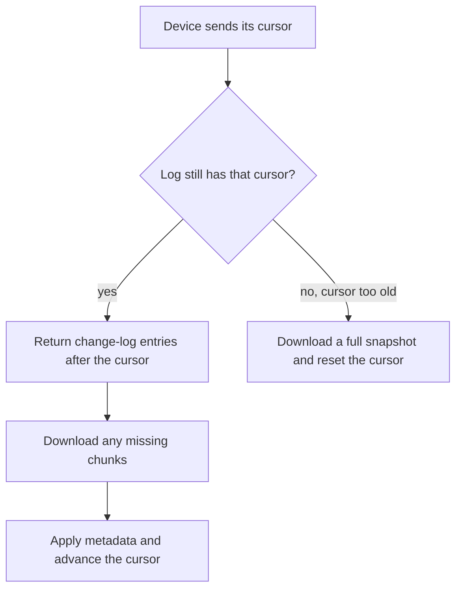

# Design Google Drive

Study notes for interview practice. Separate metadata from bytes. Sync is a cursor, not "scan the user's whole disk on every poll."

Aligned with chapter 15. Original revision guide, not a copy of the chapter.

## How to present

Clarify: file sync across devices, sharing, and conflict behavior. Then draw metadata versus block storage. Deep dive on the sync protocol and on conflicts. Uploads of large files should be resumable and chunked.

Say this:

> A sync service. File bytes live in block storage, deduped by hash. Metadata (name, parent, permissions, version) lives in a database. Each device syncs by asking for changes after a cursor. I assume strong consistency for metadata and eventual upload of bytes, and I will walk through what happens when two devices edit the same file offline.

## What to remember

- Metadata and content have different shapes. Do not store file bytes in the database. Do not store the folder tree only inside the object store.
- Large files are chunks. A file version is an ordered list of chunk hashes. Identical chunks across files are stored once.
- Upload is resumable: presigned or session-based, chunk by chunk, commit at the end.
- Sync is incremental. The server keeps a change log. The client sends its cursor and receives the delta.
- Presence of a "latest" version is a metadata decision. Conflicts become a new version or a conflicted copy, not a silent overwrite, unless product explicitly wants last-write-wins.
- Sharing is an ACL on the metadata row, checked on every download URL you mint.
- Clients can be offline. The interesting bugs are offline edits, not the happy path.

## 1. Problem statement and requirements

**Functional**

- Upload, download, delete, rename, and move files and folders.
- Sync a folder across devices for one user.
- Share a file or folder with another user, view or edit.
- See history enough to recover a conflict or a recent version. Full infinite versioning can be optional; say which you are doing.

**Non-functional**

- Metadata operations are low latency and strongly consistent: after a rename returns, every device that syncs sees it.
- Large upload (multi-GB) resumes after the laptop sleeps. It does not restart from byte 0.
- High durability for bytes. A single disk failure must not lose a file.
- Assume 50 million users, many mostly idle, some with tens of GB. Sync traffic is bursty per device, modest in aggregate compared with YouTube.
- Permission checks cannot be skipped because the CDN has the bytes.

**Out of scope**

- Real-time collaborative editing of a document (that is an operational-transform or CRDT system). This design is file sync, whole-file or chunk versions.
- Photo-specific features and search inside documents.
- A desktop file-system driver. We design the service the client talks to.

**Assumptions**

- Average user stores 10 GB. Active files are a small fraction.
- A file change uploads the changed chunks, not the whole file, when the client can compute chunk hashes.
- One metadata region is the source of truth. Edges cache downloads.

## 2. Back-of-envelope estimation

- Users: 50 million. Allocated if everyone stored 10 GB: 500 PB. They will not all be full, and dedupe plus compression reduces unique bytes. Still plan for hundreds of PB of object storage. This is the number that says "block store, not a database."
- Metadata: 50e6 users * say 10,000 files * 1 KB of metadata ≈ 500 TB of metadata in the pessimistic "power user" average. That is high and worth shrinking out loud: many users have far fewer files. Even at 500 TB, metadata is a partitioned database problem, two orders of magnitude under the bytes, and it is the hot working set only for recent changes.
- Daily sync: suppose 5 million DAU each change 20 files of which the upload is 5 MB of new chunks. Ingress ≈ 5e6 * 5 MB = 25 TB/day. Comfortable next to the stored corpus.
- Download amplification: a shared file downloaded by many users. Cache at the edge by chunk hash. The hash is immutable, so caches can be long-lived.
- Change log: one event per metadata mutation. 5e6 * 50 events/day * 200 bytes is about 50 GB/day. Tiny. The log is how sync stays incremental. Retain it long enough for offline laptops (weeks or months), then snapshot and compact.

QPS of metadata reads from open clients polling or holding a stream: if 1 million clients ask for changes every 30 seconds, that is about 30,000 polls/sec. A websocket or long poll keyed by user drops empty polls. Mention that you would rather push "cursor moved" than have every client poll. Either works at this number; push is the better design.

## 3. High-level architecture

### Architecture



### Upload flow



### Sync flow



### Whiteboard sketch

```
client
  -> sync API
       -> metadata DB (namespace, ACL, file -> chunk list, change log)
       -> block store (content-addressed chunks)
       -> notification (tell other devices the cursor moved)

download:
  client -> API mints a short-lived URL if ACL passes
         -> edge cache / block store by chunk hash
```

**Upload a new version**

1. Client splits the file into chunks (for example 4 to 8 MB) and hashes them.
2. It asks the API which hashes are already stored.
3. It uploads only missing chunks, with resume tokens.
4. It commits metadata: file id, new version, ordered chunk list, size, client revision. This commit is the atomic publish. Until it lands, the previous version remains the one other devices see.
5. API appends a change-log entry and notifies other devices.

**Sync a device that was offline**

1. Device sends its cursor.
2. API returns change-log entries after that cursor: creates, deletes, renames, new versions, ACL changes.
3. Device downloads any chunks it does not have, applies metadata, advances the cursor.
4. Local edits the device made while offline are uploaded as new versions after it has seen the server state, so it can detect a conflict.

**Read path for a shared link**

1. Resolve the file id and check the principal against the ACL.
2. Return chunk hashes and short-lived download URLs, or a single URL if you assemble server-side for small files.
3. Do not use an unguessable URL alone as authorization unless it is time-limited and bound to the permission. Leaked links are a classic failure.

## 4. Deep dive

### Metadata model and the change log

You need:

- A namespace (user or shared drive) and a tree: nodes with parent id, name, type.
- A file's current version pointing at an ordered list of chunk hashes.
- An ACL: user or group, role.
- A monotonic change log per namespace.

**Chosen: metadata commits are transactional in one partition per namespace.** A rename and the change-log append commit together. Devices trust the log order. The cursor is the log sequence.

**Rejected: "list the whole folder and diff" as the sync protocol.** Simple, and it gets worse as the user grows. It also misses deletes unless you compare full snapshots. The log makes deletes explicit.

**Rejected: storing the tree as files in object storage only.** Listing and atomic rename become awkward, and permissions want a real query. Object storage is for chunks.

Partition key is the namespace (the owner or the shared drive), not the global file id alone, so one user's sync does not scatter across dozens of transactions. A file shared widely still has one home namespace; the ACL lets others in. Hot shared drives can be a hotspot. Call that out.

### Chunks and dedupe

Content-addressed storage: the key is the hash. Upload of a chunk that already exists is a metadata no-op. Copying a file inside the product is a metadata copy of the chunk list, instant, with reference counts or garbage collection later.

**Chosen: fixed-size chunks with a hash.** Simple resume, simple dedupe, good enough.

**Also valid: content-defined chunking** (split on a rolling hash so an insert in the middle does not shift every boundary). Better dedupe for edited documents, more complex. Mention it as the upgrade if storage cost of shifted chunks shows up. Do not start there unless the interviewer is a storage person.

Reference counting must be careful. A chunk is garbage only when no version points at it and no in-progress upload needs it. Garbage collect lazily. A wrong GC is permanent data loss. Prefer a long grace period.

### Conflicts

Two laptops edit the same file offline, both based on version 7.

**Chosen policy: the first commit to land becomes version 8. The second commit, which still says "based on 7," is rejected and stored as a conflicted copy (or the client is told to rebase).** No silent last-write-wins for a user's only copy of a document.

The client uploads its bytes (those chunks may already be stored), then the metadata commit carries `base_version = 7`. The server does a compare-and-set. Success means you were still on the tip. Failure means the client must create "file (conflicted copy)" or merge if it knows how.

**Rejected: last-write-wins by timestamp.** Easy, and one user's edits disappear. Acceptable for caches and some app settings, not for a drive product, unless you have a strong version history the user can still see. If you have full history, last-write-wins on "current" plus retained versions is a reasonable alternative. Say that history is what makes it acceptable.

**Rejected: a distributed lock that stays held while the user edits.** Users are offline. The lock will be wrong.

## 5. Trade-offs and alternatives

**Push-based sync versus polling**

| Server notifies the device that the cursor moved | Device polls every N seconds |
| --- | --- |
| Low latency, fewer empty requests | Simple through NATs if the client always initiates |
| Needs a connection or a push channel per device | Battery and QPS cost if N is small |
| Connection death must fall back to poll | Latency is the poll interval |

Pick notification when a socket is up, and polling as the fallback. Do not depend on push alone; mobile networks drop it.

**Strong metadata, eventual bytes versus a fully synchronous upload**

| Commit metadata only after all chunks are stored | Stream into the database-backed file and update as you go |
| --- | --- |
| Other devices never see a half file | Simpler mental model for tiny files |
| The uploading device can still show local progress | A crash publishes a corrupt partial |
| Matches resumable upload | Does not match multi-GB files |

Always commit after chunks are durable. Small text files can use the same protocol; do not build a second one.

## 6. Bottlenecks, failure modes, mitigations

- **Hot namespace.** A corporate shared drive with thousands of simultaneous editors. One metadata partition becomes the bottleneck. Shard a very hot drive, or split change logs by subtree. Do this when you see it, not in v1 for every user.
- **Chunk GC bug.** Data loss. Grace period, and GC that only deletes hashes absent from a full metadata scan or a maintained refcount you trust. Refcounts drift; a periodic scanner is the safety net.
- **Permission change not reflected in a cached download URL.** URLs must expire quickly, and the API must check ACL at mint time. A long-lived public URL is a leak.
- **Client cursor older than the retained log.** Return "snapshot required." The client downloads a full namespace listing and resets the cursor. Compact the log so this is rare, and support it so it is not fatal.
- **Two devices, same file, flapping conflict copies.** Product quality issue. Show a clear conflict and stop auto-renaming forever. Server-side, the compare-and-set rule is enough to be correct.
- **At 10x storage.** Block store scales horizontally; cost is the problem. Dedup, cold storage for chunks not read in months, and fewer versions retained for free accounts.
- **At 10x sync QPS.** The change log and metadata partitions scale by namespace. Notification fanout for a file shared with 100,000 people starts to look like the notification system. Do not walk 100,000 sockets inside the metadata transaction. Append the log, then fan out asynchronously.

Single points of failure: one metadata primary with no replica, a block store without erasure coding or replication, a sync protocol that uses wall clocks instead of a cursor. The API tier is stateless.

## 7. Open questions

- Version retention: every save forever, or the last N, or a time window? This is a cost and a user-trust decision.
- Is a folder share the same ACL inherited by children, and what happens to a child that was moved out? Inheritance bugs are the real sharing bugs. Get the rule in words before you schema it.
- Do we need per-file locks for Office-style "Sarah is editing"? That is a lease on top of this design, not a replacement for conflict copies.
- Compliance: encryption keys per tenant, region pinning of chunks, and legal hold that disables GC. Any one of these changes storage layout.
- What is the client allowed to do with chunks it cannot decrypt, if we add end-to-end encryption later? Server-side dedupe and end-to-end encryption fight each other. Flag that if they ask about zero knowledge. You would turn dedupe off or only dedupe inside one user's key.
