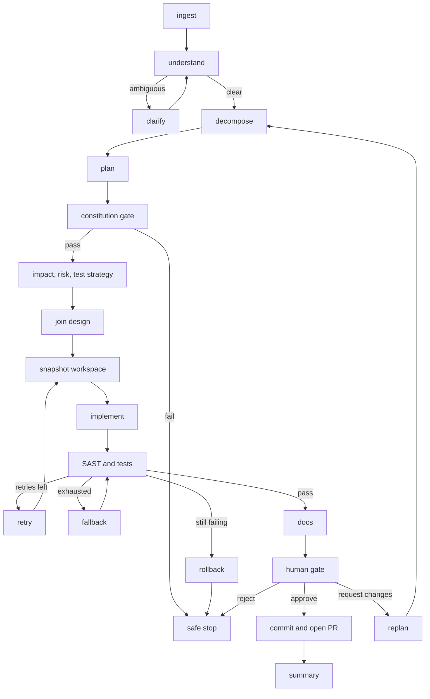

# Agentic SDLC orchestrator

Study notes from `interviews/langgraph4j-url-shortener`. The graph is the control plane. The URL shortener is the data plane. Do not present the graph as if it were the shortener's production architecture.

## How to present

Say this:

> A requirement enters a state graph. Ambiguous requirements loop through a clarify interrupt. A constitution gate can stop the run before any code is written. Impact, risk, and test strategy run in parallel, then join. Implementation is validated with SAST and tests. A human gate approves, requests changes, or rejects. Approve copies product files and opens a pull request. The graph never merges.

## What to remember

- Same graph for canned scenarios and live runs. Canned nodes use a catalog. Live nodes call a local agent worker. Gates do not change.
- Interrupts are `interruptBefore` on clarify and on the human gate. Resume is `GraphInput.resume` in the same JVM, with an in-memory checkpointer keyed by thread id.
- Quality routing: pass goes to docs then human review; retries go back to a fresh workspace snapshot; exhausted retries try a fallback then re-validate; remaining failure rolls back and stops.
- Human review: approve publishes, request-changes replans into decompose, reject stops.
- Publish commits only `com.example.shortener` product and test files and pushes a branch. It does not merge.
- Storage of the product is in-memory. The checkpointer is in-memory. Neither is a production durability story.

## 1. Problem statement and requirements

**Functional**

- Accept a change request and decide whether it is clear enough to plan.
- Plan only if it passes a written constitution.
- Implement against a snapshot of the workspace, then validate.
- Stop safely on policy failure, exhausted quality failure, or human reject.
- On approval, publish a reviewable branch.

**Non-functional**

- The control flow is explicit and replayable inside one process.
- Parallel design work joins before implementation starts.
- A failed validation must not leave a half-applied tree as the published result.

**Out of scope**

- Multi-user orchestration, a durable workflow engine, and merging to main.
- Scaling the URL shortener itself. That is [the in-memory service](url-shortener-in-memory.md) and, at interview scale, [chapter 8](../08-url-shortener.md).

## 2. Back-of-envelope estimation

This design is latency of a software run, not QPS.

- A live run is one graph execution per requirement. The expensive steps are agent calls and `mvn test`, minutes, not milliseconds.
- Checkpoint state is one thread in `MemorySaver`. Losing the JVM loses the ability to resume that thread.
- Fan-out is three nodes (impact, risk, test strategy), then a join. That is a correctness barrier, not a capacity plan.

## 3. High-level architecture

### Architecture



### What each plane owns

```mermaid
flowchart LR
  req[Requirement] --> graph[LangGraph4j state graph]
  graph --> agents[Catalog or local agent worker]
  graph --> workspace[Workspace snapshot]
  workspace --> product[URL shortener Java]
  graph --> git[Branch and pull request]
```

The product never calls the graph. The graph calls into the product tree only at validate and publish.

## 4. Deep dive

### Gates before code, and a gate before merge

**Chosen: constitution check after the plan, human check after validation.** A policy failure never spends an implement step. A green test run still cannot publish itself.

**Rejected: agent implements immediately, human reviews the PR only.** Faster, and a constitution violation is already in the diff. The graph exists to make that class of change stop earlier.

### Validate, then publish a narrow diff

Live validate runs SAST on the workspace and overlays generated Java onto a temp copy of the module, then runs the shortener tests. Approve copies workspace Java into `src/`, commits only the shortener product and tests, and opens a PR.

**Rejected: commit the whole workspace, including orchestrator edits.** The data plane and the control plane would ship together, and a bad agent edit to the graph could land beside a product fix.

## 5. Trade-offs and alternatives

**In-memory checkpoint versus a durable workflow store**

| MemorySaver in one JVM | Durable checkpointer |
| --- | --- |
| Resume works for `--interactive` in that process | Resume survives deploys and crashes |
| No extra infrastructure | You now operate workflow state |
| Enough for a demo and an interview walkthrough | Required if humans approve hours later |

Pick memory for this repo. Say you would move the saver before any shared runner.

**Canned catalog versus live agents**

| Catalog templates | Local agent worker |
| --- | --- |
| Deterministic, no API key | Can implement a new feature or bugfix |
| Same edges and gates | Same edges and gates |
| Cannot invent a design | Can fail validation and consume retries |

The point of the design is that the second row stays true. If live mode skips the constitution gate, the graph is decoration.

## 6. Bottlenecks, failure modes, mitigations

- **JVM dies during human review.** The interrupt cannot be resumed. Mitigation is a durable checkpoint, not a retry of the whole run from scratch unless the workspace snapshot was saved outside the process.
- **Validate loop.** Retry reseeds from snapshot so a bad edit does not compound. Fallback is one more validation pass, then rollback. Unbounded retry is rejected.
- **Agent edits files outside the product package.** Publish filters the commit. Validation should still fail closed if the overlay cannot compile.
- **At 10x concurrent requirements.** One in-memory graph per process will not do. Separate runner workers, a durable saver, and a queue of thread ids. The graph shape stays.

## 7. Open questions

- Who is allowed to approve, and is that identity checked or only a CLI flag?
- How long may a thread sit at the human interrupt before it is expired?
- Does SAST failure and test failure share one retry budget? They do in the current routing. A security failure might should stop sooner.
- Should publish be able to target a fork or a draft PR only? The graph never merges; the hosting policy around the PR is still a team decision.
