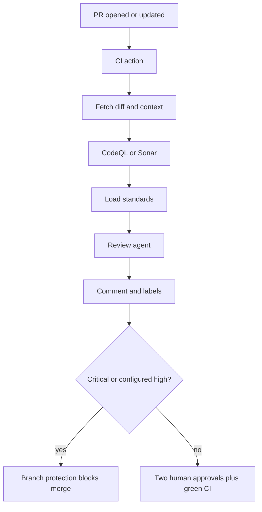

# AI code review gate

Study notes from `interviews/AI Augmented Lead/projects/02-ai-code-review-gate`. A CI check, not a code generator. Org shape in the notes: about 200 developers, 30 repos. Two human approvals stay required.

## How to present

Say this:

> On pull request open or update, an action fetches the diff, runs CodeQL or Sonar, then an agent reviews against our standards. It posts a structured comment and a label. Critical findings block merge through branch protection. The agent never approves. Diffs over about 800 lines are chunked, not skipped. Secrets are scrubbed before the model sees the diff. The review JSON is kept for the retention window.

## What to remember

- Order: diff, static scan, standards, model, comment, label.
- Critical blocks. High can block if configured. Medium warns. Low is a comment.
- Output is JSON: verdict, findings with file, line, CWE, suggestion, plus test gaps.
- Humans still need two approvals. The AI label is not an approval.
- False positives get tuned. The notes cite about 11% on HIGH after tuning. Treat that as a case-study figure, not a law.
- A single agent is enough. There is no graph.

## 1. Problem statement and requirements

**Functional**

- Review every pull request for auth, validation, and known vulnerability classes.
- Comment on the lines and set a label.
- Block merge on critical static findings.

**Non-functional**

- The check is async on the pull request. It does not sit on the developer's keystroke path.
- A model outage must not be a silent pass.
- Review artifacts are retained.

**Out of scope**

- Writing the fix. That is [spec-to-PR](spec-to-pr-agent.md).
- Replacing human reviewers.

## 2. Back-of-envelope estimation

- 50 or more pull requests a day in the problem statement, across 30 repos. Each review is one diff plus one model call plus the scanners you already run.
- Cap the review window at about 800 lines so one giant pull request cannot dominate cost or context. Chunking multiplies calls; skipping would create a bypass.
- The expensive part is still the static scanner. The model is a second opinion on the diff and the scanner output, not a replacement for CodeQL.

## 3. High-level architecture

## 4. Deep dive

### Scanner first, model second

The agent sees the diff and the scanner results. It should not be the only thing looking for injection or missing authorization. Structured output forces file, line, severity, and CWE, so a comment is actionable and a label is mechanical.

**Rejected: model-only review.** It misses patterns the scanner already knows and it cannot be your SOX control.

**Rejected: scanner-only.** It will not say "this new endpoint has no test for 401." That is the gap the agent is allowed to add.

### Fail closed on the check, never auto-approve

If the action errors, branch protection should treat the check as failed or pending, not as success. The bot identity is not in the approvers list.

**Rejected: the agent applies the approving review.** One prompt injection in the diff approves itself.

### Chunk large diffs

Over the line cap, review in chunks and combine findings. Do not label pass because the diff was large.

## 5. Trade-offs and alternatives

**Block on HIGH versus warn on HIGH**

| Block | Warn |
| --- | --- |
| Fewer missed issues | Less friction |
| False positives stall merges | Humans can ignore the label |
| Needs a tuning loop | Easier to roll out |

The notes block CRITICAL always, and make HIGH configurable. Start HIGH as warn for two weeks, measure false positives, then block. Say that rollout. A day-one hard block at 11% false positive will get the gate turned off.

**PR comment versus a separate review service**

| GitHub Action on the PR | Central review API |
| --- | --- |
| Diff and permissions are already there | Easier cross-repo metrics |
| Each repo copies the workflow | One place to change the prompt |
| Artifacts live with the PR | You must build auth to every repo |

Start with the action. Promote to a service when 30 copies of the workflow drift.

## 6. Bottlenecks, failure modes, mitigations

- **Secret in the diff.** Scrub before the model call. Still block the PR if a secret scanner hits.
- **Model timeout.** The check stays pending or fails. It does not flip to pass.
- **Comment spam on every push.** Review the latest commit, collapse older comments, or developers will mute the bot.
- **Standards drift.** Load the repo's rules each run. Do not bake last quarter's checklist into the prompt only.
- **At 10x pull requests.** Queue the action. Scanners remain the bottleneck. The schema of the review does not change.

## 7. Open questions

- Does a force-push dismiss the old label? It must, or a later commit skips the gate.
- Are generated test files in the review window or excluded?
- Who tunes false positives, and how fast can a bad rule be disabled without a deploy of every repo?
- Is the review JSON in the action artifact enough for a 7-year audit, or does it need the immutable log from the [platform](enterprise-ai-sdlc-platform.md)?
