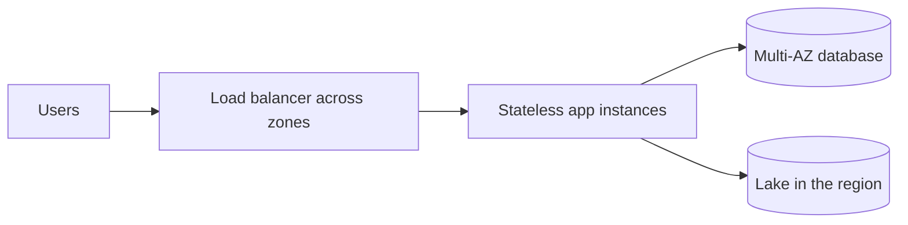
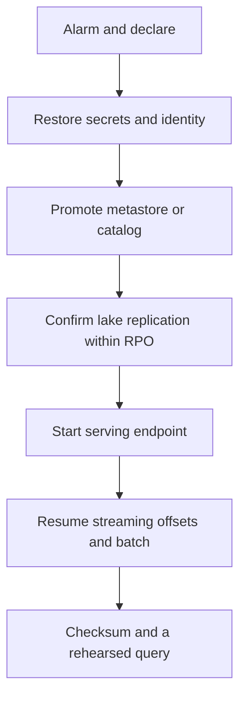

# Multi-AZ service, region loss, and disaster recovery

Study notes from the verbal cards in `interviews/AWS-SolutionsArchitect/prep/07_VERBAL_DESIGNS.md`, with the recovery numbers from the self pitch: about 15 minutes RPO and under an hour RTO, on a platform that is Spark on EMR, Delta on S3, Kafka, and a Java control plane. Ask before you treat those numbers as the customer's.

## How to present

Say this:

> Inside one region I start with three tiers across availability zones: a load balancer, a stateless app tier, and a multi-AZ database. That survives a zone, not a region. For region loss I ask for RPO and RTO. Fifteen minutes and under an hour is pilot light or warm standby, not active-active. I recover in order: secrets, metastore, data, the query or serving layer, then the jobs. I rehearse it. Checksums tell me the restore is the data I think it is.

## What to remember

- Multi-AZ is the default. Multi-region is a business target, not a diagram you add for style.
- Stateless app instances. State in the database, the lake, and the log. Otherwise failover is a scavenger hunt.
- RPO 15 minutes means you cannot rely on a nightly snapshot alone. You need a log or a replication lag inside that window.
- RTO under an hour means the standby must already exist: accounts, network, images, and a documented sequence. It does not require serving traffic in both regions all day.
- Active-active is for an RTO of minutes and for clients that can tolerate two writers. Say when you would not do it.
- Restore order matters: identity and secrets, catalog or metastore, bytes, serving, jobs.
- A backup you have not restored is not a design.

## 1. Problem statement and requirements

**Functional**

- Keep a three-tier service up through one availability zone failure.
- Recover the data platform in another region inside the agreed RPO and RTO.

**Non-functional**

- Zone failure: no manual DNS heroics. The load balancer and the database already span zones.
- Region failure: RPO about 15 minutes, RTO under about 1 hour, if that is the target they confirm.
- Recovery is ordered and rehearsed.

**Out of scope**

- Active-active writes for the first design.
- Claiming a trading-venue recovery objective.

## 2. Back-of-envelope estimation

- A zone failure should be a client retry, seconds to a small number of minutes, if the database fails over automatically and the app has no local disk state.
- 15 minute RPO on a lake: continuous replication or commit logs shipped at least that often. A 10 TB/day platform is about 7 GB an hour average, so 15 minutes is on the order of a couple of GB of new data plus the transaction log. The hard part is the metastore and the offsets, not the gigabytes.
- RTO under an hour is mostly human and sequence time: detect, decide, promote, smoke-test. If detection takes 40 minutes, the technology never had a chance. Alarm first.

## 3. High-level architecture

### One region

### Region loss

## 4. Deep dive

### Zone versus region

Multi-AZ database and a load balancer handle a zone. The application must be stateless or session state must live in a store that is also multi-AZ. A region loss throws away that whole stack. Design the second region only after the zone story is boring.

**Rejected: one big instance in one zone.** A zone event is an outage. There is nothing to fail over to.

**Rejected: active-active as the answer to "be highly available."** Two writers need conflict rules. Most internal platforms do not have them. Pilot light meets a one-hour RTO at lower cost.

### Recovery order

Secrets and identity first, or the new region cannot read the data even if the bytes are there. Metastore next, or the bytes are an unreadable pile. Data next, checked against the RPO. Serving next. Jobs last, from a recorded offset, so you do not replay a day of Kafka into a report.

**Rejected: start the Spark jobs first.** They will write against the wrong catalog or duplicate a partition.

### Proof

Checksums on the restored snapshot, a known query, and a clock on the drill. Write down the last drill date. The design includes the drill.

## 5. Trade-offs and alternatives

**Pilot light versus active-active**

| Pilot light or warm standby | Active-active |
| --- | --- |
| Fits RTO under an hour | Fits RTO of minutes |
| One writer, simpler RPO | Two writers, conflict and split brain |
| You pay for a small standby and replication | You pay for two full stacks |
| Failover is a decision | Failover can be automatic and wrong |

Pick pilot light for the 15 minute / 1 hour target. Move hotter only if they pay for the RTO and accept the consistency story.

**Continuous replication versus frequent snapshots**

| Replication lag under 15 minutes | Snapshots every few hours |
| --- | --- |
| Meets this RPO | Misses a 15 minute RPO |
| Lag is a metric you page on | Simpler and cheaper |
| Failover promotes a live copy | Failover restores and you lose the window |

Snapshots still matter for corruption. Replication copies corruption too. You want both: a short lag for the RPO, and a point-in-time copy for "we wrote bad data."

## 6. Bottlenecks, failure modes, mitigations

- **Detection is slower than the RTO.** Page on region health, not on a customer ticket.
- **Metastore not in the replication set.** The lake fails over and no table resolves. Include it in the drill.
- **Offsets not stored with the data.** Streaming resumes from the wrong place and double-counts. Record the offset you are willing to replay.
- **Stateful tasks on local disk.** They do not come back on a new instance. Push state to the database or the log.
- **At a tighter RTO.** Then, and only then, discuss active-active and client failover. Do not redesign the steady state in the last five minutes.

## 7. Open questions

- Are 15 minutes and one hour the customer's targets, or the platform you already run? Ask.
- What is in the RPO: lake tables only, or also the control-plane database and Kafka?
- Who is allowed to declare a region failover?
- Is corruption in scope, or only a region outage? The answer changes whether replication alone is enough.
