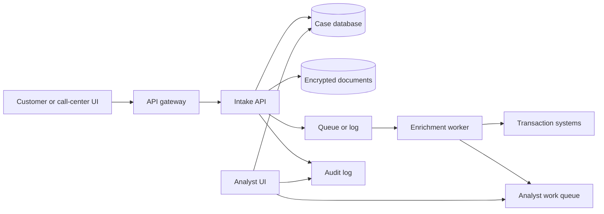
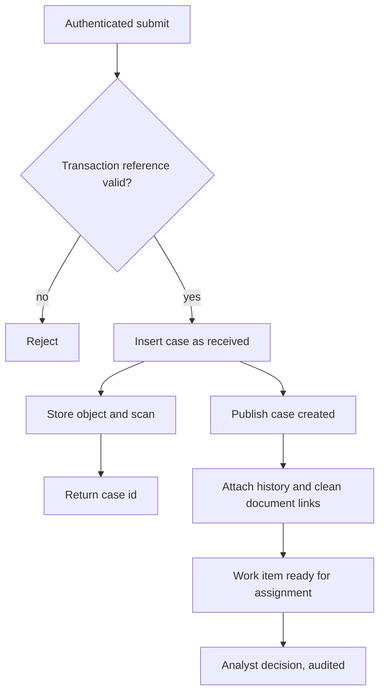

# Bank dispute intake

Study notes from the verbal design in `interviews/AWS-SolutionsArchitect/prep/07_VERBAL_DESIGNS.md`. This is a case workflow, not a claim that you have run a disputes org. The design judgment is intake, documents, audit, and not doing the investigation inside the submit call.

## How to present

Say this:

> A dispute is a case: who, which transaction, why, documents, and a status you can audit. The submit API authenticates, writes the case to a database, and puts files in encrypted object storage. It returns a case id. It does not score fraud in that request. An event wakes a worker that attaches recent transactions and the scanned documents and creates a work item. Analysts assign, decide, and every view is logged. Batch is for rescore and extracts, not for the acknowledge SLA.

Then stop and ask whether they want documents, the analyst queue, or enrichment.

## What to remember

- Case metadata in a database. Files in S3, keyed by case id, encrypted, scanned before they are marked clean.
- Submit is fast. Investigation is async.
- Kafka or SQS so a spike in disputes does not tie up the channel, and so enrichment can retry.
- Analyst UI reads a work queue, not a bucket.
- Auth on intake and on the analyst app. Least privilege. TLS. Private subnets.
- API scale follows request rate. Workers scale on queue depth.
- Do not call the API framework the frontend. Do not lead with Kubernetes.

## 1. Problem statement and requirements

**Functional**

- Accept a dispute and its documents from a customer or a call center.
- Hand a complete case to an analyst: history, files, timeline.
- Record the decision and who saw the case.

**Non-functional**

- Acknowledge quickly. The SLA is on intake and assignment, not on finishing the investigation inside HTTP.
- Documents are malware-scanned before an analyst opens them.
- The case is searchable by status, age, and amount. Object storage is not the system of record.

**Out of scope**

- The fraud model's training pipeline.
- Core banking ledger design. You integrate with it; you do not replace it.
- Pretending this is a system you operated at a bank.

## 2. Back-of-envelope estimation

The notes do not give a rate. Offer assumptions and wait.

- If 100,000 disputes a day arrive in business hours, that is well under 10 creates a second average, with a peak after a incident. The API is easy. Document size and scan time are the burst.
- A 10 MB file times a peak of 20 uploads a second is about 200 MB/s into object storage. Do that on a direct upload, not through the API process.
- The queue depth, not CPU, tells you how many enrichment workers to run.
- Audit logs grow with views, not only with creates. Analysts opening cases is the larger write if you log every view, which you should.

## 3. High-level architecture

### Architecture

### Submit versus investigate

## 4. Deep dive

### Split the record and the bytes

The database holds ids, status, reason, timestamps, and the object keys. S3 holds the bytes. You can list, assign, and report SLA from the database. You cannot do that from a bucket without building a worse database beside it.

**Rejected: the case is only an object.** Search, assignment, and status transitions become list-and-parse.

**Rejected: the file bytes in the database.** Backups, scans, and large uploads get expensive and slow.

Direct upload with a short-lived URL keeps the API from proxying the file. The case is not "complete" until the scan marks the object clean. Analysts do not get a link before that.

### Async enrichment

The submit path writes the case and the event. A worker calls the systems of record for recent transactions, checks scan status, and inserts the work item. Retries are safe if the work item is idempotent on case id.

**Rejected: fraud analysis inside the POST.** Timeouts, partial writes, and a channel outage when the model or the core is slow.

**Rejected: only a nightly batch.** That misses an acknowledge SLA measured in hours or less. Keep batch for rescore, backfill, and regulator extracts.

## 5. Trade-offs and alternatives

**Queue versus synchronous enrichment**

| Event and worker | Enrich before the HTTP response |
| --- | --- |
| Channel stays up when core banking is slow | Analyst sees a full case immediately |
| The customer gets an id and a status of received | Submit latency is the slowest dependency |
| Retry and dead-letter are normal | A failure leaves no case or a half case |

Async. If product wants the analyst to see history within a minute, that is a worker SLO, not a reason to block the customer.

**Kafka versus SQS**

| Log | Queue |
| --- | --- |
| Replay and more than one consumer | Simple work queue, one successful processing |
| You operate ordering and retention | Retry and dead-letter are built in |
| Fits if analytics also reads the dispute stream | Enough if only the enricher cares |

Either is valid. Pick the queue unless a second consumer must read the same history. Say that, and do not list both as if they were one box.

## 6. Bottlenecks, failure modes, mitigations

- **Scan backlog.** The case exists, the file is not clean, the analyst sees "pending scan." Do not block the ack on the scanner.
- **Duplicate submit.** Idempotency key from the client so a retry does not open two cases for one transaction.
- **Enrichment poison message.** Dead-letter and an operator view. The case stays in `received` so it is visible, not lost.
- **Broken access check on the analyst UI.** Customer documents are the sensitive part. Auth on both doors, encryption, and an audit of views.
- **At 10x after a public incident.** Pre-signed uploads and worker autoscaling on depth. The case table is still small. The object store and the scan queue are what grow.

## 7. Open questions

- What is the acknowledge SLA versus the decision SLA? They size different parts of the system.
- Who may upload: the customer, a call-center agent, or both? Authorization differs.
- Is the transaction system allowed to be called at enrich time, or only from a replica?
- How long are documents retained after the case closes, and who can delete them?
