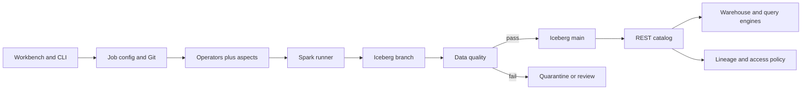
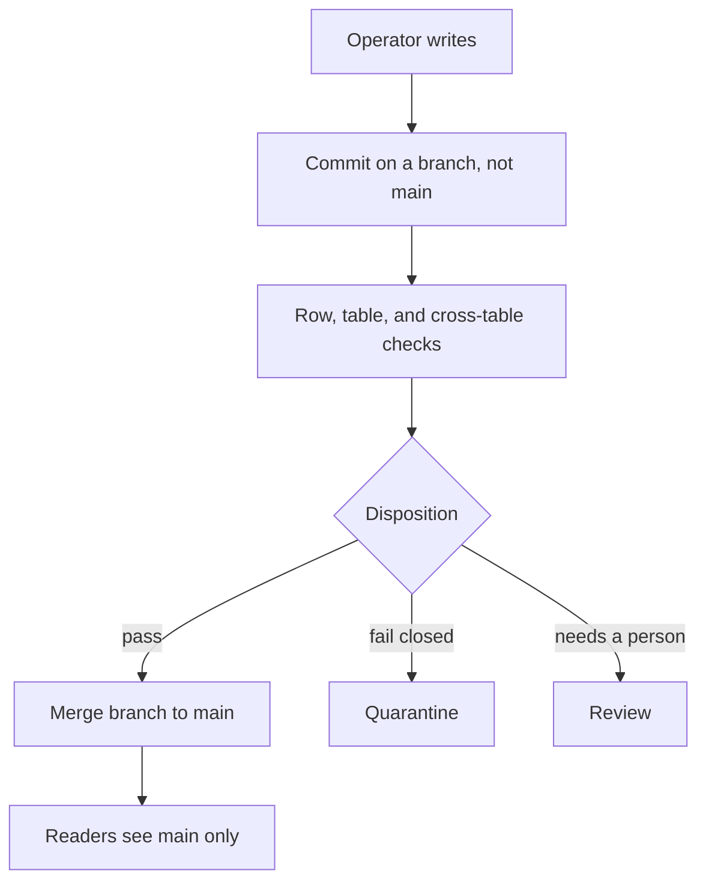

# DEHub data operator platform

Study notes from `interviews/WEX - SeniorStaff - DataPlatform` (DEHub architecture, plus the Iceberg and Write-Audit-Publish material in the Spark deep dive). This is a lakehouse framework, not a single job.

## How to present

Say this:

> Business logic is an operator: datasets in, datasets out. Logging, retries, metrics, and access checks are aspects on the framework, not copy-pasted into every job. The same operator runs in batch and streaming. Spark is the compute, behind a runner that can sit on more than one cloud. Tables are Iceberg. A write lands on a branch, data quality runs, and only then does it merge to main. Readers never see unaudited data. Snowflake and other engines read the lake; they are not the system of record.

## What to remember

- Contract: `process(session, map of datasets, context) -> map of datasets`. Config chooses inputs so a data engineer does not write plumbing.
- Named operators: filter, join, match-and-merge (canonical id and survivorship).
- Aspects: logs, metrics, retry, ACL, and an execution record (pipeline, version, run id, git hash, image, cost, owner).
- Write-Audit-Publish: Iceberg branch, quality checks, then merge, quarantine, or human review.
- Quality has three scopes: row rules, table rules (unique key), cross-table rules (inclusion).
- Catalog is open (Polaris-style REST in the notes). Lineage and masking sit beside it.
- Orchestration: a scheduler for batch, long-running compute for streaming, same operator code.
- Compaction and small files are an operations problem on the lake, not something each job invents.

## 1. Problem statement and requirements

**Functional**

- Author a pipeline once, from a UI or from code, and run it as batch or stream.
- Land curated tables that other engines can read.
- Audit who ran what, and block bad data before it becomes current.
- Support restatement: rerun a window with the recorded config.

**Non-functional**

- Cloud-agnostic compute wrapper. Spark is the engine you defend; a native accelerator is optional later.
- Payments-grade access control on tables, not only on the warehouse login.
- Idempotent operators so a retry does not double-apply.

**Out of scope**

- Replacing the warehouse as a BI tool. It stays a consumer.
- A new query engine on day one.

## 2. Back-of-envelope estimation

Use a payments-scale sketch and label it as assumed, because the DEHub notes do not give a single traffic number.

- A daily batch of a few tens of terabytes is a file-layout problem: aim for files large enough that a task has real work (on the order of 128 MB to 1 GB compressed, depending on the cluster). Thousands of tiny files means the driver spends the job in planning.
- Streaming is sized by partitions and checkpoint interval, not by "one giant batch every night."
- WAP doubles the short-lived data for a branch. Budget lake storage for the branch plus snapshots, and expire snapshots on a policy.
- Cross-table quality checks are shuffles. They are cheaper than a bad merge, and they are too expensive to run on every micro-batch if you do not scope them. Say which checks are per batch and which are per streaming trigger.

## 3. High-level architecture

### Architecture

### Write-Audit-Publish

## 4. Deep dive

### Operators and aspects

An operator is a pure data transform. An aspect wraps it: time it, log the run id, retry a transient failure, and check that this identity may read the input tables. Match-and-merge is the one to be able to describe: incoming rows versus an accumulator, a canonical id, and survivorship when two sources disagree.

**Rejected: SQL scripts with logging copied into each notebook.** The second pipeline will forget the audit fields. The framework is the product.

**Rejected: a different code path for streaming.** Batch and stream diverge, and a bug fix lands in one of them. The Dataset-in, Dataset-out contract is what keeps one implementation.

### Write-Audit-Publish

Main is what consumers read. The job commits to a branch. Quality runs against that snapshot. Auto-merge only on success. A failed check does not rewrite main.

**Rejected: write straight to the current table and delete bad rows later.** Readers, and the warehouse, will see the bad snapshot. Time travel can undo it, and it cannot undo a decision a human already made from the bad rows.

**Rejected: a staging database outside the lake.** You now have two catalogs. A branch is the staging area, and the catalog stays one.

### Files, compaction, and restatement

Small files and skewed partitions are the usual Spark failure, not "need a bigger cluster" as the first answer. Compact on a schedule. Partition for the query (often event date), not for every column someone filtered once. Restatement reruns an operator with the stored config and run id; because the operator is idempotent and WAP merges a branch, a restatement is another audited commit, not an in-place overwrite you hope is correct.

## 5. Trade-offs and alternatives

**Open lake versus warehouse-as-truth**

| Iceberg as the table, warehouse reads it | Land only in the warehouse |
| --- | --- |
| More than one engine can read | One vendor, simpler for BI |
| You operate compaction and the catalog | The vendor operates storage |
| WAP and time travel are table features | Rollback is a warehouse feature you may not have |

The notes pick the lake so Snowflake stays a consumer. That is a lock-in decision. Say it as a decision.

**Branch per write versus partition overwrite**

| WAP branch | Overwrite a partition in place |
| --- | --- |
| Readers stay on the last good snapshot | Simpler, and readers see partial failure |
| Extra snapshots and files | Less catalog churn |
| Quality can block the merge | Quality can only alert after the fact |

WAP is the right default for payments data. Overwrite is acceptable for a rebuildable derived table that nobody treats as truth.

## 6. Bottlenecks, failure modes, mitigations

- **Small-file spiral.** Compact, and set a target file size on the write. A micro-batch that commits every few seconds without compaction will melt planning time.
- **Quality check too heavy for the trigger interval.** Run row checks on every commit and cross-table checks on a slower cadence, or WAP will miss its SLA.
- **Catalog or lock contention** on a hot table. One writer per branch; do not let two jobs merge the same table without a lock.
- **Aspect failure** (metrics endpoint down) must not fail a correct write, unless the aspect is access control. Split "must hold" aspects from "best effort" aspects.
- **At 10x data.** Same operators. More shuffle partitions, a compaction service, and a catalog that is not a single small database you forgot to scale. Streaming checkpoints need their own store.

## 7. Open questions

- Which quality failures auto-quarantine, and which page a person? The notes allow both and do not assign rules to classes.
- Is the workbench allowed to generate Spark that bypasses the operator SDK? If yes, aspects can be skipped. The design assumes one graph underneath both UX surfaces.
- Multi-cloud runner: one binary with different schedulers, or a cluster per cloud chosen at deploy? That changes identity and the catalog endpoint.
- Snapshot retention versus storage cost. Compliance may forbid expiring the snapshot you need for an audit.
