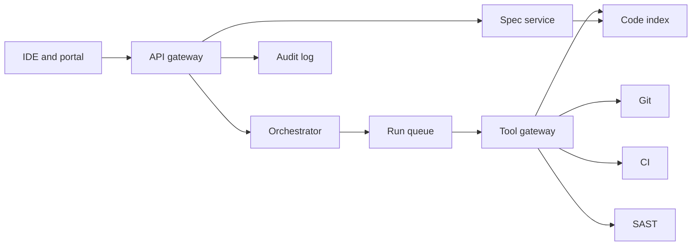
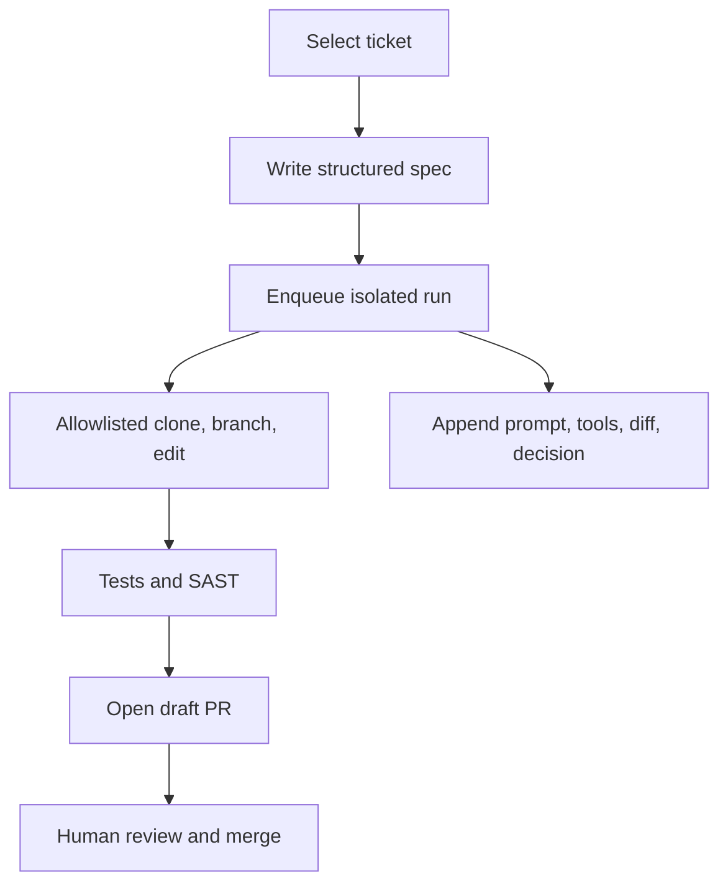

# Enterprise AI SDLC platform

Study notes from `interviews/AI Augmented Lead` (system-design patterns, plus the four project case studies). This is the platform around the agents. The coded LangGraph loop in the URL-shortener repo is a smaller cousin: [agentic SDLC](agentic-sdlc-orchestrator.md).

## How to present

Say this:

> About 200 developers, Java and .NET, Jira in and a draft pull request out. An API gateway authenticates. A spec service turns a ticket into a structured spec. An orchestrator runs the graph in a sandbox. Tools go through an allowlist: git, CI, SAST, and a code index. Nothing merges itself. An append-only audit log keeps the prompt, the tools, the diff, and the approval. If the model is down, the engineer still gets the spec and writes the code.

## What to remember

- Agents are async. A queue and a worker pool. A failed run does not block the developer.
- Tool gateway is the security boundary. The model does not hold production credentials.
- Quality gate is the same CI a human pull request runs, plus SAST.
- Human merge, two reviewers in the FinServ telling, plus the AI label where you use one.
- Audit retention on the order of 7 years. Citations for policy answers, not a bare model reply.
- Cost control is a token budget per team and a smaller model for lint and review.
- Large features can split into architect, developer, QA, and reviewer. A small bug stays one agent.
- 90 days: rules and a spec template, then a CI review gate, then spec-to-PR on one repo.

## 1. Problem statement and requirements

**Functional**

- Turn a ticket into a spec with acceptance criteria.
- Generate code and tests in an isolated workspace.
- Open a draft pull request.
- Record the run so an auditor can reconstruct it.

**Non-functional**

- No production secrets in prompts.
- Agent failure degrades to "spec only," not to a stuck pipeline.
- Concurrent runs are isolated per repo.
- Latency is async for pull requests. Interactive latency is only for the IDE.

**Out of scope**

- Auto-merge.
- Letting the agent deploy to production.

## 2. Back-of-envelope estimation

- 200 developers, a few pull requests a day each, is hundreds of agent runs a day, not thousands per second. The queue exists for bursts and for long runs, not for QPS.
- A run is minutes: clone, generate, test, scan. Worker count follows concurrent runs, not request rate.
- Token cost dominates server cost. Cache embeddings for the code index. Cap tokens per team or a single repo can spend the quarter on retries.
- Audit records are small next to build logs. Seven years of prompts and diffs is a storage and access-control problem, not a throughput problem.

## 3. High-level architecture

### Architecture

### One ticket

## 4. Deep dive

### The tool gateway

The model proposes a tool call. The gateway allows a fixed set: read and write on allowlisted paths, run the test command, call git and the CI API. Production credentials are not in the runner.

**Rejected: the agent shell has the developer's credentials.** A prompt injection in a ticket or a file becomes a production action.

**Rejected: no sandbox, edits on the default branch.** A bad run is immediately on main. Isolated branch, draft pull request, human merge.

### RAG for standards, with citations

"How do we do idempotency?" embeds the question, retrieves ADRs and code, and answers with links. In a regulated shop the answer is invalid without the citation. If retrieval misses, the agent says it does not know.

**Rejected: the model answers policy from weights.** It will invent an ADR number. That is worse than no answer.

### When to split agents

Architect produces a contract and a file list. Developer implements. QA reports coverage. Reviewer returns findings to a human. Use that when the change is large, on the order of more than about five files. A bug fix is one agent. More agents means more handoff artifacts to audit, which is the cost.

## 5. Trade-offs and alternatives

**Queue versus running the graph inside the IDE**

| Queued runner | IDE-only agent |
| --- | --- |
| Same CI as a human, audit is central | Fast for the person typing |
| A model outage does not freeze the laptop | Hard to enforce "no prod secrets" |
| Minutes, not keystrokes | Right for pair programming |

Use the queue for anything that opens a pull request. Keep the IDE for exploration.

**One orchestrator versus a different bot per phase**

| One graph with gates | Separate bots for spec, code, and review |
| --- | --- |
| One audit trail and one retry policy | Each bot is simpler |
| Harder to change one phase | Easy to skip a gate by accident |

One graph for spec-to-PR. The review gate in CI can be a separate, simpler agent because it does not write code. That split is [the review gate](ai-code-review-gate.md).

## 6. Bottlenecks, failure modes, mitigations

- **Model outage.** Serve the spec and stop. Do not block merges that do not depend on the agent.
- **Noisy repo.** Per-repo concurrency limits on the runner.
- **Retry loop.** Cap retries, then escalate to a human. The spec-to-PR note uses three.
- **Secret in a ticket.** Scan prompts and diffs before the model call and before the audit store.
- **At 10x developers.** More workers and a budget service. The gateway and the audit log stay the design. Do not give each team a private unlogged runner.

## 7. Open questions

- Who may trigger a run: any engineer, or a label on the ticket?
- Is the audit log immutable storage with legal hold, or an application table?
- Which repos are in the pilot, and what metric ends the pilot? Lead time alone is not enough if revert rate rises.
- Does the code index include proprietary code that must not leave the network? That decides hosted model versus a private endpoint.
