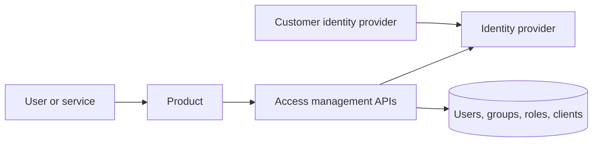
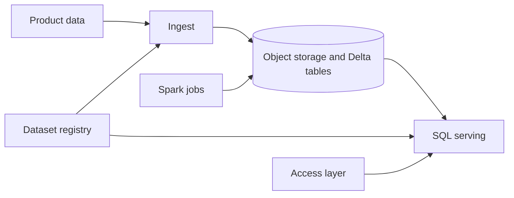

# Identity layer and Datahub

Study notes from `interviews/Service-StaffDataPlatformSoftwareEngineer`. This is the architecture described in the staff pitch, not a codebase. Two systems you can walk through, and a third you should not claim to have built.

## How to present

Say this:

> Two platforms. User access management sits on an identity provider: login, roles, groups, application access, SSO, and API clients for services. The data platform is multi-tenant on object storage and a lake table format: register a dataset, ingest and transform with Spark, serve SQL. On the order of 10 TB a day and about 99.9% availability in that pitch. Query time dropped by changing the model and the partitions, not by adding machines. An access graph, who can do what on which data across many systems, is the product I would join. I have built the identity layer and the data platform that graph would sit on. I have not built the graph.

## What to remember

- Access control answers: who can use which application, with which role. It is not yet "who can read which column."
- Humans and service accounts both go through that layer.
- SSO means the customer can use their own identity provider. You still own roles and application grants.
- Datahub: register datasets, Spark transforms, Delta tables, SQL serving, backups, and a disaster-recovery story that was rehearsed, including zero-downtime upgrades.
- The 50% faster queries came from modeling and partitioning. That is the design point. Do not let it turn into a hardware story.
- Do not say you shipped an access graph or a graph engine.

## 1. Problem statement and requirements

**Functional, access layer**

- Authenticate users and service clients.
- Authorize with roles and permissions, per application.
- Manage users, groups, sessions, and bulk import.
- Let a customer attach their own identity provider.

**Functional, data platform**

- Register a dataset and its owner.
- Ingest and transform at batch scale.
- Serve SQL to analysts and products.
- Back up and restore, and fail over without a planned outage for an upgrade.

**Non-functional, from the pitch**

- More than about 10 TB a day through the platform.
- About 99.9% availability, on the order of 8.8 hours a year of budget.
- Many tenants on one platform. Isolation is part of the design, not a later feature.

**Out of scope of what was claimed**

- A cross-system authorization graph.
- A custom query engine.

## 2. Back-of-envelope estimation

- 10 TB a day is about 120 MB/s average ingest, before replication and before shuffle. Peaks and retries make the pipeline several times that. The design constraint is file layout and partition choice, which matches the "we got faster without more machines" line.
- 99.9% on a data platform usually means the SQL endpoint and the ingest SLA, not "every job succeeded." Say which one you are counting.
- Identity QPS is small next to the lake. The hard identity problems are correctness of a role change and revocation of a session, not requests per second.

## 3. High-level architecture

### Access layer

### Data platform

A role change in the access layer is what allows a person or a service to query. The lake does not invent a second user store.

## 4. Deep dive

### One identity plane for humans and services

API clients are not a back door around login. They are principals with grants, same as users. Session revocation matters because a leaked cookie should die without a password reset. SSO does not mean the customer defines your application roles; they assert identity, and you map groups to roles.

**Rejected: each product has its own user table.** The pitch's point is that the data platform and the partner portal sit behind the same layer. A second user store will drift.

**Rejected: calling this an access graph.** The graph question is which permission on which resource, across systems, including data you do not own. This layer is application login and roles. Keep the distinction or the interview becomes a credibility problem.

### Lake layout is the performance design

Faster queries from modeling and partitioning means: less data read per query, fewer files, and a partition key that matches the filter (often tenant plus date, or a business key the queries share). Adding executors would have raised cost and hidden a bad layout.

**Rejected: "we scaled the cluster" as the success story.** It may also be true. It is not the decision the pitch is teaching.

Zero-downtime upgrade and a tested restore are operational designs. Say what you would verify: a restore drill, a failover of the SQL endpoint, and a job that can restart without double-writing a partition. Delta's transactional commit is what makes the restart safe if the job writes a new snapshot instead of mutating files in place.

## 5. Trade-offs and alternatives

**Shared identity provider versus identity inside each app**

| One provider, products integrate | Each app owns login |
| --- | --- |
| One revocation story, one SSO setup | Faster for a single app |
| You operate the identity service as tier 0 | A breach of one app stays smaller only if users differ |
| Service clients and humans share policy | Service auth gets invented twice |

The shared plane is the one to defend for a multi-product company.

**Partition and model versus more compute**

| Fix the layout | Add executors |
| --- | --- |
| Lower bytes read, lower cost | Faster this week, same waste |
| Needs a real query shape | Needs budget |
| Harder to undo if the key is wrong | Easy to buy |

Pick layout when the bottleneck is bytes scanned. Pick compute when the layout is already honest and CPU or shuffle is the wall. The pitch says the first case was the one they had.

## 6. Bottlenecks, failure modes, mitigations

- **Identity outage.** Every product fails closed. That service is more important than any one Spark job. Run it multi-instance and do not put it on the same failure domain as a single tenant's cluster.
- **Stale role after revocation.** Sessions must be revocable. A long-lived token with no check is a hole.
- **Tenant data mixed in one table without a partition or a predicate.** A missing filter is a leak. Registry and table layout should make tenant id hard to forget.
- **Bad partition key.** Queries scan the month to find one tenant, or the tenant to find one day. Look at the actual filters before you repartiion.
- **Restore never rehearsed.** A backup you have not restored is a hope. The pitch claims restore and DR; the thing to be ready to describe is the drill, not the vendor feature name.
- **At 10x data (about 100 TB/day).** Ingest bandwidth and small files show up first. Compaction, a partition strategy you already defended, and isolated compute per heavy tenant. The identity layer does not need to change shape.

## 7. Open questions

- How is tenant isolation enforced in SQL: views, row filters, or separate paths? The pitch does not specify the mechanism.
- What is the RPO and RTO that 99.9% and "disaster recovery" actually mean?
- Are service-client credentials rotated, and where do they live?
- For an access graph, which systems are in v1: only this data platform, or also the applications and the warehouse? Scope that before drawing a graph database.
