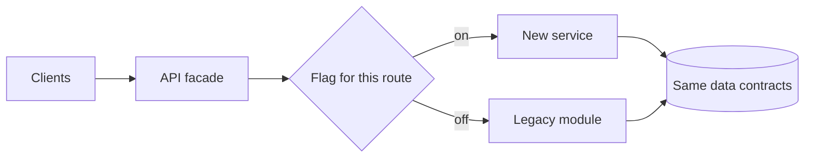
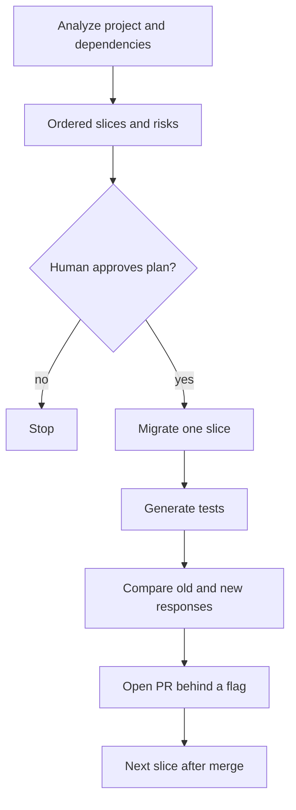

# Legacy migration, strangler fig

Study notes from `interviews/AI Augmented Lead/projects/03-legacy-migration-agent`. A .NET Framework monolith, on the order of 120,000 lines, with one customer-facing module of about 45,000 lines extracted first. The agent plans slices. Humans approve the plan and each pull request. Traffic moves with a flag.

## How to present

Say this:

> I will not rewrite the monolith. A new service sits beside it. A facade proxies to the old module, then read paths move, then writes, then the old module is deleted. The agent analyzes dependencies, proposes ordered slices, and waits for approval before generating one slice: code, tests, a parity check against the old API, and a pull request behind a feature flag. The next slice starts only after that one is in.

## What to remember

- Strangler order: facade, reads, writes, decommission.
- Graph: analyze, plan, human approval, one slice, tests, parity, pull request, then the next slice.
- A slice names source files, target files, pattern replacements, a flag, and a risk.
- Parity compares old and new responses before the flag defaults to on.
- Typical rewrites in the notes: ADO.NET to EF Core, WCF or ASMX to REST or gRPC, `HttpContext.Current` to an accessor, configuration to options.
- Regulatory retention still applies to statement PDFs. Migration does not throw away the archive.

## 1. Problem statement and requirements

**Functional**

- Extract one module without a big-bang cutover.
- Keep the external API stable while the implementation moves.
- Prove a slice matches the old behavior before traffic shifts.

**Non-functional**

- Customer-facing reads and writes stay available during the move.
- Each slice is reversible by flag.
- A human approves the plan and the pull request.

**Out of scope**

- Rewriting all 120,000 lines in one project.
- Letting the agent turn the flag on in production.

## 2. Back-of-envelope estimation

- 45,000 lines is not one pull request. If a slice is a few files, you might have on the order of tens of slices. At a human review each, that is quarters, not a weekend. The notes' "24 months manual" is the baseline you are trying to beat, not a promise the agent hits a date.
- Parity tests are the costly runs: two stacks, the same requests. Budget a fixture set, not production traffic, until a slice is at a small percentage.
- Risk is concentrated on write paths and on PDF generation. Do those after reads.

## 3. High-level architecture

### Runtime

### Agent loop

## 4. Deep dive

### Facade first

The new process owns the route and delegates to the old module. Clients change once. Later slices flip a flag per route. You can move one percent, watch errors, and flip back.

**Rejected: big-bang cutover.** The estimate of a long manual migration is evidence the team cannot absorb a single release of this size. A failed cutover is a customer-facing outage.

**Rejected: rewrite in a branch for months.** The branch rots. Slices merge continuously behind flags that default off.

### Parity before traffic

For a read slice, send the same request to old and new and compare the response. Mismatches fail the pull request. For writes, parity is harder: use a shadow write that does not become the source of truth until the flag is on, or compare on a copy. Do not dual-write money or statements without a reconciliation rule.

**Rejected: unit tests only.** They prove the new code runs. They do not prove it matches the PDF or the JSON customers already parse.

### One slice per run

The agent does not "finish the migration" in one context window. The plan is the backlog. Each run has source files, target files, and a flag name. The next run starts from what merged.

## 5. Trade-offs and alternatives

**Feature flag versus a separate host and DNS cut**

| Flag on one facade | DNS or config cutover |
| --- | --- |
| Percent rollout and instant rollback | Harder partial traffic |
| Flag debt until you delete the old path | Cleaner end state sooner |
| One client endpoint | Clients or config must move |

Flags for the migration. Delete the flag and the old code in the decommission slice so the debt has an owner.

**Agent-written slices versus a human pairing on the plan only**

| Agent generates the slice | Humans write every slice from the plan |
| --- | --- |
| Faster on mechanical rewrites, ADO to EF | Better on the weird PDF edge cases |
| Parity gate is mandatory | Still need parity |
| Reviewers must not rubber-stamp | Slower, and the knowledge still leaves with seniors |

Use the agent for the mechanical mapping. Keep a human on parity failures and on anything marked high risk in the plan.

## 6. Bottlenecks, failure modes, mitigations

- **Hidden WCF or static context.** The analyze step has to list those or the slice will not compile. Treat a surprise dependency as a plan change, not a drive-by fix.
- **Parity flake.** Time, random ids, and PDF fonts will differ. Compare canonical fields, not raw bytes, unless the bytes are the contract.
- **Flag left on half the routes.** A dashboard of flags and a decommission checklist. The strangler is unfinished until the old module is gone.
- **Agent expands a slice.** The file list is the scope. Extra files fail the run.
- **At the rest of the monolith.** Repeat the same graph per module. Do not generalize the facade into a rewrite platform before one module is decommissioned.

## 7. Open questions

- What is the parity tolerance for PDFs: field-level, or pixel-level?
- Who can change the flag in production, and is that change audited?
- Does the new service read the same database or a migrated schema? A schema change is its own slice.
- What is the retention requirement on generated statements during the overlap, and which service is allowed to write them?
