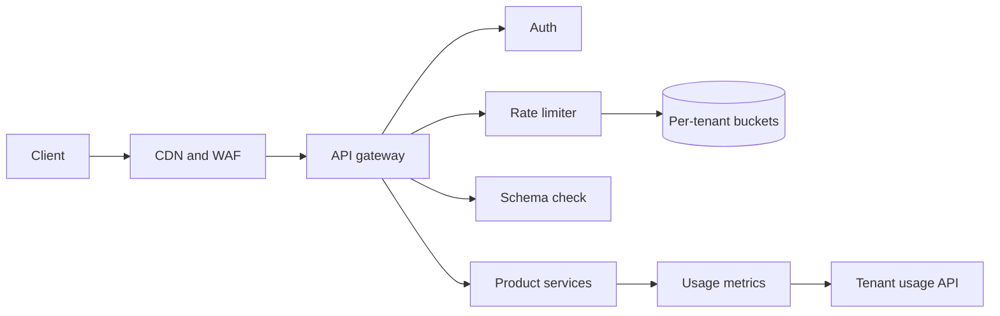
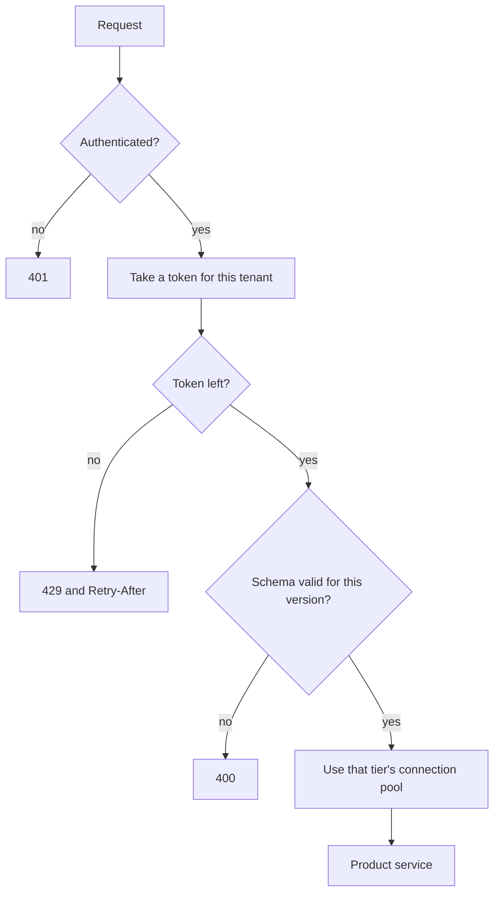

# Multi-tenant API platform

Study notes from scenario 2 in `interviews/Principal Architect - Platform`. This is the edge in front of the [supply-chain platform](supply-chain-risk-platform.md). The generic limiter is [chapter 4](../04-rate-limiter.md). Here the key is the tenant, the limit is a tier, and a noisy tenant must not exhaust everyone else's connections.

## How to present

Say this:

> Clients hit a gateway that authenticates, rate-limits, and validates before any product service runs. Standard tier is about 25 requests per second with a burst around 100. Enterprise is higher. The bucket lives in a shared store, one key per tenant. Over the limit is 429 with the remaining-quota headers. Connection pools are split by tier so one tenant cannot hold every backend socket.

## What to remember

- Auth is OAuth2 or an API key, at the gateway, not inside each service as the only check.
- Token bucket: refill at the sustained rate, capacity equals the burst. Atomic in the shared store.
- 429, `X-RateLimit-Limit`, `X-RateLimit-Remaining`, `Retry-After`.
- Versions live in the path (`/v1`, `/v2`). v2 may add fields. A `Sunset` header announces the deprecation window, about 12 months in this scenario.
- Usage metrics are labeled by tenant so a dashboard and a noisy-neighbor alert can see them.
- An in-memory bucket is the sketch. Production is shared, or ten gateway tasks become ten times the limit.

## 1. Problem statement and requirements

**Functional**

- Authenticate the caller and attach a tenant id.
- Enforce a tier limit.
- Reject unknown bodies against the published schema.
- Expose usage to that tenant.
- Keep old clients working through a deprecation window.

**Non-functional**

- Gateway availability around 99.9%.
- The limit check is a cache hop, not a trip to the system of record.
- One tenant over limit does not raise latency for other tenants.

**Out of scope**

- The scoring pipeline and the supplier data model.
- Billing invoices. Usage events can feed billing later.

## 2. Back-of-envelope estimation

- 1,000 tenants * 25 RPS is the contractual ceiling, 25,000 checks/sec, if all of them burst together. Size the limiter for that peak, not for the average.
- State per tenant is tiny: tokens and a timestamp, under a few hundred bytes. 1,000 keys is nothing. The risk is hot tenants and a slow shared store, not memory.
- A 99.9% gateway allows about 8.8 hours of downtime a year. A bad deploy of a plugin is the usual way you spend it.

## 3. High-level architecture

### Architecture

### One request

## 4. Deep dive

### The bucket is per tenant, and it is shared

Sustained refill is the tier's RPS. Capacity is the burst. Two gateway instances must not each allow 25 RPS. The consume operation is atomic. An in-process map is how you explain the math; it is not the deployment.

**Rejected: a global limit for the whole platform.** Simple, and one enterprise customer spends it.

**Rejected: fail open with no local cap.** A store outage becomes unbounded traffic on the product services. For this API, fail closed or fail open with a coarse local ceiling. Pick fail closed if the contractual limit is a promise, and say so.

### Bulkheads

Separate connection pools, and ideally separate worker budgets, for standard versus enterprise. Rate limiting stops new requests from being accepted. Bulkheads stop an already-slow tenant from occupying every socket while their handlers hang.

**Rejected: one pool and only a 429.** A tenant under the rate limit can still pin threads if the upstream is slow and timeouts are generous.

### Versions

Path versions, additive changes, `Sunset` when a version will die. Gateways route `/v1` and `/v2` at the edge so services can be split later without teaching every client a new host.

## 5. Trade-offs and alternatives

**Gateway limiter versus in-service limiter**

| At the gateway | Inside each service |
| --- | --- |
| One policy, product code stays thinner | Each service can limit a costly method more tightly |
| A gateway bug blocks every API | A forgotten service is unlimited |
| Auth and limit see the same tenant id | Easy to drift |

Do both only for the expensive methods. The platform promise (25 RPS for the tenant) belongs at the gateway. A single export endpoint can have a stricter local limit.

**URL version versus a header version**

| `/v1` in the path | `Accept` header |
| --- | --- |
| Obvious in logs and caches | One URL, harder to cache and to read in a trace |
| Old and new can be different deployments | Forces one deployment to speak every version |

Path versions match a platform that must run v1 for a year beside v2.

## 6. Bottlenecks, failure modes, mitigations

- **Hot tenant key.** One Redis key at 100 RPS is fine. A bug that uses one global key is not. Alert on limiter latency, not only on 429 rate.
- **Clock skew across gateways.** Refill using the store's time.
- **Schema check on large bodies.** Do it after the rate limit so an abusive client pays the 429 before you parse a huge payload.
- **Plugin failure.** Auth or limiter throwing should be a 503 with a short timeout, not a bypass. Measure gateway 5xx separately from upstream 5xx.
- **At 10x tenants.** The bucket store shards by tenant id. Pools stay per tier, not per tenant, until a single tenant needs its own pool. That is the enterprise escape hatch.

## 7. Open questions

- Is the 25 RPS limit per API key or per tenant? A tenant with twenty keys will otherwise multiply the tier.
- Do internal service calls use the same gateway and the same budget?
- Which status codes spend error budget: gateway 5xx only, or upstream 5xx too? That belongs with [observability](platform-observability.md).
- Is a burst of 100 a product promise or an implementation detail? Document it, because clients will depend on it.
