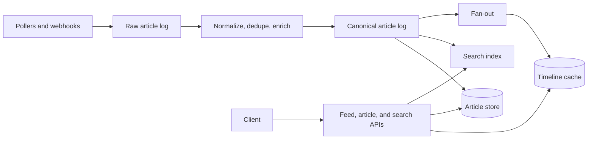
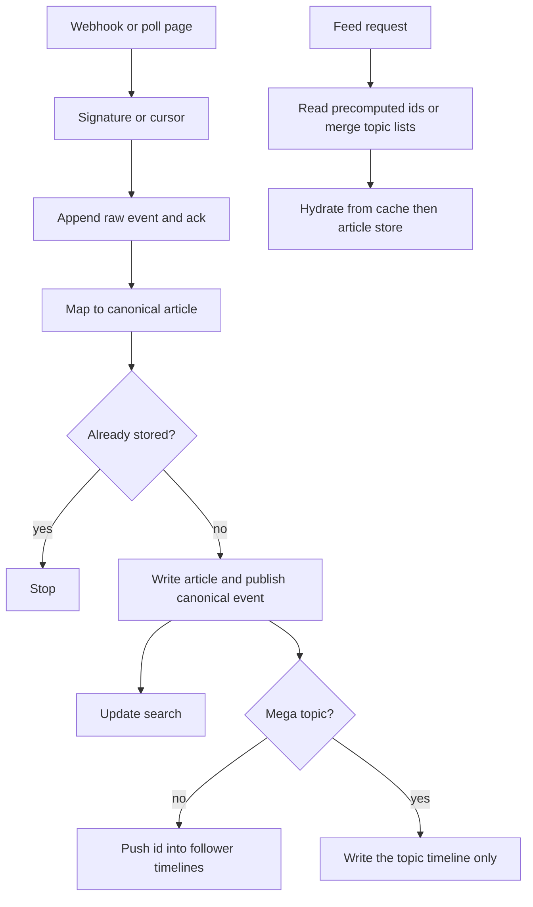

# News aggregator

Study notes from `interviews/WEX - SeniorStaff - DataPlatform/DesignInterview/News_Aggregator_Design.md`. Related to [chapter 11](../11-news-feed.md), with a different write path: you do not own the posts. Providers do.

## How to present

Say this:

> Separate ingest from the read path. Providers push webhooks or we poll them. The webhook only validates and appends to a log. Normalization, dedupe, and enrich happen downstream. The article store is the source of truth. Search and feeds are derived. Home feed is a cache of ids, fan-out on write for normal topics, fan-in for a breaking topic that would stampede. Freshness target is under about 30 seconds for webhook providers. Poll-only providers cannot beat their poll interval.

Assumed scale in that note: 100 million monthly actives, 10 million daily, on the order of 10,000 articles an hour at peak.

## What to remember

- Webhook returns 202 after the raw event is durable. No parsing on that thread.
- Pollers are isolated per provider, with a cursor and a rate limit, so one slow source does not block the rest.
- Article id is a hash of the canonical URL, so replay is safe. Near-duplicates use a similarity hash.
- Stores: key-value or wide-column for the article, object storage for media, Redis sorted sets for timelines, a search index, a relational store for follows, a column store or lake for clicks.
- Search can lag and can be rebuilt. The feed must not call the provider and must not require search to be up.
- Rank a few hundred candidates. Do not score the whole corpus on a page view.
- v1 can be chronological plus follows. Two-tower ranking is later.

## 1. Problem statement and requirements

**Functional**

- Ingest from known provider APIs, push or poll.
- Dedupe reprints.
- Personalized home feed and topic feeds.
- Article page and historical search.
- Record clicks for later ranking.

**Non-functional**

- Feed p99 under about 200 ms. Article p99 under about 100 ms. Search p99 under about 400 ms.
- Ingest to visible under about 30 seconds for webhooks, p95.
- Read API around 99.9%.
- Multi-region is active-passive first.

**Out of scope for the first cut**

- Sub-second freshness from a poll API you do not control.
- Full personalization and a push channel of article bodies.

## 2. Back-of-envelope estimation

- 10,000 articles an hour is about 3 a second average, maybe tens a second at a peak. Ingest QPS is not the problem. Fan-out is.
- A topic followed by millions of users must not become millions of writes per article. That is the hybrid rule.
- Timeline memory: cap each sorted set (on the order of the latest 1,000 ids). 10 million daily users * 1,000 * 16 bytes is about 160 GB if every user has a hot list. Many users are cold; build those on read.
- Five years of articles: metadata in the key-value store, bodies in object storage, search split into hot (about 90 days), warm monthly indexes, and a cold lake you do not query on the request.

## 3. High-level architecture

### Architecture

### Ingest versus read

## 4. Deep dive

### The webhook does almost nothing

Validate the signature, append the payload, return 202. Normalization and enrichment are consumers. A slow model call must not time out the provider's webhook or you will get retries and duplicates. Duplicates are safe only because the article id is deterministic.

**Rejected: fetch, parse, and update timelines inside the webhook.** One slow provider call holds the socket, and a crash after a partial write is harder to replay than a log.

### Hybrid fan-out

Normal topics and users: push the article id onto follower timelines at ingest so the read is one cache lookup. Mega topics: write one topic timeline and merge it at read time for people who follow it.

This is the same trade as [chapter 11](../11-news-feed.md), with topics instead of celebrities. Say that.

**Rejected: fan-out for breaking news.** Write amplification becomes the incident.

**Rejected: fan-in for every follow.** Every home-feed open merges every topic that user follows. Fine for a user who follows three topics, painful as the default.

### Search is derived

The index can be rebuilt from the canonical log. Deletes are idempotent on article id and version. Do not use the index as the only copy of the body. Pagination uses a cursor on time plus id, not a deep offset.

## 5. Trade-offs and alternatives

**Key-value source of truth versus search as the only store**

| Article store plus an index | Search cluster only |
| --- | --- |
| Point reads and updates are natural | One system to operate |
| The index can be rebuilt | A mapping mistake can be the only copy |
| Feed does not depend on search | Feed and search fail together |

Keep the store. The notes call out Elasticsearch or OpenSearch as weak systems of record for updates and multi-region truth.

**Webhook versus poll**

| Webhook | Poll |
| --- | --- |
| Freshness can hit the 30 second goal | Freshness floor is the interval |
| You must verify signatures and tolerate retries | You must store a cursor and respect their rate limit |
| Not all providers offer it | Works for almost any HTTP API |

Support both, per provider config. Do not quote one freshness SLO for both.

## 6. Bottlenecks, failure modes, mitigations

- **Provider rate limit or outage.** Per-provider queues, backoff, dead letter. Other providers keep moving.
- **Reprint storm.** URL hash plus a similarity hash. Recent hashes in a short-lived set; a longer window in the article store.
- **Timeline memory.** Cap and trim. Cold users are built on demand from topic lists.
- **Hot article.** Cache the body at the edge and collapse concurrent cache fills.
- **Search lag.** Accept seconds of lag. The feed reads the article store, not the index.
- **Region loss.** Timelines are rebuildable from follows and recent articles. The article store is what you replicate. Say active-passive until you have a reason to dual-write.

## 7. Open questions

- Is the home feed chronological or ranked in v1? The note allows a later ranker over the same candidate ids. Do not start with the model.
- Who can unpublish, the provider or an editor? That is a tombstone on the article id, fanned out as a delete.
- How personalized is "personalized" on day one: followed topics only, or a model?
- What is the poll interval you are willing to pay for, per provider, given their rate limit and your freshness promise?
