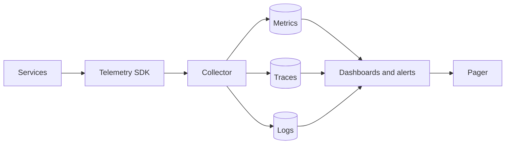
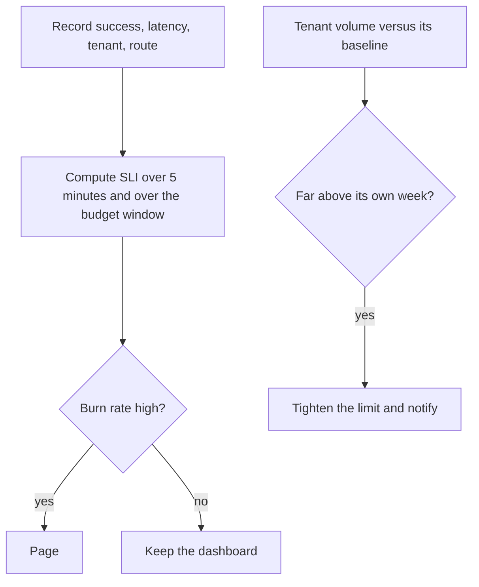

# Platform observability and SLOs

Study notes from scenario 6 in `interviews/Principal Architect - Platform`. This is how you operate the [API platform](multi-tenant-api-platform.md) and the [risk platform](supply-chain-risk-platform.md), not a separate product.

## How to present

Say this:

> Every request carries a tenant id. Metrics, traces, and logs meet in one place. I define SLIs for availability, latency, and score freshness. A standard tenant at 99.9% has about 43 minutes of error budget in 30 days. Enterprise at 99.95% has about 22 minutes. I page on budget burn and on one tenant departing from its own baseline, not on a single slow request.

## What to remember

- Three signals: metrics, traces, logs. OpenTelemetry at the process, a collector, then a metrics store, a trace store, and a log store. One dashboard in front.
- Availability SLI is successful requests over all requests, and you must say whether 429 counts as success. It should. The platform did its job.
- Latency SLI is a percentile, p99 in this scenario, not the average.
- Freshness SLI is the share of entities whose score is younger than the contractual window.
- Per-tenant SLO is the same SLI with a tenant label. A platform-wide 99.9% can hide one tenant at 99%.
- Noisy neighbor: volume above about 3 standard deviations of that tenant's own week, then a tighter limit and a human follow-up.

## 1. Problem statement and requirements

**Functional**

- Measure API availability and latency per tenant and per route.
- Measure score freshness against the tier's window.
- Alert a human when an error budget is burning, or when one tenant dominates.

**Non-functional**

- Telemetry failure must not fail the request. Export is async.
- High-cardinality labels are bounded: tenant id and route, not raw supplier id on every metric.

**Out of scope**

- A full security analytics warehouse.
- Tracing every record inside a batch score job at the same sampling rate as the API.

## 2. Back-of-envelope estimation

Error budget for 30 days, which is 43,200 minutes:

- 99.9% leaves 0.1%, about 43 minutes.
- 99.95% leaves about 22 minutes.
- 99.99% leaves about 4 minutes.

Those are the numbers to say. A 99.95% tenant cannot absorb a casual 30 minute deploy.

Cardinality: 1,000 tenants * a few dozen routes * a status class is fine for a metrics store. 1,000 tenants * 250 million entity ids as a label is not a metric; that is a log or a trace sample.

## 3. High-level architecture

### Architecture

### How a burn becomes a page

## 4. Deep dive

### SLIs that match the contract

Availability: non-5xx over all requests, by tenant. A 429 is a successful protection, not downtime. A 401 is not downtime. Gateway timeouts and upstream 5xx are.

Latency: histogram, then a quantile. Averages hide the tail the contract cares about.

Freshness: a gauge or a periodic job, `entities with score age under the window / entities that tenant watches`. Do not pretend the API histogram measures this. It is a data SLO.

**Rejected: one uptime check on the load balancer.** The balancer can be up while scores are a day old and one tenant is erroring.

### Labels and sampling

Tenant id on API metrics is required, because the contract is per tenant. Supplier id is not a metric label. Traces can carry the supplier id on a sample. Logs can carry it when you are debugging. Sampling stays higher for errors than for successes.

**Rejected: 100% tracing of every signal in the score pipeline.** The pipeline is 140 events/sec in the base scenario and the traces will cost more than the scoring. Sample, and keep 100% of the ones that error.

## 5. Trade-offs and alternatives

**Per-tenant SLO versus one platform SLO**

| Per tenant | Platform only |
| --- | --- |
| Matches a contractual 99.95% for one customer | Easy to alert |
| More series, more dashboards | A big tenant can be down inside a green platform number |
| Noisy-neighbor response is possible | You notice the tenant only when they file a ticket |

You need both. Page the platform on a fast burn. Page the tenant's budget when that tenant is the one with the contract.

**Tight limit automatically versus a human**

| Auto-limit on a volume spike | Only alert |
| --- | --- |
| Protects everyone quickly | Avoids throttling a legitimate month-end job |
| Can punish a planned batch | Relies on someone being awake |

The scenario does both: auto-apply a stricter limit, and notify a human. Say the false-positive case (a planned ERP pull) so you do not sound reckless.

## 6. Bottlenecks, failure modes, mitigations

- **Collector outage.** SDK buffers and drops. Requests still succeed. You are blind, so the collector is on-call even though it is not in the user path.
- **Cardinality explosion.** A new label with unbounded values will take the metrics store down. Review label changes the way you review schemas.
- **Alert fatigue.** Fast burn (5 minutes) and slow burn (hours of budget) are two alerts, not twenty latency alerts.
- **Deploy spends the enterprise budget.** A 22 minute budget means progressive delivery and a rollback that is faster than the budget. Feature flags beat a big-bang restart.
- **At 10x tenants.** Recording rules per tier, not a hand-built dashboard per tenant. Keep raw series only for tenants with a contractual SLO if the cost shows up.

## 7. Open questions

- Do client timeouts that never reach you count against the SLO? You cannot see them unless the client reports them.
- Is maintenance excluded from the budget? If yes, write the window down. If no, the 22 minutes include your deploys.
- Who is paged for a single enterprise tenant at 2 a.m., the platform on-call or a named owner?
- Score freshness for entities nobody watches: is that in the SLO, or only the watchlist? The cheaper and more honest SLO is the watchlist.
