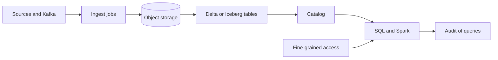
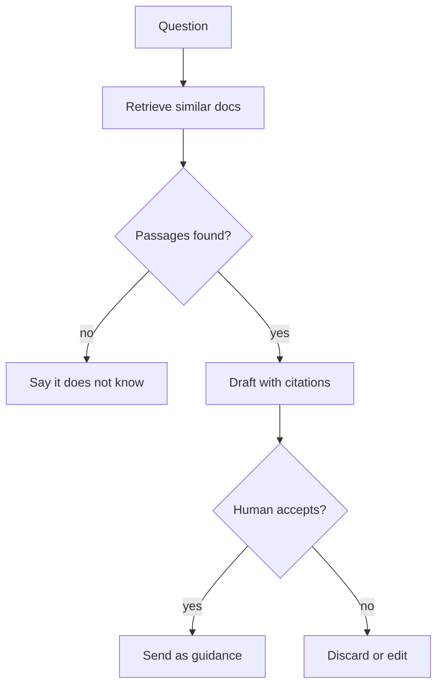

# Regulatory lakehouse and document Q&A

Study notes from the short verbal cards in `interviews/AWS-SolutionsArchitect/prep/07_VERBAL_DESIGNS.md`, grounded in the platform in the self pitch: Hive to Delta on S3, more than about 500 datasets, Spark, about 10 TB a day. Do not describe it as a trading venue. The Q&A card is retrieve, suggest, human decides. It is not an unsupervised agent on a trading workflow.

## How to present

Say this for the lake:

> Ingest into a durable object store. Tables are a format with transactions and time travel, which is how I would talk about the Hive to Delta move. Access is fine-grained. Reads and writes are audited. Analysts and products query the tables. I would not put the only copy of a regulated dataset in a warehouse you cannot reconstruct.

Say this for document Q&A:

> Retrieve similar internal documents, draft an answer with citations, and a person accepts or edits it before it is treated as advice. No tool that can place a trade. If retrieval misses, the system says so.

## What to remember

- Lake: S3 as the durable bytes, a table format with ACID and time travel, catalog, audit, fine-grained access.
- The Hive to Delta cutover in the pitch was zero-downtime across 500-plus datasets and a large cost drop. The design point is the table format and the layout, not a new cluster brand.
- Time travel is for mistakes and audits. It is not a backup in another region. Region recovery is [HA and DR](aws-ha-and-dr.md).
- Q&A: retrieval, then a draft, then a human. Citations or it does not count.
- Map this to a research-doc assistant. Do not invent a production Bedrock estate you did not run.

## 1. Problem statement and requirements

**Functional, lake**

- Land regulated datasets once, query them many ways.
- Know who read what.
- Correct a bad publish without destroying history.

**Functional, Q&A**

- Answer from internal documents.
- Show the passages used.
- Require a human before the answer is sent as guidance.

**Non-functional**

- About 10 TB a day through the platform, as stated in the pitch.
- Availability of the serving path around 99.9%, with the same caveat as elsewhere: say whether that is the SQL endpoint.
- The model must not be the system of record for policy or for a transaction.

**Out of scope**

- A market-data plant or an execution system.
- An agent that can change positions or move money.

## 2. Back-of-envelope estimation

- 10 TB a day is a layout problem: file sizes, partition keys, and compaction. See [DEHub](dehub-data-operator-platform.md) for the operator version of the same idea. Here the verbal version is the AWS shape: object storage plus a table format.
- 500 datasets is a catalog and a migration problem. A cutover per dataset, dual-read or a view swap, not one flag for all 500.
- Q&A traffic is human scale, questions per minute, not ingest scale. The cost is the model and the index, and the risk is a wrong answer, not QPS.

## 3. High-level architecture

### Lake

### Document Q&A

## 4. Deep dive

### Table format instead of a directory of files

Hive-style directories make a concurrent write and a failed job visible as partial files. A transactional table format commits a snapshot. Readers see the old snapshot or the new one. Time travel answers "what did this table look like at 2 p.m." The zero-downtime cutover is a dataset-by-dataset swap once the new snapshot matches, not a cluster outage.

**Rejected: rewrite all 500 datasets in one weekend.** A bad layout or a bad comparison becomes a 500-dataset incident.

**Rejected: the warehouse as the only copy.** You can still serve from a warehouse. The durable, auditable table should be one you can rebuild and govern. The pitch's analog is Delta on S3.

### Suggest, then a person

Retrieval narrows the context. The draft quotes the documents. A human sends it. That is the same gate as the SDLC designs: the model proposes, a person accepts.

**Rejected: an agent with tools against production trading or ledger systems.** A wrong tool call is not a bad paragraph. It is a transaction. The card is explicit: no unconstrained agent on that workflow.

**Rejected: an answer with no citation.** In a regulated setting that is an unauditable claim. Abstain when retrieval is empty.

## 5. Trade-offs and alternatives

**Lake as truth, warehouse as a serving copy**

| Table on object storage, engines read it | Land only in the warehouse |
| --- | --- |
| Time travel and more than one engine | Simpler for BI users |
| You operate compaction and the catalog | The vendor operates storage |
| Matches the Hive to Delta story | Harder to reconstruct if the account is the only copy |

Defend the lake when the question is regulatory retention and rebuild. Defend a warehouse serving layer when the question is the analyst's SQL. They can be the same design: lake first, serving second.

**Human in the loop versus a fully automatic answer bot**

| Draft plus accept | Automatic reply |
| --- | --- |
| Slow, and someone is accountable | Fast, and nobody owns a wrong answer |
| Fits research docs | Unacceptable for a control or a trade |
| Citations are checked by the person | Citations can be ignored by the product |

Automatic is a search box. The design they asked for is the draft.

## 6. Bottlenecks, failure modes, mitigations

- **Small files after streaming ingest.** Compact. Query latency will not improve by adding executors first.
- **Catalog unavailable.** Queries stop even when the bytes are in S3. The catalog is on the recovery list.
- **Access check only at the BI tool.** A Spark job can still read the table. Enforce at the catalog or the table, and audit there.
- **Q&A retrieval misses and the model fills the gap.** Abstain. Measure how often humans reject drafts.
- **At 10x data.** Partition and compaction policy, not a second ungoverned bucket per team. The Q&A index is rebuilt from the document set; it is not the archive.

## 7. Open questions

- Which datasets are in the 15 minute RPO, and which can wait for a nightly snapshot?
- Is fine-grained access row, column, or whole table? The pitch does not specify the mechanism.
- For Q&A, what corpus is allowed, and are customer documents in it?
- Who is the human approver, and is the sent answer stored with the citations?
