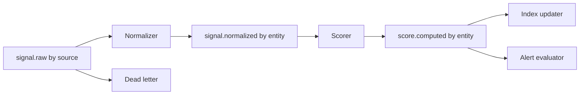
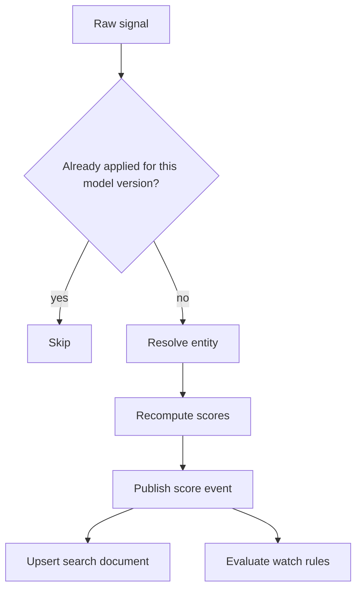

# Risk signal pipeline

Study notes from scenario 3 in `interviews/Principal Architect - Platform`. This is the write path behind the [supply-chain platform](supply-chain-risk-platform.md).

## How to present

Say this:

> About 500,000 signals an hour, which is under 150 events a second. I still use a log, because the requirement is replay and a 5 minute propagation time, not raw throughput. Raw events are keyed by source. After resolution they are keyed by entity, so one supplier is ordered on one partition. Scoring publishes a computed score. Index update and alert evaluation consume that independently.

## What to remember

- Three topics: raw, normalized, score computed. On the order of 48 partitions in the scenario.
- Partition key changes at the normalizer: source id in, entity id out.
- Idempotency key: entity, signal, and model version. Replays must not double-apply a score.
- Schema is a registry with backward-compatible changes.
- A dead-letter topic for poison messages, plus a way to reprocess after a fix.
- Retention on the order of 7 days so a bad deploy can be replayed.
- Pause consumers if the search index falls behind. Do not let the scorer outrun the index without a bound.

## 1. Problem statement and requirements

**Functional**

- Ingest risk signals from many sources.
- Normalize and attach them to an entity.
- Recompute domain score and composite.
- Update search and evaluate alert rules within about 5 minutes.

**Non-functional**

- Ordered per entity, not globally.
- At-least-once delivery with idempotent consumers.
- A bug fix can replay a time range.

**Out of scope**

- The query API and the tier precompute, except that they consume the same score event.

## 2. Back-of-envelope estimation

- 500,000 / 3600 is about 139 events/sec average. Peak a few times that still fits a small consumer group.
- 48 partitions is about 3 events/sec each at that average. The partition count is for headroom and for entity spread, not because 139/sec needs 48 cores.
- If scoring takes about 50 ms of work, one instance does about 20 events/sec. A handful of scorers handles the average. The scenario's larger consumer counts (on the order of 12 to 24) are for lag recovery and deploys, not for the steady rate. Say that, or the interviewer will think you cannot divide.

End-to-end budget of 5 minutes is loose next to 50 ms of CPU. The time goes to batching, entity resolution, and index refresh, not to the scorer thread.

## 3. High-level architecture

### Architecture

### One signal

## 4. Deep dive

### Key by entity after you know the entity

Source order does not matter to a supplier page. Entity order does: two signals for the same supplier should not apply out of order and leave an older score in the index. Key the normalized and computed topics by entity id. Keep the raw topic keyed by source so one noisy feed does not land on one entity partition before resolution.

**Rejected: one partition key for the whole pipeline.** Either you isolate sources and scramble entity order, or you isolate entities and let one source block unrelated suppliers on the raw topic.

### Idempotent score apply

Consumers dedupe on `(entity_id, signal_id, model_version)`. A replay after a model change is a new version and should apply. A replay of the same version should not move the score twice or fire the alert twice.

**Rejected: at-most-once with no dedupe.** A rebalance drops signals and the 5 minute SLO becomes "best effort."

### Independent consumers of the score

Search and alerts fail differently. A mapping error in the index must not block a sanctions alert, and a notification outage must not block search. Two consumer groups on `score.computed`.

## 5. Trade-offs and alternatives

**Log plus consumers versus a workflow engine per signal**

| Kafka-style log | A workflow per event |
| --- | --- |
| Replay and backpressure are native | Each step is easier to see for one event |
| Ordering is per partition | Ordering across steps is your problem |
| 139 events/sec is a small cluster | Per-event workflow state is wasted |

Use the log. A workflow engine earns its place for the [onboarding](supply-chain-risk-platform.md) job, which is long and has a human review, not for every signal.

**Pause on index lag versus unbounded buffer**

| Pause the scorer when the index lags | Let the index lag without bound |
| --- | --- |
| Search freshness stays inside the SLO | Scoring looks healthy while search is hours behind |
| Upstream retention must cover the pause | Cheap until the index cannot catch up |

Pause, alert, and scale the index writers. Retention has to be longer than the pause you are willing to take.

## 6. Bottlenecks, failure modes, mitigations

- **Poison message.** Dead-letter it. Do not retry forever on the main partition or one entity blocks the partition.
- **Hot entity.** A supplier with a huge signal rate is one partition. Shard that entity only if it shows up; do not shard every key on day one.
- **Schema break.** Registry compatibility check in CI. Consumers tolerate missing new fields.
- **Replay storm.** A 7 day replay at full speed will look like an attack on the index. Rate-limit replays and mark them so alerts do not page on historical signals.
- **At 10x (about 1,400 events/sec).** Add partitions before you are hot, and recompute the scorer count from the 50 ms budget. The shape of the three topics does not change.

## 7. Open questions

- What is the business timestamp: source time or ingest time? Late events can overwrite a newer score if you are not careful.
- Do alerts fire on replay? Default should be no, unless the rule was wrong and product wants a backfill.
- Is entity resolution allowed to emit two entity ids for one signal (a possible split)? The partition key has to be chosen after that decision.
- How long is the dead-letter queue owned by a human, and what is the SLO for draining it?
