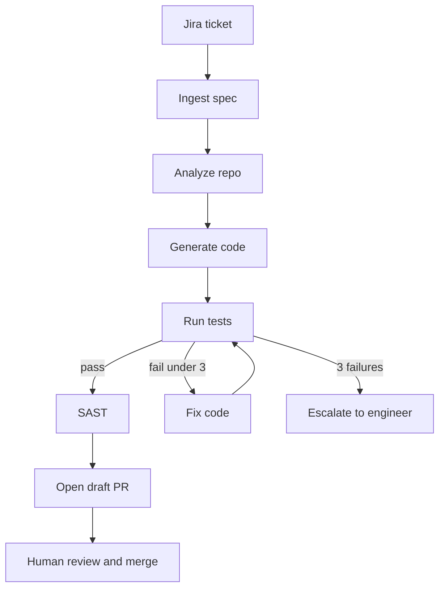

# Spec-to-PR agent

Study notes from `interviews/AI Augmented Lead/projects/01-spec-to-pr-agent`. One workflow inside the [enterprise platform](enterprise-ai-sdlc-platform.md). Payments-shaped telling: about 12 engineers, 4 repos, about 40 stories a sprint, no auto-merge, SOX trail.

## How to present

Say this:

> A ticket becomes a structured spec. The graph reads the repo, writes code, runs tests, and may fix failures up to three times. Then SAST. Then a draft pull request. If tests still fail, a human is notified. The agent never merges.

## What to remember

- Nodes: ingest spec, analyze repo, generate code, run tests, fix, SAST, open draft PR.
- Route after tests: pass goes to SAST; fail under three retries goes to fix; three failures escalate.
- State includes the ticket, spec, plan, changed files, test output, retry count, findings, PR URL, and an audit list.
- Tools are Jira, search and read, write, the test command, and the GitHub API.
- Stack in the case study: Java 17, Spring Boot, a Python LangGraph orchestrator.

## 1. Problem statement and requirements

**Functional**

- Read a Jira id and produce a spec that has acceptance criteria.
- Implement on a branch and run the module tests.
- Open a draft pull request with a summary.

**Non-functional**

- No merge without a human.
- Every run is auditable.
- A stuck test loop ends.

**Out of scope**

- Migrating a monolith. That is a different graph: [strangler migration](legacy-migration-strangler.md).
- Reviewing someone else's pull request. That is [the review gate](ai-code-review-gate.md).

## 2. Back-of-envelope estimation

- 40 stories a sprint, two weeks, is a handful of runs a day for this team. Latency is the test suite, often minutes, not the model call.
- Three retries times a full `mvn test` is the cost spike. Cap it.
- Four repos means four allowlists. Do not give one runner every repository.

## 3. High-level architecture

### Flow

The orchestrator holds the state. GitHub and Jira are tools behind the gateway, not steps the model calls with raw credentials.

## 4. Deep dive

### Structured spec before code

Ingest refuses to continue when acceptance criteria are missing. Generating from a vague ticket produces a confident wrong diff.

**Rejected: paste the Jira description into the model.** The ticket is prose, often without the non-goals. The spec template is the contract.

### Bounded repair

Fix loops back to test with a retry count. At three, stop and assign a person. The branch may still exist; the pull request should say the tests did not pass, or you do not open it. Prefer not opening a red draft unless the team wants to see the attempt. Say which you choose.

**Rejected: unlimited fix loops.** They burn tokens and still fail, and the engineer hears about it late.

## 5. Trade-offs and alternatives

**Draft PR versus committing to a shared agent branch**

| Draft pull request | Long-lived agent branch |
| --- | --- |
| Review, CI, and audit match human work | Faster for the agent to iterate |
| The engineer can discard it | Easy to mix two stories |
| SOX story is familiar | Hard to say who approved what |

Draft PR. The agent is an author, not a second remote.

**Python graph beside a Java repo versus the graph inside the build**

| Orchestrator separate from the service | Tests invoke the agent |
| --- | --- |
| The product build stays deterministic | CI becomes non-deterministic |
| You operate two runtimes | One repo |
| Matches this case study | Hides cost and flakes in the test suite |

Keep generation out of `mvn test`. CI runs the tests the agent already ran, again, as the source of truth.

## 6. Bottlenecks, failure modes, mitigations

- **Flaky tests.** A retry that "fixes" a flake by editing production code is a defect. If the same test fails without a compile error, escalate earlier.
- **Scope creep.** The plan lists files. Writes outside that list fail the run.
- **Hallucinated dependency.** The build fails closed. Do not let the agent add a repository or a new library without a human.
- **Jira or GitHub down.** The run stops. Developers are not blocked from pushing their own branches.
- **At 10x stories.** Queue runs. Do not raise the retry cap.

## 7. Open questions

- Does SAST failure block the draft, or only comment? The route in the notes runs SAST after tests pass and still opens a PR. Critical findings should block. Confirm the threshold.
- Who is the PR author, a bot account or the engineer who clicked run? That matters for the audit.
- Are integration tests in the loop or only unit tests? The full suite may be too slow for three retries.
