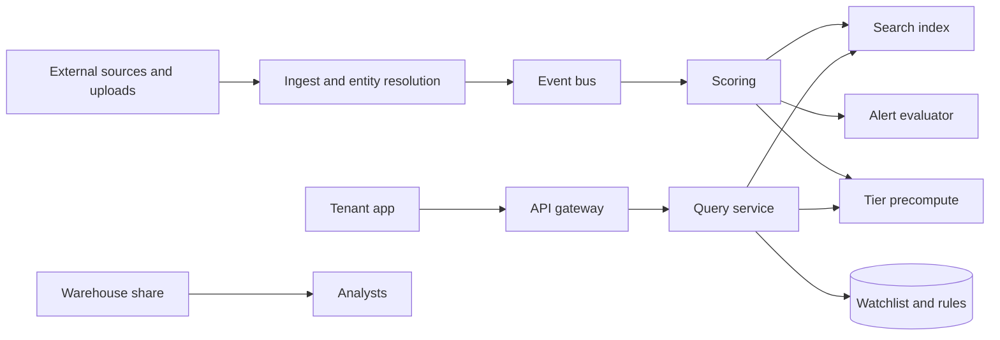
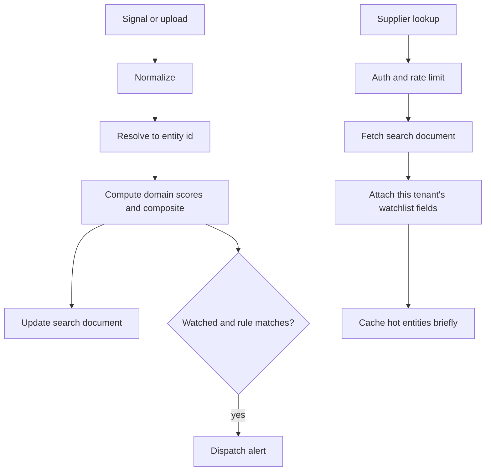

# Supply-chain risk platform

Study notes from `interviews/Principal Architect - Platform` (system-design scenarios 1, 4, and 5, and the platform project write-up). One product: shared supplier intelligence, tenant watchlists, scores, and alerts.

## How to present

Say this:

> About 250 million suppliers and on the order of 11 billion relationships, served to about 1,000 tenants. Writes are signals and uploads. Reads are search, a supplier page, and tier expansion. I will not traverse the live graph for the common tier query. I precompute tiers. Elasticsearch answers name and country search. Scores are eventual, on the order of minutes, not a transaction.

State the read ratio you are assuming: about 100:1.

## What to remember

- Write path: source, normalize, entity resolution, score, then fan-out to search and alerts.
- Read path: API gateway, query service, Elasticsearch, plus tenant watchlist metadata from Postgres. Hot suppliers cached for a few minutes.
- Graph queries people actually run are precomputed (tier 1 to 3). Full path search is rare and async.
- Tenancy: pooled database plus row-level security for standard; schema per tenant for enterprise; a dedicated silo for federal. Do not start with a database per tenant.
- Onboarding 50,000 suppliers is a batch pipeline with its own quota so it cannot starve live scoring.
- Bulk analytics go to a warehouse share, not through the REST API.

## 1. Problem statement and requirements

**Functional**

- Ingest public signals and customer supplier lists.
- Resolve them to a canonical entity.
- Keep a relationship graph and serve tier-N suppliers of a root.
- Score several risk domains plus a composite.
- Per-tenant alert rules. REST for apps. A warehouse share for analysts.

**Non-functional**

- API around 25 requests/sec sustained and about 100 burst per standard tenant. Enterprise tier higher.
- Dashboard reads under about 500 ms. Alerts within about a minute of a score change for watched suppliers. Score freshness SLA in the project notes is looser for the standard tier (up to 24 hours) and tighter for premium. Say which number you are designing to; the scenario and the project note do not match, and you should pick one out loud.
- 99.9% for the API. Scores are eventually consistent.
- Tenant isolation, including a stricter tier for regulated customers.

**Out of scope for v1**

- A live path query as the default UI.
- Strongly consistent scores across regions.
- Per-tenant custom models beyond a weight overlay on the shared score.

## 2. Back-of-envelope estimation

- 1,000 tenants * 25 RPS is 25,000 RPS if every tenant sits at the cap. They will not. Plan for a few thousand RPS of reads, with the noisy tenant capped.
- 250 million entity documents in Elasticsearch is a large but ordinary search cluster if documents stay narrow. The graph is the awkward store: 11 billion edges. You do not query that online for "show tier 2."
- Precomputed tiers: 1,000 tenants * a large watchlist * 3 tiers. A tenant with 100,000 watched roots and a branching supply chain can explode this table. Cap depth at 3 and cap fan-out per root, and compute tiers for watched roots, not for all 250 million entities.
- Signal pipeline volume is in the companion note: about 500,000 events/hour is only about 140 events/sec. The hard part is entity resolution quality, not Kafka throughput.

## 3. High-level architecture

### Architecture

### Read and write

## 4. Deep dive

### Precomputed tiers, not live traversal

Most "who is tier 2 of X" questions are a lookup: `(tenant, root, tier) -> supplier ids`, with the parent on the path so the UI can explain the hop. Recompute on a schedule and when a watched root's neighborhood changes.

**Rejected: walk 11 billion edges on the request.** Correct and too slow for a dashboard.

**Rejected: only a graph database and no search index.** Name and country search is the other common query. A graph store is a poor inverted index. Keep it for the rare "all paths from X to Y," and make that an async job the client polls.

### Entity resolution before scoring

Scores attach to a canonical id. Raw names do not. The pipeline normalizes identifiers, blocks candidates (country plus a phonetic or token key), scores similarity, and merges or creates a golden record. Low-confidence matches during onboarding go to a review queue instead of a silent merge.

**Rejected: trust the customer's supplier id as global identity.** Two tenants, and two rows inside one file, will spell the same company differently. Shared intelligence only works if the entity id is yours.

### Tenant isolation

Standard tenants share tables with row-level security. Enterprise can move to a schema. Federal is a separate environment, not a flag. Onboarding of 50,000 rows is partitioned by tenant id, capped (on the order of 5 concurrent onboarding jobs), and is not allowed to delay the live signal consumers. Deleting a tenant deletes the watchlist and does not delete golden records other tenants use.

## 5. Trade-offs and alternatives

**Pooled rows versus a database per tenant**

| Pooled plus row-level security | Database per tenant |
| --- | --- |
| One migration, lower cost at 1,000 tenants | Stronger isolation, louder operations |
| A missing predicate is a data leak | A missing predicate stays in one database |
| Noisy neighbor is a query and rate-limit problem | Noisy neighbor is more contained |

Pick pooled for standard, and keep an escape hatch. Do not pretend row-level security is free; every query path has to carry the tenant id.

**Eventual scores versus synchronous rescore**

| Async score, search lags by minutes | Rescore inside the request |
| --- | --- |
| Ingest stays up when scoring is slow | Reads see a fresh score |
| Alerts wait on the pipeline | A sanctions update storms the API tier |
| Replay is a consumer offset | Replay is a batch job you invent later |

Async is the design. Watched suppliers can jump a priority queue so the alert SLA is tighter than the full-catalog freshness SLA.

## 6. Bottlenecks, failure modes, mitigations

- **Search overload.** Timeouts, replicas, and a short cache for hot entity ids. Do not send analytics aggregations to the search cluster; those go to the warehouse.
- **Scoring backlog.** Priority for watched entities. Lag alert. The API serves the last score and shows the timestamp.
- **Bad entity merge.** Splitting a golden record is an incident. Keep match confidence and a reversible merge log.
- **Onboarding flood.** Dedicated quota, max concurrent jobs, and a status the tenant can see. Existing tenants' live pipeline is the higher priority.
- **At 10x tenants.** Rate limits and row-level security still hold. The tier table and the watchlist indexes are what you re-shard. The golden entity store stays global.

## 7. Open questions

- Which freshness number is contractual: under a minute for alerts, under an hour for premium scores, or 24 hours for standard? Design the priority queue only after that answer.
- Are relationship edges global or tenant-private? Customer-uploaded edges should not leak into another tenant's tier table.
- What is the human review SLA for low-confidence matches, and does onboarding complete before those are resolved?
- Is the warehouse share allowed to contain only entities that tenant watches, or the whole catalog? That is a licensing and isolation decision, not a SQL decision.
