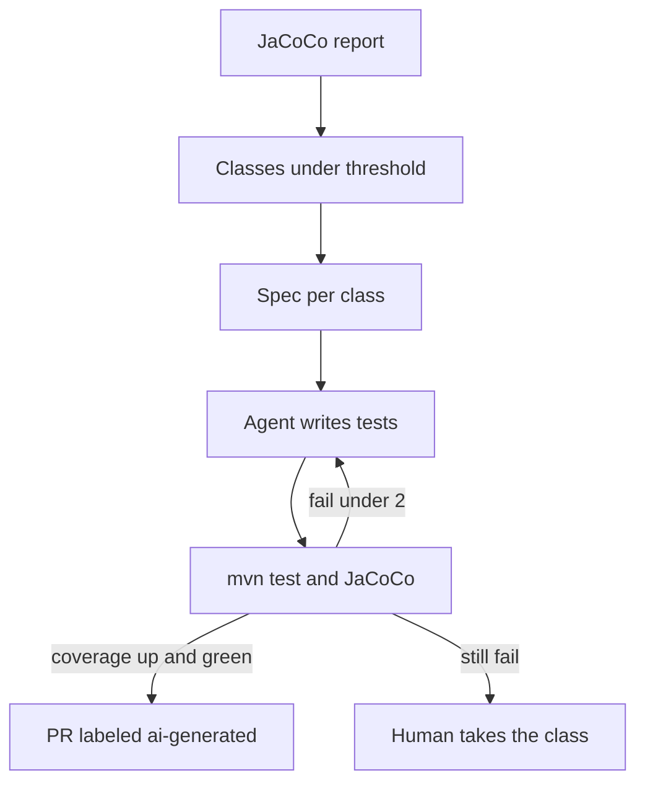

# Test generation agent

Study notes from `interviews/AI Augmented Lead/projects/04-test-generation-agent`. The case study is a Java service, about 180,000 lines, coverage around 45% on the way to about 75% for service and controller packages. The agent writes tests. CI decides if they count.

## How to present

Say this:

> JaCoCo lists methods under the coverage bar. A spec is written per class: the methods, the edge cases, and the test style to copy. An agent adds tests. Maven and JaCoCo run. If coverage moves and the tests fail for a real reason, it gets two tries, then a human. The pull request is labeled as generated. A test that asserts true is rejected. Unit tests do not boot Spring. Integration tests use Testcontainers when the class needs a database.

## What to remember

- Gap report first, then one class per task. Do not ask for "more tests" on the whole repo.
- Priority is uncovered, complex, business-critical methods.
- Max two repair iterations in this case study, then a person.
- Patterns are copied from an existing test in the repo, not invented.
- The gate is coverage delta plus a green run, not the agent's claim.
- Generated tests are reviewable. The label is how reviewers find them.

## 1. Problem statement and requirements

**Functional**

- Find classes below a threshold.
- Generate unit tests for named methods, including failure cases.
- Open a pull request only when the suite is green and coverage increased.

**Non-functional**

- Tests must assert behavior. Tautologies do not count.
- The agent does not weaken production assertions to make a test pass.
- CI is the judge.

**Out of scope**

- Raising coverage by deleting untested code.
- Generating tests for the whole 180,000 lines in one run.

## 2. Back-of-envelope estimation

- Moving service and controller packages from about 45% to about 75% is a quarter of work in the notes, not one pull request. One class per run keeps review possible.
- Two retries of `mvn test` for one class is the cost cap. A full-repo test on every attempt will not finish.
- The gap script is cheap. The suite is not. Run the module tests, not the world, inside the loop.

## 3. High-level architecture

## 4. Deep dive

### Spec from the gap, not from the model

The gap JSON names the class, the coverage, and the uncovered methods. The spec adds cases: happy path, invalid input, timeout, rejected upload. The agent does not choose which class is "important" from a vibe. Priority is in the report.

**Rejected: "write tests until coverage is 75%."** The model will add shallow tests on easy classes and skip `verifyIncome`.

### Fail the empty assertion

Review or a lint rejects `assertTrue(true)` and tests with no assertions. Coverage without an assertion is how you hit a number and ship a regression.

**Rejected: coverage as the only gate.** Line coverage rises when you execute code. It does not rise when you check the answer. You still want the delta, and you want assertions.

### Unit versus Spring

Service tests use mocks and no Spring context, matching an existing example in the repo. Testcontainers is for the integration slice, not for every class. That keeps the loop fast enough to retry twice.

## 5. Trade-offs and alternatives

**IDE agent plus CI versus CI-only generation**

| Generate locally, CI confirms | A bot commits tests on a schedule |
| --- | --- |
| The author watches the diff | Coverage moves without a person in the loop |
| Style matches the repo if the spec says so | Easier to ignore a bad suite |
| Slower to start | No one owns the tests |

The case study is the first column. CI is still mandatory, because the IDE run is not the merge signal.

**Two retries versus fix-forward by a human immediately**

| Two automatic retries | Human on first failure |
| --- | --- |
| Fixes import and assertion typos | Saves tokens on hard classes |
| Can "fix" the test by weakening it | Better for payment rules |
| Cap is what makes it safe | Slower on boilerplate |

Keep the cap at two, and fail the run if the diff touches production code. Test generation should not change the service to make the test pass.

## 6. Bottlenecks, failure modes, mitigations

- **Flaky Testcontainers.** Do not count a flake as a coverage win. Retry the test run once for infrastructure failure, separate from the agent's two code retries.
- **Mocking the method under test.** The test is green and useless. Review for that specifically on generated pulls.
- **Threshold gaming.** A class at 59% gets a trivial test to cross 60%. The spec lists the methods, so the pull request is incomplete if those methods are still uncovered.
- **Secrets or customer data in fixtures.** Use builders and fakes. The agent must not paste production rows into the repo.
- **At the rest of the repo.** Raise the threshold after the first packages move. Do not lower the bar to declare the quarter done.

## 7. Open questions

- Is the target line coverage, branch coverage, or mutation score? The notes say line coverage. Mutation score is the honest next metric and it is slower.
- May generated tests be merged with one reviewer, or the same two as product code?
- What happens to a class the agent cannot test without a rewrite? Leave it on the human list. Do not block the quarter on it.
- Who updates the example test the spec says to copy, when that example itself is wrong?
