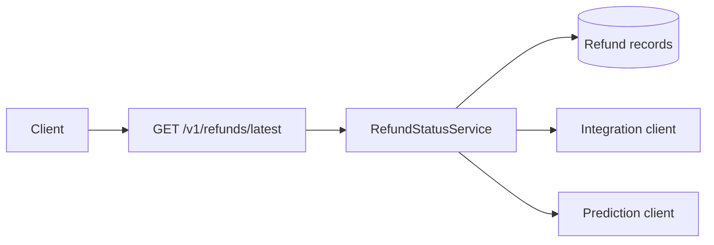
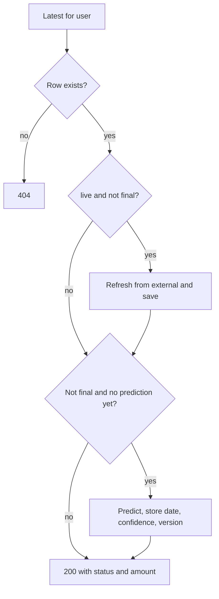

# TurboTax refund status

Study notes from the Spring Boot service in `interviews/turbotax-refund-status`. This is the code that exists, not a full production design. `turbotax-refund-status-with-ui` has no UI and an empty POM, so it adds nothing.

## How to present

Say this:

> `GET /v1/refunds/latest?userId=` returns the newest refund row for that user. If `live` is true and the status is not final, the service refreshes from the external integration and saves. If the status is still not final and there is no prediction yet, it calls a prediction client and stores the date, confidence, and model version. Final means deposited, rejected, or completed. The current integration and the model are stubs. The database is H2 in the default run and Postgres in the container test.

Be explicit about Redis: the POM and a Testcontainers test mention it. The request path in `RefundStatusService` does not read or write Redis.

## What to remember

- One read API. Newest row is `findFirstByUserIdOrderByCreatedAtDesc`.
- Missing user is 404.
- Live refresh is opt-in and skipped for final statuses.
- Prediction runs at most once per row, and only while the status is not final.
- Status, amount in cents, tax year, and the prediction fields are the response. The external id and metadata stay on the entity.
- Amounts are integer cents, not floating money.

## 1. Problem statement and requirements

**Functional**

- Show the latest refund status for a user.
- Optionally refresh a non-final status from an external system.
- Attach an availability prediction when one is not already stored.

**Non-functional, as implemented**

- The read is a database transaction.
- There is no authentication on the controller.
- There is no cache on the path.

**Out of scope in this tree**

- A UI, notifications when status changes, and a real tax-authority client.
- Multi-region and a stated QPS.

## 2. Back-of-envelope estimation

Not in the repo. If you are asked to scale this shape, say the assumptions:

- Tax season is spiky. A large fraction of users check status, and they recheck.
- The row is small, under a kilobyte. The working set is "latest row per user," not full filing history, if you only serve latest.
- At a few thousand reads a second, a primary plus a cache of the latest row is enough. The external refresh, not the database, will be the bottleneck if `live=true` is common.
- Do not invent a cluster until they ask for a peak.

## 3. High-level architecture

### Architecture

### Read flow

## 4. Deep dive

### Final status stops the side effects

`DEPOSITED`, `REJECTED`, and `COMPLETED` skip the external call and skip a new prediction. That keeps a settled refund stable and keeps you from calling an agency API on every poll.

**Rejected: always call external on read.** Correctness of "live" goes up, and you will get rate-limited in April. The flag is the control.

**Rejected: call the model on every read.** The stored version would flap, and you would not know which prediction the user already saw. The null check is a one-shot.

### What is real and what is a stub

`IntegrationService` sets status to `IN_PROCESS` and stamps a time. `AiPredictionClient` returns seven days out, confidence 0.6, model `v1.0`. The control flow is the design. The bodies are placeholders. Do not describe them as a production IRS client or a trained model.

The Postgres-and-Redis test starts both containers and then only asserts that a saved row can be read back. Redis is unused by the service. If you propose a cache, label it as a next step: cache the latest response by user id, and invalidate it when a refresh writes a new status.

## 5. Trade-offs and alternatives

**Refresh on read versus refresh on a schedule**

| `live=true` on the GET | A worker polls the agency and the GET is local |
| --- | --- |
| Simple, and the user pays the external latency | The page is fast and as fresh as the job |
| A thundering herd of users multiplies agency calls | You need a cursor and a budget per filing |
| Easy to demo | Right shape for tax season |

The code is the left column. For a real peak, move refresh off the request and let the GET read the last stored status. Keep `live` as an explicit, rate-limited escape hatch.

**Store the prediction on the row versus compute it in the response**

| Persisted prediction | Compute every time |
| --- | --- |
| Stable answer, model version is auditable | Always uses the latest model |
| A model upgrade does not reach old rows unless you backfill | No migration |
| Matches the code | Hides which version the user was shown |

Persist it. A backfill is a deliberate model rollout, not a surprise on the next GET.

## 6. Bottlenecks, failure modes, mitigations

- **No auth.** Anyone who can guess or enumerate `userId` can read a refund. That is the first fix, ahead of scale.
- **External stub cannot fail.** A real client needs a timeout. On timeout, return the stored status and do not overwrite it with an error.
- **Prediction on the read path.** A slow model stalls the GET. Time-box it or fill it asynchronously.
- **Latest-by-createdAt.** Two filings in one year need a clear rule. "Latest" might should be by tax year, not by insert time. The code uses insert time.
- **Redis mentioned, not used.** Do not draw it on the current diagram. Add it when the read QPS says the database is the bottleneck, and invalidate on refresh.
- **At 10x reads.** Cache latest-by-user, and stop calling external on the user path. The row stays the source of truth.

## 7. Open questions

- Is `userId` an internal id or a taxpayer identifier? The API treats it as a query parameter with no session.
- What are the real status values from the agency, and which of them are final?
- May the prediction change after it is stored, and who is allowed to trigger that?
- Does "latest" mean the current tax year only? The repository method does not filter on year.
- The UI repo is empty. Is the client in scope or not?
