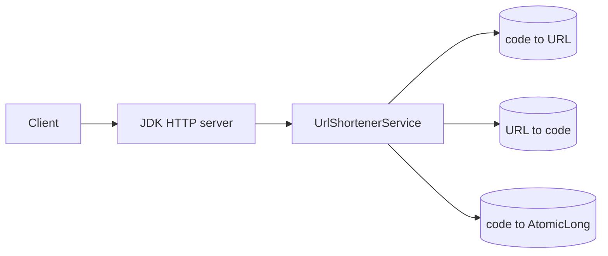
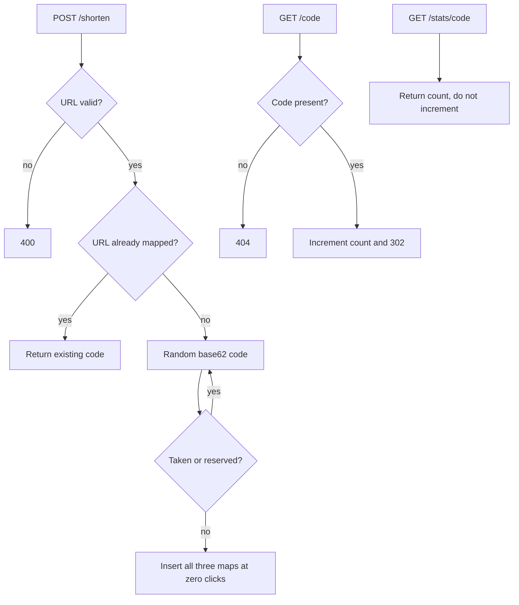

# In-memory URL shortener

Study notes from the Java service in `interviews/url-shortener` and the same product package inside `interviews/langgraph4j-url-shortener`. This is the coded design. The scaled interview design is [chapter 8](../08-url-shortener.md). Say which one you are defending.

## How to present

Say this:

> One process, three maps: code to URL, URL to code, and a click counter. Shorten is idempotent, so the same long URL always returns the same code and does not reset the count. Resolve is a 302 and increments the count. Stats reads the count and does not increment. Codes are random, not sequential, and a few path names are reserved.

Then say what this design refuses to be: it will not survive a restart, and it will not serve a second machine.

## What to remember

- `POST /shorten` with the raw URL body. `GET /{code}` redirects 302. `GET /stats/{code}` returns the count.
- Idempotency key is the long URL itself. Second shorten returns the existing code.
- Code generation: `SecureRandom` long, masked positive, modulo 1e9, base62. Retry while the code is taken or reserved (`shorten`, `stats`).
- Invalid URLs are 400. Unknown codes are 404. Wrong method is 405.
- Click increment happens on resolve, under an `AtomicLong`. Stats is a pure read.
- There is no database, no cache, no expiry, and no 301.

## 1. Problem statement and requirements

**Functional**

- Create a short code for a valid long URL.
- Redirect that code to the long URL.
- Report how many times the code was resolved.
- Repeating shorten for the same URL does not create a second code.

**Non-functional**

- Correct under concurrent calls inside one JVM (`ConcurrentHashMap`, `AtomicLong`).
- Codes are not predictable from a counter.
- The service is a single process on port 8080 by default.

**Out of scope, in this repo**

- Persistence, replication, custom aliases, deletion, TTL, and a shared click count across hosts.
- Those show up as requirements files in the langgraph repo; they are not this runtime.

## 2. Back-of-envelope estimation

The code space is `1_000_000_000` values before base62, not 62^7.

- Birthday collisions become likely well before a billion live URLs. The loop retries on collision, so correctness holds and latency grows as the map fills.
- Memory is three entries per URL (two strings and one counter). Tens of millions of URLs is a large heap, not a cluster. That is the scaling wall.
- A restart loses every mapping and every count. Availability of the process is not durability of the data.

If the interviewer wants 100 million creates a day, leave this design and use [chapter 8](../08-url-shortener.md).

## 3. High-level architecture

### Architecture

### Shorten and resolve

## 4. Deep dive

### Idempotent create

The URL-to-code map is the idempotency index. A second POST does not roll the counter back to zero.

**Rejected: always mint a new code.** Breaks "one short link per destination" and makes click counts lie.

**Rejected: hash the URL and take a prefix with no collision loop.** Collisions alias two destinations. This code retries. The modulus still caps the space; see estimation.

### 302 and a separate stats read

Resolve returns 302 with `Location` and counts that hit. Stats does not go through resolve, so a monitoring poll does not inflate the product metric.

**Rejected: 301.** Browsers would cache the redirect and later clicks would never hit this process. For an in-memory counter, that makes the metric wrong immediately. Chapter 8 discusses when 301 is the right product choice. Here the counter is the product.

### Random codes, not a counter

`SecureRandom` avoids CWE-338 (predictable `java.util.Random` or a naked increment). Reserved names keep `/shorten` and `/stats` from being captured as codes.

**Rejected: auto-increment base62.** Short, sortable, and guessable. Fine for a public alias that is not a secret. This implementation chose unguessable-enough codes inside a 1e9 window, which is a smaller space than a 64-bit id. Say that limit out loud.

## 5. Trade-offs and alternatives

**Single process maps versus a shared store**

| ConcurrentHashMap | Database plus cache, as in chapter 8 |
| --- | --- |
| No network, easy to test | Survives restart and a second instance |
| Counts are exact only on this JVM | Counts need an atomic increment in the store |
| Collision retry is local | Code minting can be an id generator |

This repo picked the left column on purpose: the assignment is the behavior and the gates (tests, SAST), not a distributed system.

**Count on read versus a log of clicks**

| Increment in resolve | Append a click event |
| --- | --- |
| O(1), exact for this process | Survives fan-out to analytics |
| Lost on crash | At-least-once needs a consumer |
| Couples redirect latency to the counter | Redirect can return before the count lands |

The increment is acceptable because the map is already the system of record. A log is the upgrade when more than one process redirects.

## 6. Bottlenecks, failure modes, mitigations

- **Restart.** All links 404. There is no mitigation inside this design except "do not use it for real links."
- **Two instances behind a load balancer.** Creates and counts diverge. Do not horizontally scale this process.
- **Map fills toward 1e9.** Mint latency climbs. Cap the map and fail creates, or widen the space and move to a store.
- **Hot code.** One `AtomicLong` is enough inside one JVM. It is not a cross-host counter.
- **SAST and tests** are the quality gate in the repo (`SastScanner`, JUnit). They do not change the runtime architecture. Mention them if the interview is about how the code is produced; that story is the [SDLC graph](agentic-sdlc-orchestrator.md).

## 7. Open questions

- Is dedupe by exact URL string required, or should tracking parameters be stripped first? The code uses the raw string.
- Should stats be public? This server does not authenticate.
- What is the max live URL count this process is allowed to hold?
- The langgraph requirements mention TTL, delete, custom alias, and HEAD. None of those are in `UrlShortenerService`. Confirm they are out of scope before you imply the server does them.
